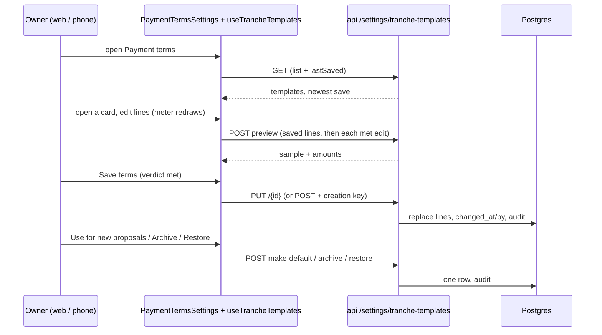

# M01 · Onboarding & tenant configuration — engineering tasks

This file covers module M01 — company signup and authentication, team invites and user onboarding, the role-administration screens, progressive setup and the business profile, the two-tier catalog and price book, branding and document templates, payment-term templates, message templates, capture settings, locale defaults and integration credentials. Task-id prefix: `T-M01-`. Source docs: `docs/prd/modules/M01-onboarding-and-tenant-config.md` (all M01 rows), plus the foreign rows riding M01-owned screens per `docs/prd/registers/screens.md`: `docs/prd/foundations/F2-roles-and-permissions.md`, `docs/prd/foundations/F3-localization.md`, `docs/prd/foundations/F6-notifications-and-search.md`, `docs/prd/foundations/F7-design-language.md`, `docs/prd/modules/M02-crm-and-leads.md`, `docs/prd/modules/M05-studio/11-shell-and-platform.md`. Rules per `docs/tasks/README.md`: acceptance criteria are copied verbatim from the PRD, never rewritten; `DESIGN: PENDING` blocks build, not start.

---

## Screen tasks

### T-M01-001 · Sign In — mobile
**Type:** screen · **Tier:** P0
**Status:** shipped (#53)
**Why:** Every installer and every field hand enters through this one door with a phone and a code, never a password, and a shared field phone signs the next person in within a minute without handing them a colleague's unuploaded photographs; without it nobody reaches a tenant, a role or a home — and today nothing signs a person in on either platform, so no other screen can be proven. The phone lands first (`M01` §2: employees arrive "phone, almost always"); the desktop door is `T-M01-033`, the Google door `T-M01-032`.
**PRD rows:** M01-03 (P0), M01-04 (P0), M01-05 (P0), MS12-17 (P0)
**DESIGN:** SCR-M01-01 → https://claude.ai/artifact/6B4UBcKiJsHoreFjiKUSLN
**Depends on:** `T-M01-025` (shipped, #40 — the OTP, session and tenant routes; the F4-37 switch state) · `T-M13-006` (shipped, #52 — `homeFor`, the destination the dwell names) · `packages/ui` `PhoneField`, `OtpInput`, `Button`, `Banner`, `Sheet`, `LogoTile`, `EmptyState` (landed).

**DONE WHEN:**
- Given an OTP that fails to deliver by SMS, when the failure occurs, then no automatic fallback to any other channel fires, login fails loudly with a plain retry-later message, and the resend control and the user-initiated "call me instead" voice option are the visible ways forward (M01-03, owner ruling 2026-08-06). *(This criterion previously read "when 30 s elapse or delivery fails, then the fallback channel fires automatically and resend + voice options are visible" — the ruling removes the automatic fallback it tested; copied verbatim from the amended §M01.1 acceptance block.)* → proof: qa-mobile with the development adapter's failing number the frame reads "The code did not send", no channel fires, the resend is live with no countdown and Get the code by call sits beside it; the 502 is `T-M01-025`'s
- Given a sent OTP, when the resend control is under its cooldown, then it becomes available again after 30 s (M01-04, owner ruling 2026-08-06). *(Line added when that ruling closed: this block previously asserted no cooldown length at all, because the value was the recorded 30 s vs 45 s divergence M01-04 carried; the ruling supplies it.)* → proof: qa-mobile after Send code the resend line counts down from 30 s and unlocks at 30 s
- Given a confirmed hard SMS delivery failure, when the failure state renders, then the resend cooldown is released immediately — the resend control is available with no countdown left to wait out — and the user-initiated "call me instead" voice option is offered in that same state (M01-03, M01-04, owner ruling 2026-08-06); given that an M01-04 cap is already reached at that moment, then the cap still governs and the message says so honestly (M01-04). *(Line added when that ruling closed and copied verbatim from the amended §M01.1 acceptance block: that block previously asserted nothing about the resend control inside the failure state — the 0–30 s hard-failure gap, now closed.)* → proof: qa-mobile the failing number's frame shows no countdown; with three requests already made in 15 minutes the cap frame renders instead and names 3 per 15 minutes and 8 a day
- Given 5 failed verify attempts, when the fifth fails, then that OTP is invalid and the user is told to request a fresh one; given 3 consecutive invalidations, then the number is locked 15 min with an explanation (M01-04). → proof: qa-mobile five wrong codes render tries left on each, then the used-up frame with Send a new code; three used-up codes render the locked frame with no entry, no resend and no primary; the API halves are proven at `T-M01-025` (qa-api) and the Google sentence at `T-M01-032`
- Given any sign-in surface, when it renders, then no password field exists anywhere (M01-05) and Google Login is offered alongside Mobile OTP (M01-02). → proof: qa-mobile the frame carries phone and code and no password field at 375px; the Google control is proven at `T-M01-032`
- Given sign-in, Then mobile OTP and Google work and establish tenant/role context with no dead controls (MS12-17); language and units persist per user with real catalogs (MS12-18); sign-out preserves work (MS12-19). → proof: qa-mobile sign in by OTP and land on the home route with the session projection populated; Google is proven at `T-M01-032`, language and units at `T-M01-011`, sign-out at `T-SHELL-001`
- Three base states + brief-listed states present at 375px and 1536px with full parity; zero raw colour literals/off-scale values. → proof: qa-mobile every base and brief-listed state at 375px — normal, number-not-accepted, loading, otp-sent, otp-entry, otp-auto-read, wrong-code, expired-code, resend-cooldown, call-me-instead, delivery-failed-retry-later, cap-already-reached, number-locked-15min, error/auth-error, verified-success-dwell (1.2 s, naming the home) — the colour-literal lint clean; `google-link-first-sign-in` at `T-M01-032`, `switch-discards-held-work`'s trigger with M04's queue; parity with 1536px at `T-M01-033`

### T-M01-033 · Sign In — web
**Type:** screen · **Tier:** P0
**Status:** shipped (#55)
**Why:** The owner is often on a laptop: the same phone-and-code door, drawn as the two-field desktop composition, over the same flow the phone uses; without it the web product has no way in and the phone and the desktop would drift on the one screen every person passes through.
**PRD rows:** M01-03 (P0), M01-04 (P0), M01-05 (P0), MS12-17 (P0)
**BRIEF:** docs/ux/briefs/SCR-M01-01-sign-in.md
**Design:** the same canvas as `T-M01-001`'s DESIGN line — Frame 2 (the 1536 two-field composition) and the desktop arrangement of the code family and of the switch dialog; one screen, one DESIGN line, kept on the phone slice (`M111` split by platform).
**Depends on:** `T-M01-001` (the shared flow, the outcomes, the home titles) · `T-M01-025` (shipped, #40) · `T-M13-006` (shipped, #52).

**DONE WHEN:**
- Given an OTP that fails to deliver by SMS, when the failure occurs, then no automatic fallback to any other channel fires, login fails loudly with a plain retry-later message, and the resend control and the user-initiated "call me instead" voice option are the visible ways forward (M01-03, owner ruling 2026-08-06). *(This criterion previously read "when 30 s elapse or delivery fails, then the fallback channel fires automatically and resend + voice options are visible" — the ruling removes the automatic fallback it tested; copied verbatim from the amended §M01.1 acceptance block.)* → proof: qa-web as `T-M01-001`'s line, at 1536px
- Given a sent OTP, when the resend control is under its cooldown, then it becomes available again after 30 s (M01-04, owner ruling 2026-08-06). *(Line added when that ruling closed: this block previously asserted no cooldown length at all, because the value was the recorded 30 s vs 45 s divergence M01-04 carried; the ruling supplies it.)* → proof: qa-parity the resend control counts down `RESEND_SECONDS` and unlocks at 30 s on both platforms
- Given a confirmed hard SMS delivery failure, when the failure state renders, then the resend cooldown is released immediately — the resend control is available with no countdown left to wait out — and the user-initiated "call me instead" voice option is offered in that same state (M01-03, M01-04, owner ruling 2026-08-06); given that an M01-04 cap is already reached at that moment, then the cap still governs and the message says so honestly (M01-04). *(Line added when that ruling closed and copied verbatim from the amended §M01.1 acceptance block: that block previously asserted nothing about the resend control inside the failure state — the 0–30 s hard-failure gap, now closed.)* → proof: qa-web as `T-M01-001`'s line, at 1536px
- Given 5 failed verify attempts, when the fifth fails, then that OTP is invalid and the user is told to request a fresh one; given 3 consecutive invalidations, then the number is locked 15 min with an explanation (M01-04). → proof: qa-web as `T-M01-001`'s line, at 1536px
- Given any sign-in surface, when it renders, then no password field exists anywhere (M01-05) and Google Login is offered alongside Mobile OTP (M01-02). → proof: qa-parity both frames carry phone and code and no password field at 375px and 1536px; the Google control on both is `T-M01-032`'s
- Given sign-in, Then mobile OTP and Google work and establish tenant/role context with no dead controls (MS12-17); language and units persist per user with real catalogs (MS12-18); sign-out preserves work (MS12-19). → proof: qa-web sign in by OTP and land on the home route with the session projection populated; a signed-in visitor to `/login` is sent to the home route and an anonymous visitor to `/home` is sent to `/login`
- Three base states + brief-listed states present at 375px and 1536px with full parity; zero raw colour literals/off-scale values. → proof: qa-web every base and brief-listed state at 1536px · qa-parity every state against `T-M01-001`'s at 375px — the same outcomes from the same store and the same copy

### T-M01-036 · Company Signup — the flow
**Type:** engine · **Tier:** P0
**Status:** shipped (#57)
**Why:** Company signup's decisions — which panel a door shows, a known number held back for the person's own choice, the one company write that moves a session under its new tenant — authored once, so the phone and the web render one flow and never two; without it each screen would hold its own copy of the door and the two would drift on the one screen every company passes through.
**PRD rows:** M01-01 (P0), M01-08 (P0)
**Depends on:** `T-M01-025` (migration 0002; POST /tenants, the OTP routes) · `T-M01-001` (the door's reducer and `useSignIn`).
**DONE WHEN:**
- Given a new phone number, when signup completes, then exactly phone, OTP, company name, owner name and city were required, a tenant exists with the signer as EPC Owner, and no billing or payment step occurred (M01-01, M01-11). → proof: qa-api drive the flow through `packages/data`'s own client against the running API: a new number verifies at the signup door onto the company step, `createCompany` with the three fields moves the session under a tenant the signer holds as `epc_owner`, and `GET /auth/session` names it
- Given an existing account's phone at signup, when the OTP verifies, then the user is logged in to the existing account and no second company exists (M01-08). → proof: qa-api the same drive with a known number: the store holds it as `known` and nothing of the account loads; `enterKnownAccount` signs it in to the existing tenant and the tenant count is unchanged; `leaveKnownAccount` ends that session on the server
- Given a signup abandoned after OTP verification, when the person returns, then setup resumes where it stopped (M01-10). → proof: qa-api verify, drop the layer, boot a new one on the same jar: the session comes back `restored` with no company and the signup view is the company step, no code requested · qa-mobile + qa-web the sign-in door still signs in and lands home on both platforms, because the shared verify path changed
### T-M01-002 · Company Signup — mobile
**Type:** screen · **Tier:** P0
**Status:** shipped (#58)
**Why:** An owner types a phone, a code, a company name, their name and a city and owns a workspace in under a minute with no plan, card or tax number in the way; without it there is no tenant for anything else to happen in. The phone lands first, as the sign-in door did (`T-M01-001`); the desktop composition is `T-M01-034`, the join steer `T-M01-035`.
**PRD rows:** M01-01 (P0), M01-08 (P0)
**DESIGN:** SCR-M01-02 → https://claude.ai/artifact/6B4UBcKiJsHoreFjiKUSLN
**Depends on:** `T-M01-036` (the flow, the words, the known-number hold) · `T-M01-025` (migration 0002; POST /tenants, the OTP routes, the public marking of the signup path) · `T-M01-026` (migration 0006; the seeded `onboarding_progress` row) · `T-M01-001` (the door's flow, the code family and its limit states, drawn once on the front door) · `T-FCORE-016` (migration 0001; the market the server assigns from).
**DONE WHEN:**
- Given a new phone number, when signup completes, then exactly phone, OTP, company name, owner name and city were required, a tenant exists with the signer as EPC Owner, and no billing or payment step occurred (M01-01, M01-11). → proof: qa-mobile complete signup on both simulators: five inputs and no plan, card or tax step · qa-api `GET /auth/session` then names the new tenant with the `epc_owner` preset
- Given an existing account's phone at signup, when the OTP verifies, then the user is logged in to the existing account and no second company exists (M01-08). → proof: qa-api verify a known phone through signup: the response is the existing account's session, `GET /tenants/me` names the existing tenant and the tenant count is unchanged · qa-mobile the known-number frame offers *Sign in with this number* and *Use a different number*, and the first lands on the account's home
- Given a signup abandoned after OTP verification, when the person returns, then setup resumes where it stopped (M01-10). → proof: qa-mobile abandon after the code step and return: the company step renders with the verified number as a fact and no code is requested again
- Three base states + brief-listed states present at 375px and 1536px with full parity; zero raw colour literals/off-scale values. → proof: qa-mobile every base and brief-listed state at 375px less `M01-09`'s two (`T-M01-035`) — normal, loading, error, duplicate-phone-login-offered, resume-after-abandon, number-invalid, fields-invalid — the colour-literal lint clean; 1536 and parity are `T-M01-034`'s
### T-M01-034 · Company Signup — web
**Type:** screen · **Tier:** P0
**Status:** shipped (#59)
**Why:** The owner signs the company up "usually on a laptop, often with a salesperson on a call": the same five inputs, drawn as the two-field desktop composition over the flow the phone runs; without it the web product has no way to make a tenant, and the two doors would drift on the one screen every company passes through.
**PRD rows:** M01-01 (P0), M01-08 (P0)
**BRIEF:** docs/ux/briefs/SCR-M01-02-company-signup.md
**Design:** the same canvas as `T-M01-002`'s DESIGN line — the `d-*` frames at 1536 (`d-step1-number`, `d-step2-code`, `d-step3-filled`, `d-duplicate-phone`) and the phone arrangement at 375 on the web; one screen, one DESIGN line, kept on the phone slice (`M111` split by platform).
**Depends on:** `T-M01-036` (the flow, the words, the known-number hold) · `T-M01-002` (the phone screen, the states as first drawn) · `T-M01-033` (the door's two-field composition and its breakpoint) · `T-M01-025`.
**DONE WHEN:**
- Given a new phone number, when signup completes, then exactly phone, OTP, company name, owner name and city were required, a tenant exists with the signer as EPC Owner, and no billing or payment step occurred (M01-01, M01-11). → proof: qa-web complete signup at 1536px and at 375px: five inputs and no plan, card or tax step; `GET /auth/session` names the new tenant with the `epc_owner` preset
- Given an existing account's phone at signup, when the OTP verifies, then the user is logged in to the existing account and no second company exists (M01-08). → proof: qa-web a known phone's code verifies into the existing account: the finding in the identity half at 1536px, both roads full-size, *Sign in with this number* landing on the home; a signed-in owner opening `/company-signup` is sent home
- Given a signup abandoned after OTP verification, when the person returns, then setup resumes where it stopped (M01-10). → proof: qa-web abandon after the code step and reopen `/company-signup`: the company step renders with the verified number in the identity half and no code is requested again
- Three base states + brief-listed states present at 375px and 1536px with full parity; zero raw colour literals/off-scale values. → proof: qa-web every base and brief-listed state at 1536px less `M01-09`'s two, measured against the `d-*` frames from disk; parity with `T-M01-002` is by construction — one store (`signupView`, `useSignIn`), one copy (`COMPANY_SIGNUP`) — shown by the import list, never re-driven
### T-M01-035 · Company Signup — request to join
**Type:** screen · **Tier:** P1
**Status:** shipped
**Why:** A second person from a company that already has a workspace is steered to join it rather than opening a second one that splits the company's leads, designs and money; without it every colleague who signs up makes a duplicate company nobody can merge.
**PRD rows:** M01-09 (P1)
**BRIEF:** docs/ux/briefs/SCR-M01-02-company-signup.md
**Design:** the same canvas as `T-M01-002`'s DESIGN line — `m-request-to-join`, `m-request-sent` and `m-request-failed` at 375, `d-request-to-join`, `d-request-sent` and `d-request-failed` at 1536; one screen, one DESIGN line, kept on the phone slice.
**Depends on:** `T-FPLAT-017` (the registry and the record the request is) · `T-M01-002` and `T-M01-034` (the screens the states are drawn on) · `T-M01-025` (GET /tenants/similar).
**DONE WHEN:**
- (M01-09 carries no dedicated Given/When/Then line in the PRD's acceptance block; the requirement text quoted above is the binding criterion.) → proof: QA (web and phone) a company name and city matching an existing workspace renders the steer with both roads full-size, "Create a new company anyway" still creates, and "Request to join" leaves the matched tenant's EPC Owner a request naming the asker and lands the asker on the `request-sent` state · QA (api) the Owner's notification carries the registered type

### T-M01-038 · The web door at phone width matches the phone board
**Type:** screen · **Tier:** P0 (`F7-43`)
**Status:** shipped
**Why:** At 375 the web door (`/login`, `/company-signup`) is laid out as the 1536 two-field composition stacked, not as the phone board: the heading sits above the step header and at `h1`, an off-flow state's content is centred low on the page, and the action flows under the column instead of being pinned. The boards draw one phone layout for both the app and the web at 375 (`F7-43` item 1, parity).
**PRD rows:** none of its own — `F7-43` item 1 (375 and 1536, parity by capability); the boards `SCR-M01-01` and `SCR-M01-02` are the reference.
**Design:** the existing boards' 375 frames (`SCR-M01-01`, `SCR-M01-02`) — no new drawing.
**Depends on:** `T-M01-035` (the web frames it rebuilds at 375).
**DONE WHEN:**
- At 375 every web door frame lays out as its phone board: the step header above the heading, the heading in the `--fs-h2` role, the gap under the header or the step header the board's token, the front door's column centred between the header and its foot where `SCR-M01-01` centres it and the signup frames top-aligned, and the action pinned at the bottom where the board pins it. → proof: a side-by-side of every web door frame at 375 against its board frame, and the e2e door specs green.

Corrected before approval (2026-10-08): the line read "an off-flow title `sp-8` under the header". The boards' 375 tables put `m-request-sent`'s heading `sp-8` under the header and `m-duplicate-phone`'s `sp-6`, and draw the step header on `m-request-to-join` and `m-request-failed`; the front door centres its column and the signup frames do not.

### T-M01-039 · The door and the web when the network or the session fails
**Type:** screen · **Tier:** P0 (`F8-36`)
**Status:** shipped
**Why:** The door blames the server for the person's own connection (D1), a boot during a deploy or a timeout signs a signed-in person out (D7), a person whose access was removed lands on the door with no reason (D6), the company step says *nothing was created* after a request that got no answer (D39), the web has no offline state and loads forever (D80), both apps render API failures each their own way (D68), and the phone's dev build shows an unread debugger warning (D78).
**PRD rows:** `F8-36` (a failure says what happened, plainly); `M01-07` (sessions end only by their own rules).
**DESIGN:** SCR-M01-01 → https://claude.ai/artifact/6B4UBcKiJsHoreFjiKUSLN · SCR-M01-02 → https://claude.ai/artifact/6B4UBcKiJsHoreFjiKUSLN — each board holds every frame.
**Depends on:** `T-M01-038`.
**DONE WHEN:**
- A request that got no answer reads as *could not be reached*, never *something on our side failed*; a server refusal keeps its own words. → proof: unit test of `loginFrame`; QA web and phone with the network off.
- A boot that fails for anything but a lost session keeps the person signed in and offers a retry over the loading frame. → proof: unit test of the session store; QA with the api stopped during boot.
- A person whose access was removed sees the board's access-removed frame on the door, cleared by the next sign-in. → proof: QA web and phone; side-by-side with the board.
- After a create that got no answer, the company step says the company may have been made and trying again is safe; a server refusal keeps *nothing was created*. → proof: unit test of the words; QA with the api stopped mid-create; side-by-side with the redrawn `SCR-M01-02` frame.
- With no connection the web shows the shared no-connection screen instead of loading forever. → proof: a Playwright case that drops the network.
- Both apps render an API failure through one `ApiErrorText` in `packages/ui` (one `.types.ts`, words from `packages/i18n`). → proof: typecheck; QA web and phone.
- The phone dev build's debugger warning is read and its source fixed, or recorded with why it stays. → proof: QA on a cold start.
- A path no route serves shows a drawn not-found frame in the reader's language, with a way home (D87). → proof: e2e web; side-by-side with the board.
- `SCR-M01-02`'s frames meet the words law after the board's copy pass, and the app's words follow (D133). → proof: the design check's word inventory; side-by-side.
- `m-google-failed` is drawn and measured in Hindi and Marathi (D139), and four small web-door differences are ruled and built — the board wins unless a law says otherwise (D142). → proof: side-by-side, web and phone.

### T-M01-040 · Signing in returns the person to where they were going
**Type:** screen · **Tier:** P1 (`M01-61`)
**Status:** shipped
**Why:** A deep link opened while signed out lands on home after sign-in (D20); the owner ruled the person returns to the link.
**PRD rows:** `M01-61` (P1).
**Design:** none — no new frame; the door is `SCR-M01-01` as drawn.
**Depends on:** `T-M01-039`.
**DONE WHEN:**
- `M01-61` → proof: e2e web (a signed-out deep link returns to it after sign-in; a route the roles cannot open shows the not-found frame); QA phone with a deep link.

### T-M01-041 · The door's parts lifted into packages/ui
**Type:** screen · **Tier:** P1
**Status:** shipped
**Why:** Twelve door parts exist once per platform, drawn the same from the same hooks and words (D24), and the phone's code step lacks the language control the web keeps (D23).
**PRD rows:** none of its own — Law 7 (one prop contract per shared component); `SCR-M01-01`, `SCR-M01-02` as drawn.
**Design:** none — the existing boards.
**Depends on:** `T-FPLAT-082` (part c), `T-M01-040`.
**DONE WHEN:**
- Each door part lives in `packages/ui` with one `<Name>.types.ts` and both halves; the apps render them; ~~the phone's code step carries the language control.~~ → proof: typecheck and the e2e door specs; side-by-side of every door frame against its board. *(The struck clause: owner ruling on finding 3, 2026-10-10 — the board stands, and `docs/ux/briefs/SCR-M01-01-sign-in.md` records where the control sits.)*

### T-M01-003 · Onboarding — Language
**Type:** screen · **Tier:** P0
**Status:** shipped
**Why:** A surveyor whose phone runs in Marathi opens the app in Marathi before anyone explains a setting, and the choice follows them to every screen; without it the first minute is in the wrong language for the people who live on the phone.
**PRD rows:** F3-03 (P0)
**DESIGN:** SCR-M01-03 → https://claude.ai/artifact/6B4UBcKiJsHoreFjiKUSLN
**Depends on:** `T-M01-025` (migration 0002; the profile write above) · `T-M01-026` (migration 0006; the onboarding step) · `T-M01-002` (the step this one follows) · `T-FPLAT-005` (the runtime language resolution that redraws the screen in the language just touched) · `T-FPLAT-007` (the Devanagari face on mobile and per-script line height).
**DONE WHEN:**
- Given any user of any preset, when they open onboarding for the first time and when they open their profile afterwards, then a language picker is available on both platforms, listing each language in its own script and name (`F3-03`). → proof: QA web · ios · android the first-run picker and the profile picker list English · हिन्दी · मराठी in their own scripts on both platforms, and choosing one redraws the screen in it with no Save
- Given a user whose device language is in the set, when they first run the app, then the app renders in that language without their intervention (`F3-03`). → proof: QA (web and phone) a device (or browser) locale of Hindi opens first run in Hindi with the device pill on हिन्दी; a locale outside the set opens in English with the picker fully available
- Three base states + brief-listed states present at 375px and 1536px with full parity; zero raw colour literals/off-scale values. → proof: QA (web and phone) every base and brief-listed state drawn at 375px and 1536px, the colour-literal lint clean on both

### T-M01-004 · Setup — What You Sell
**Type:** screen · **Tier:** P0
**Status:** shipped
**Why:** The owner says whether they sell residential, C&I or both and their typical system size in kWp, and the first proposal opens close to a real job instead of at zero; without it every seeded default is a guess nobody declared.
**PRD rows:** M01-23 (P0)
**DESIGN:** SCR-M01-04 → https://claude.ai/artifact/6B4UBcKiJsHoreFjiKUSLN
**Depends on:** `T-M01-025` (migration 0002; `tenantSegmentSchema`) · `T-M01-026` (migration 0006; the business-profile routes and the step write) · `T-M01-003` (the step before).
**DONE WHEN:**
- Given the onboarding sequence, when it runs, then segment + typical size are asked (M01-23), company profile and invites are skippable (M01-24, M01-12), and the final screen offers exactly the two doors (M01-26). → proof: QA (web and phone) run onboarding end to end: this step asks the two questions and draws no Skip, the profile and invite steps skip, and the landing shows exactly two doors; the size renders `estimated · Declared by you` and an undeclared size is empty, never 0
- Three base states + brief-listed states present at 375px and 1536px with full parity; zero raw colour literals/off-scale values. → proof: QA (web and phone) every base and brief-listed state drawn at 375px and 1536px, the colour-literal lint clean on both

### T-M01-005 · Business Profile
**Type:** screen · **Tier:** P0
**Status:** shipped
**Why:** The owner enters the company's logo, tax registration, address and bank details once — or skips them until the first proposal needs them — and every proposal, agent script, customer link and invoice reads the same facts; without it each surface asks again and the documents disagree.
**PRD rows:** M01-24 (P0), M01-25 (P0), M01-31 (P0)
**DESIGN:** SCR-M01-05 → https://claude.ai/artifact/6B4UBcKiJsHoreFjiKUSLN
**Depends on:** `T-M01-026` (migration 0006 and every settings route above) · `T-FCORE-016` (migration 0001; the pack read) · `T-FCORE-001` (`IN_FORMATS`, the tax-format validators — landed) · `T-M01-025` (the guard for `onboarding.manage_tenant_settings`) · `T-M01-004` (the step before, whose Finish-later route lands here) · the first `file` slice (the logo upload; no task id yet — the logo part waits on it, the other four parts do not).
**DONE WHEN:**
- Given a skipped company profile, when the first proposal is about to be sent, then the prompt to complete it fires there, inline (M01-24, M01-29). → proof: QA (web and phone) skip the step, build a proposal to its send: the tax-registration field set opens over the proposal, do-it-now saves and keep-skipping leaves the default in place; the send itself is `T-M06-022`'s
- Given a malformed tax registration, when it is typed, then validation is live against the market pack's format, the format is explained, and skip remains available (M01-25). → proof: QA (web and phone) a malformed registration is answered on the field against the market format with the format explained, and the forward act stays live
- Given the business profile, when any consumer surface needs company identity facts, then it reads the one profile and the user is never asked to re-enter them (M01-31). → proof: QA (api) `GET /settings/effective` carries the profile's facts and no consumer route re-asks them; the document renders are proven with `T-M06-017`'s first render
- Three base states + brief-listed states present at 375px and 1536px with full parity; zero raw colour literals/off-scale values. → proof: QA (web and phone) every base and brief-listed state drawn at 375px and 1536px, the colour-literal lint clean on both

### T-M01-006 · Setup — You're Ready
**Type:** screen · **Tier:** P0
**Status:** shipped
**Why:** Onboarding ends on a real choice — add the first lead or open the finished demo rooftop — so an owner is quoting or learning within a minute of signing up; without it setup ends on a blank dashboard.
**PRD rows:** M01-26 (P0)
**DESIGN:** SCR-M01-06 → https://claude.ai/artifact/6B4UBcKiJsHoreFjiKUSLN
**Requirements (verbatim):** Verbatim rows live in `docs/ux/briefs/SCR-M01-06-setup-ready.md`; they are the specification.
**Data model:** none — reads `tenant` (`T-M01-025`, migration 0002 — the company name read back), `onboarding_progress` (`T-M01-026`, migration 0006) and the demo instance `T-M01-029` seeds from `demo_project_content`.
**Contract:** `packages/contracts/src/tenant.ts` — GET /tenants/me (the company name) · `packages/contracts/src/onboarding.ts` — PUT /onboarding/progress/{step} (the corridor closed; the screen is never reachable again) · the demo door reads the demo lead through M02's lead read shape carrying `isDemo` (`T-M01-029`, added in M02's contract file when that slice begins) — `error-demo-unavailable` is that read not existing yet (before M02's slice) or failing while the workspace answers.
**Depends on:** `T-M01-025` (migration 0002) · `T-M01-026` (migration 0006) · `T-M01-007` (the step before).
**Out of scope:** quick-add — `T-M02-001`; the demo content, its seeding and door two opening the labelled demo — `T-M01-029`, which builds in block 8 and proves that door: until it lands, door two renders its `error-demo-unavailable` card honestly, so this task does not wait on it; the demo label on every surface — the owning modules read the marker; the shell the doors open into — `T-SHELL-001`.
**DONE WHEN:**
- Given the onboarding sequence, when it runs, then segment + typical size are asked (M01-23), company profile and invites are skippable (M01-24, M01-12), and the final screen offers exactly the two doors (M01-26). → proof: QA (web and phone) the landing shows exactly two doors and nothing else; door one routes to Leads, door two shows its `error-demo-unavailable` card while no demo exists (opening the labelled demo is `T-M01-029`'s proof), and no shell route leads back here; the empty Leads screen door one lands on is `T-M02-003`'s own empty state, proven there
- Three base states + brief-listed states present at 375px and 1536px with full parity; zero raw colour literals/off-scale values. → proof: QA (web and phone) every base and brief-listed state drawn at 375px and 1536px, the colour-literal lint clean on both

### T-M01-007 · Invite Teammate
**Type:** screen · **Tier:** P0
**Status:** shipped
**Why:** The owner invites a surveyor by name and phone with the presets they need in one tap, from onboarding or from Team, and the invite reaches that phone as a message; without it a company stays one person.
**PRD rows:** M01-12 (P0), F2-21 (P1)
**DESIGN:** SCR-M01-07 → https://claude.ai/artifact/6B4UBcKiJsHoreFjiKUSLN
**Requirements (verbatim):** Verbatim rows live in `docs/ux/briefs/SCR-M01-07-invite-teammate.md`; they are the specification.
**Data model:** none — reads `invitation` and `invitation_role` authored by `T-M01-028` (migration 0005); the per-tenant daily invite count (M01-04) is derived from `invitation.sent_at` there, never a counter; the twelve presets are `ROLE_PRESETS` in `packages/domain/src/authz/roles.ts`, never a table.
**Contract:** `packages/contracts/src/invitation.ts` — POST /invitations (name, phone, ≥1 preset → pending; zero roles refused before anything sends; an already-member phone and the daily cap refused with the reason the surface renders) · `packages/contracts/src/onboarding.ts` — PUT /onboarding/progress/{step} (skip during onboarding). `rolePresetSchema` (`common.ts`); preset display names and clauses are `packages/i18n` copy.
**Depends on:** `T-M01-028` (migration 0005; POST /invitations) · `T-M01-025` (migration 0002; the guard for `onboarding.manage_team`, the invite cap) · `T-FPLAT-003` (the zero-role guard, F2-21) · `T-M01-026` (the onboarding step write) · `T-M01-012` (the Team screen it is one tap from outside onboarding).
**Out of scope:** the invite record, the send on the platform rail, expiry and the cap value — `T-M01-028`; the guard — `T-FPLAT-003`; the invitee's side — `T-M01-008`; revocation and the pending list — `T-M01-012`; the invite message's language — the tenant default on `tenant` (`T-M01-025`) rendered by `packages/i18n`.
**Carried from `T-M01-035`:** the `join_requested` notice's act — *invite this person*, opening this screen with the asker's name and number filled in (`M01-09`). The notice's subject is the asker's `user_account`; a notification carries no link yet, so the act lands with this screen.
**DONE WHEN:**
- Given the Team screen, when it renders, then *Invite teammate* opens this screen — at the top of the list at 375, in the page header at 1536 — and the teaching state's *Invite your first teammate* does the same (`T-M01-012` ruling D1 A: Team ships without both, and this task adds them). → proof: QA (web and phone) each opens this screen from Team, at 375 and 1536
- Given an invite with zero roles, when it is submitted, then it is blocked before sending (M01-12, F2-21). → proof: QA (web and phone) submit with no preset: the refusal renders on the role group and no request leaves the client; QA (api) a zero-role body is refused by `POST /invitations` before any message is sent
- Given an invite composed with zero roles, when it is submitted, then it is blocked before sending (F2-21). → proof: QA (api) `POST /invitations` with an empty role list answers the refusal and sends nothing — the guard's own unit is `T-FPLAT-003`'s
- Three base states + brief-listed states present at 375px and 1536px with full parity; zero raw colour literals/off-scale values. → proof: QA (web and phone) every base and brief-listed state drawn at 375px and 1536px, the colour-literal lint clean on both

#### Parts

| part | what | AC | depends on | status |
|---|---|---|---|---|
| a | Team life, the happy path: *Invite teammate* on Team (above the list head at 375, in the page head at 1536), the invite editor (sheet at 375, side panel at 1536), `OptionCardGroup`'s multi-select mode, the invite form, a send, and the no-role refusal — web and phone | AC-2, AC-3, AC-6, AC-11, AC-13, AC-14, AC-16 | `T-M01-012c` (#328, stacked) | shipped |
| b | Every other answer to a send, in the Team life: already a member, already invited, number not covered, the cap, signed out, not allowed, a failed request — and their words; the teaching state's act — web and phone | AC-1, AC-7, AC-8, AC-9, AC-10, AC-12, AC-15, AC-19, AC-22, AC-23 | part a | shipped |
| c | The corridor life: `invite_team` joins the steps with a screen (D208), `DoorFrame`'s onboarding panes at 1536 (D261), *Skip for now*, *Continue setup*, *Open Team* and the refusals in the corridor — web and phone | AC-4, AC-5, AC-17, AC-18, AC-20, AC-21, AC-24, AC-25 | part b | shipped |

#### RFC

**RFC approved:** 2026-10-20 — D1 A, D2 A, D3 A, D4 A, D5 A (owner rulings)

**1. Title** — `T-M01-007` — the owner invites a teammate by name, phone and roles, from Team and from setup.

**2. User impact** — Today a company stays one person: Team lists people but has no way to add one. After this task the owner taps *Invite teammate* on Team (or meets the invite step right after the company profile), types a name and a phone number, ticks one or more of the twelve roles and sends; HelioGrid texts the person, and the invite shows on Team at once. A role-less invite, a number already on the team, a number already invited and the 50-a-day cap each stop with their own plain message.

**3. Analysis**

| line | finding | source | fix / decision |
|---|---|---|---|
| Brief *States* loading, error | **Over-built** — "only the presets are in flight", but no request carries them: the twelve presets are `ROLE_PRESETS` (`packages/domain/src/authz/roles.ts:18-31`) and their words are i18n copy; no presets route exists (`packages/contracts/src/tenant.ts:199` is the only roles route) | `roles.ts:18-31`; task `Data model:` "never a table" | D1 |
| Brief *The role picker* | **Missing** — no capability line of any preset exists in code (`PRESET_NAME` holds only the names, `packages/i18n/src/copy/shell.ts:72-85`); `SCR-M01-13` is not built | board `-Mobile.dc.html` `roles()` | the twelve lines land in `packages/i18n/src/copy/role-presets.ts`, word for word from the board, for `T-M01-013` to reuse |
| DONE WHEN 2 and 3 | **Wrong** (duplicate) — both prove the zero-role refusal; the api answers 400 `VALIDATION_FAILED` from `roleSetSchema.min(1)` (`packages/contracts/src/common.ts:116`, `apps/api/src/common/filters/envelope-exception.filter.ts:88-94`) before the handler, and a message goes out only through the outbox after commit (`apps/api/src/modules/invitation/invitation.service.ts:69`) | as cited | kept verbatim as AC-2 and AC-3; AC-2 is the client's, AC-3 the api's |
| Contract — the refusals | confirmed — 409 `ALREADY_MEMBER`, 409 `ALREADY_INVITED`, 422 `DOMAIN_RULE_VIOLATION`, 422 `IDEMPOTENCY_KEY_REUSED`, 429 `INVITE_CAP_REACHED` (`packages/contracts/src/invitation.ts:106-114`); the screen keys on the code, never the status; a deactivated member is also `ALREADY_MEMBER` (`invitation.send.repository.ts:24-37`) — still on Team, so the banner holds | as cited | no change |
| Brief *number-not-covered* | **Missing** — the words: `apiErrorMessageId('DOMAIN_RULE_VIOLATION')` says "That change isn't allowed here." (`packages/i18n/src/copy/api-error.ts:38`). And not reachable from the app: `PhoneField` fixes the market's dial code (`PhoneField.types.ts:18`), which the market covers | as cited | the invite copy carries the board's line; the frame is proven by `InviteForm.spec.tsx` and the 422 by the api |
| Brief *invite-cap-reached* vs `api-error.ts:62-64` | **Wrong** — *Your company has sent today's invites. Try again tomorrow.* contradicts the rolling 24 hours (M01-04; brief) | as cited | the screen draws the board's cap banner; the generic line and the api's envelope message (`apps/api/src/modules/invitation/invitation.service.ts:86-88`) are corrected to *Your company has reached its invite limit for the last 24 hours.* (part b) |
| Brief, refusals in the Team life | **Missing** — only the corridor life is drawn; there *Open Team* points at the page already behind the editor, and *Skip for now* / *Continue setup* do not exist | brief *Entry & exit* | D4 |
| Corridor *Open Team* | **Missing** — the gate draws the owed step in place of every inside route (`apps/web/features/auth/SessionGate.tsx:61-62`) and the phone mounts no shell while a step is owed (`apps/mobile/src/navigation/guards.ts:32-39`), so *Open Team* leads nowhere unless the step is answered first | as cited | *Open Team* records `invite_team` `skipped`, then opens Team (AC-20) |
| Carried from `T-M01-035` — the `join_requested` act | **Missing** — the notice carries the asker's name and phone only inside its translated title and body (`packages/i18n/src/copy/join-request.ts:9-26`); `notificationSchema` has no field for them (`packages/contracts/src/notification.ts:39-59`) and no notice has an act (`apps/web/features/notifications/NotificationCentre.tsx:87-91`) | as cited | D2 |
| Deferred D261 | `DoorFrame` already draws the doors' two panes (`packages/ui/src/components/DoorFrame/DoorFrame.types.ts`) and the setup steps use it (`SetupWhatYouSell.native.tsx:6,37`) | Law 5 | `DoorFrame` gains `panes: 'door' \| 'onboarding'` (brand pane 4 of 12 with the `desktop-wide` bloom and the wordmark at 30) and an optional `trailing` (m-default draws none); D261's other half (move 01–05, or say why not) stays, `T-M01-006 starts` |
| Deferred D208, D216, D240, D287, D290, D292, D282 | D208 (part c) and D216 (part a) join; D240 holds nothing these boards draw (`FormActionBar` is not on them; the shell rows shipped with `T-M01-012a`); the Team board fixes D287, D290, D292 and D282's `20px` on `SCR-M01-07` d-team are a `design/M01` lock (`.claude/skills/task/design-track.md` step 5) | `docs/tasks/deferred.md` | §14; D3 |
| DONE WHEN 1 | confirmed and sharpened — `SCR-M01-12` m-teaching draws no top *Invite teammate*, only the `EmptyState` act (`SCR-M01-12-Team-Mobile.dc.html:199-205`); m-loading and m-error draw the top act | as cited | frame map; the 1536 teaching state keeps the page-head act and adds the `EmptyState` act, as d-default's head and m-teaching's body (`assumed` — the 1536 board has no teaching frame) |

Assumptions:
- *Skip for now* and *Continue setup* record `invite_team` `skipped`, and a send records it `completed`; a failed record puts it off for the session (`putOffSetup('invite_team')`). The step never comes back: Team is its one later place (owner ruling at part c build — the first reading put it off for the session, so it asked again on every reload and sign-in).
- After the corridor step the company resumes at `ready`, which has no screen until `T-M01-006`, so each act lands on the home (`packages/domain/src/auth/setup-step.ts:38-40`).
- A sent invite in the Team life closes the editor, the team read refreshes, focus returns to *Invite teammate*; no toast — the board draws none.
- Name, phone and roles are checked by `useZodForm` over `createInvitationSchema` (`packages/contracts/src/invitation.ts:33`) with the forms error map: no second copy of `roleSetSchema.min(1)`; the zod error on `roles` is what raises the no-role banner. A name over 120 characters is refused by the same schema. The number is also held to the market's digit count (`phoneDigitsMismatch`, the door's rule) by `useInvite`'s schema, and answered in the door's words.

**4. Scope**
- In: everything in *Parts*.
- Out: the invite record, the send, expiry and the cap value (`T-M01-028`); the landing (`T-M01-008`); the `join_requested` act (D2); *You're ready* (`T-M01-006`); the Team board redraws (D3); D261's doors 01–05.
- Targets: "held to the same under-a-minute bar as signup" (M01 §M01.2) — a person who knows the name and number sends in under a minute; no other target stated.

**5. Proposal**
- **One form, two lives.** `InviteForm` in `packages/ui` (both halves, one `InviteForm.types.ts`) draws the name `Input`, `PhoneField`, the *What can they do?* heading with its `Explainer` (*About roles*), the refusal `Banner`, and the twelve presets as `OptionCardGroup` `mode="multiple"`. It takes its words, its values and its refusal as props, and its `layout` (`stacked` at 375, `wide` at 1536: name and phone side by side, roles in three columns). The corridor wraps it in `DoorFrame panes="onboarding"`; the Team life in `EditorSurface` (`desktop="panel"`, width 480) with `SheetActions` *Cancel* · *Send invite* and the expiry caption in its footer.
- **The answer is read once.** `packages/domain/src/tenancy/invite.ts`: `inviteOutcome(answer)` → `sent` · `already_member` · `already_invited` · `not_covered` · `cap` · `signed_out` · `forbidden` · `failed`, keyed on the answer's code (`IDEMPOTENCY_KEY_REUSED` → `failed`), a closed union both screens switch over (Law 11), unit-tested.
- **One hook.** `useInvite()` in `packages/data/src/react/` holds the form, the mutation over the shipped `repositories.invitation.create` (its creation key makes a double tap one invite) and the outcome; on `sent` it invalidates the team reads (`packages/data/src/cache/keys.ts`).
- **The Team entry** (part a). Web `TeamScreen.tsx` puts *Invite teammate* (`lg` primary, `plus` glyph) at the right of `.hg-team-head` at 1536 and full width above `MemberListHead` at 375; the teaching state's `EmptyState` takes *Invite your first teammate* through `MemberList`'s `teachingAction` slot (the screen passes the button). Phone `TeamScreen.tsx` the same: `ShellPage` gains `lead` — content that scrolls above the held head — and `ShellFrame`'s `stickyHeaderIndices` moves to the head's index (`apps/mobile/src/screens/shell/components/ShellFrame.tsx:53`). The editor is screen state, not a route: no new address.
- **The corridor** (part c). `SetupInviteTeam` in `packages/ui` (both halves, its spec) composes `DoorFrame`, `InviteForm`, the brand pane's *After you send* steps and the foot once, as `SetupWhatYouSell` does; each app only binds it to `useSetupInvite` and mounts a `ToastHost`. `invite_team` joins `STEPS_WITH_A_SCREEN` (`setup-step.ts:11-15`) and `LANDING_OF_STEP` gains `invite-team-step` (`packages/domain/src/auth/landing.ts:6-10`), so the profile's two ways on reach it (D208). Web: `SessionGate`'s `setupSteps` draws `SetupInviteTeamScreen` (`apps/web/app/(inside)/layout.tsx:17-23`). Phone: route `SetupInviteTeam` beside the other steps (`apps/mobile/src/navigation/routes/app.ts:36-40`, `guards.ts:32-39`). `useSetupInvite()` adds the corridor's step writes to `useInvite`.
- **Twin:** both lives on web and phone; `InviteForm`, `OptionCardGroup`, `DoorFrame`, the words (`packages/i18n/src/copy/invite.ts`) and `inviteOutcome` are shared; only the sheet/panel host, the corridor route and the `ShellPage` slot stay in each app.
- Alternative: each preset as `Checkbox` plus a hand-placed line, as the boards draw — ruled out by the owner (D216).

**6. Frame map** (`.design/M01/SCR-M01-07-*` and the Team page behind it, `SCR-M01-12-*`; lock `1792423921-7279`)

| frame | state | element → component, props, copy, tokens |
|---|---|---|
| SCR-M01-12 m-default, m-loading, m-error | Team at 375 | *Invite teammate* `Button` primary `lg` full width, `plus` `md` inverse, first in the scroll above the held list head, gap `--sp-4`; the head still holds on scroll |
| SCR-M01-12 m-teaching | Team alone, 375 | no top act; `EmptyState` `action` *Invite your first teammate*, primary `lg`, `plus` inverse |
| SCR-M01-12 d-default | Team at 1536 | page head: h1 *Team* `--fs-h2` + count, *Invite teammate* `lg` primary with `plus`, right, `justify-content: space-between`, gap `--sp-6`; teaching at 1536: the same head plus the `EmptyState` act (assumed) |
| m-team | Team life, 375 | `EditorSurface` sheet, title *Invite someone*, close; body gap `--sp-4`: `Input` *Their name* (placeholder *Anjali Kulkarni*); `PhoneField` *Their phone number*, helper *HelioGrid sends the message to this number — it does not come from your phone.*; *What can they do?* `--fs-body` bold + `Explainer` *About roles* (title *Roles*; pages *Pick at least one role. Someone invited with no role would sign in to an empty app.* · *More than one is fine, and roles can change later on Team.*; placement bottom); roles group gap `--sp-2`, each row `--fill`, `--r-tile`, padding `--sp-2 --sp-4 --sp-3`, title, line `--fs-body-sm` secondary; footer `SheetActions` ghost *Cancel* · primary *Send invite* `lg`, gap `--sp-3`, caption *Invite lasts 7 days · cancel it from Team* `--fs-caption` secondary, centred. Known differences: D216 (rows are `OptionCardGroup`), D256 (sheet foot) |
| d-team | Team life, 1536 | `EditorSurface` panel 480, the same body and footer as m-team, over the d-default page. Known differences: D282 (`20px` → `--r-md`), D290 (act column 176) |
| m-blocked-no-role, d-blocked-no-role | *Send invite* with no role | danger `Banner` `kind="validation"` *Tick at least one role before sending — an invite with none would open an empty app.* at the top of the role set, scrolled into view (the board draws the form scrolled to it); group `aria-invalid`; *Send invite* stays live; no request (network log) |
| m-already-member | 409 `ALREADY_MEMBER` | name, `PhoneField` without its helper, then info `Banner` `kind="state"` *This number is already on your team*, gap `--sp-3`; the role set is not drawn; corridor action *Open Team*, foot *Skip for now* · *Use a different number* (clears the phone, focuses it, the role set returns with its ticks). Team life: D4 |
| m-already-invited | 409 `ALREADY_INVITED` | as m-already-member; title *This number already has an invite waiting*, body *Nothing to send — to invite this number again, cancel the pending invite on Team.* |
| m-number-not-covered | 422 `DOMAIN_RULE_VIOLATION` | `PhoneField` `error` *We can't send invites to this number — check it or use another.*; roles kept; *Send invite* live. Not reachable from the app — the dial code is fixed; `InviteForm.spec.tsx` |
| m-cap-reached | 429 `INVITE_CAP_REACHED` | only the title and `Banner` `kind="cap"` *50 invites in the last 24 hours — the limit for one company*, body *Each invite counts for 24 hours from when it was sent.*, action *Open Team*, gap `--sp-4`; no name, phone or role set; foot one primary *Continue setup* full width. Team life: D4 |
| m-default | corridor, 375 | `DoorFrame` (no `trailing`): `BrandBloom` top, `Wordmark` 24; h1 *Invite someone* `--fs-h2`, padding `--sp-6 0 --sp-4`; body gap `--sp-5`; h2 *What can they do?* `--fs-h3` + `Explainer` (placement top); role rows as m-team; foot gap `--sp-3`, row gap `--sp-2`: ghost *Skip for now* `lg`, primary *Send invite* `lg` filling; caption centred |
| d-default | corridor, 1536 | `DoorFrame panes="onboarding"`: brand pane cols 1–4, `BrandBloom desktop-wide`, `Wordmark` 30 at `--sp-10 --sp-12`, h1 *Invite someone* `--fs-h1`, overline *After you send*, three steps gap `--sp-5` (`IconCircle` 44 accent: *HelioGrid messages their phone* / *Not from your number* · *The invite works for 7 days* / *Cancel it on Team* · *They join with the roles you pick*); task pane cols 5–12, padding `--sp-16 --sp-16 --sp-10`, gap `--sp-8`; name and phone two columns gap `--sp-5`, `PhoneField` without helper; roles in three columns gap `--sp-3`; foot right-aligned gap `--sp-3`, padding-top `--sp-3`; no expiry caption (the brand pane says it) |
| m-loading, m-error | none (D1) | not reachable — no request carries the presets |

Hindi and Marathi for every new word drafted by hand in both `.po` files, for a native review.

**7. Changes**
- Packages: ui adds `OptionCardGroup` `mode: 'single' | 'multiple'` (multiple: `value: readonly string[]`, `onChange(values)`, a `group` of `checkbox`es), `InviteForm`, `DoorFrame` `panes` and optional `trailing`, `MemberList`'s `teachingAction`; domain adds `inviteOutcome`, `InviteOutcome`, the `invite-team-step` landing; data adds `useInvite`, `useSetupInvite`; i18n adds `copy/invite.ts`, `copy/role-presets.ts` (`PRESET_LINE`). Direction unchanged.
- Law 12: `InviteOutcome` → a closed union every caller switches over (typecheck); `PRESET_LINE` → `satisfies Record<RolePreset, …>` (typecheck); `invite_team` → `STEPS_WITH_A_SCREEN` `satisfies readonly OnboardingStep[]` and `LANDING_OF_STEP` `satisfies Record<SetupScreenStep, string>`, which `SessionGate`'s `Record<SetupLanding, ReactNode>` (`SessionGate.tsx:18`) and the phone's `ROUTE_OF_LANDING` must then cover (typecheck). No brand, token, route, table or error code.
- Data and schema: none — no migration.
- API and contracts: none — `POST /invitations` and `PUT /onboarding/progress/{step}` are shipped and unchanged.
- Jobs: none.
- Release: the only change to stored meaning is a step a session is now asked for; an old app that does not know it lands on the home, as today.

Files (part a, ~35 — D5):

| action | path | purpose |
|---|---|---|
| modify | `packages/ui/src/components/OptionCardGroup/{OptionCardGroup.types.ts,OptionCardGroup.tsx,OptionCard.tsx,OptionCardGroup.native.tsx,OptionCard.native.tsx,OptionCardGroup.css}`, add `OptionCardGroup.logic.ts` | the multi-select mode (D216), and `ariaLabel` for a group named by a heading outside it |
| add | `packages/ui/src/components/InviteForm/{InviteForm.types.ts,InviteForm.tsx,InviteForm.native.tsx,InviteForm.css,InviteEditor.tsx,InviteEditor.native.tsx,index.ts}`; modify `packages/ui/src/styles.css` | the one form, and the editor both apps draw over Team (added at build: `.claude/rules/screen-parts.md`) |
| modify | `packages/ui/src/index.ts` | exports |
| add | `packages/domain/src/tenancy/invite.ts`, `packages/domain/tests/tenancy/invite.test.ts`; modify `src/tenancy/index.ts` | the answer, read once |
| add | `packages/data/src/react/use-invite.ts`; modify `src/react/index.ts`, `src/errors/errors.ts`, `src/react/use-team-acts.ts`; modify `packages/contracts/src/invitation.ts` (`inviteFormSchema`) | the send; the form's schema, held to the market's digit count, where the apps and the form's spec may both read it; `answerOf` shared with the Team acts (added at review) |
| add | `packages/ui/src/components/Checkbox/CheckboxTick{.tsx,.native.tsx}`; modify `Checkbox.tsx`, `Checkbox.native.tsx` | the one tick a checkbox and a multi-select card draw (added at review) |
| modify | `packages/i18n/src/copy/validation.ts` | `REQUIRED_FIELD` for the empty number (added at review) |
| add | `packages/i18n/src/copy/{invite.ts,role-presets.ts}`, `tests/invite.test.ts`; modify `src/index.ts`, `src/locales/{en,hi,mr}/messages.{po,ts}` | words — every word of both lives, the corridor's too (*After you send* and its steps, *Skip for now*, *Continue setup*, *Open Team*), so parts b and c add only `team-list.ts` and the cap line |
| modify | `apps/web/features/team/{TeamScreen.tsx,team.css}`, add `apps/web/features/team/components/TeamInvite.tsx` | web Team life; the form glue (`useTeamInvite`) — the form library and the words meet only in an app (`architecture.md` §2), so each app holds this one small hook |
| modify | `apps/mobile/src/screens/team/TeamScreen.tsx`, `apps/mobile/src/screens/shell/{styles.ts,components/ShellPage.tsx,components/ShellFrame.tsx}`, add `apps/mobile/src/screens/team/components/TeamInvite.tsx` | phone Team life; the scrolling lead above the held head |
| add | `tests/e2e/components/{InviteForm.spec.tsx,InviteForm.story.tsx,OptionCardGroup.story.tsx}`; modify `tests/e2e/components/OptionCardGroup.spec.tsx`, `tests/e2e/web/more-team.spec.ts` (+ its desktop landing image, redrawn by CI: the page head now holds *Invite teammate*) | proof |

Files (part b, ~35): modify `packages/domain/src/tenancy/{invite.ts,index.ts}` + `tests/tenancy/invite.test.ts` (every outcome, `InviteRefusal`, `inviteRefusal`); `packages/ui/src/components/InviteForm/{InviteForm.types.ts,InviteForm.tsx,InviteForm.native.tsx,InviteForm.css,InviteEditor.tsx,InviteEditor.native.tsx}` (the refusal states, the editor foot by refusal); `packages/ui/src/components/PhoneField/{PhoneField.types.ts,PhoneField.tsx,PhoneField.native.tsx}` (a `ref` focus handle for *Use a different number* — added at build, as `SearchField`'s); `packages/ui/src/components/MemberCard/{MemberCard.types.ts,MemberList.tsx,MemberList.native.tsx}` (`teachingAction`); `packages/data/src/react/use-invite.ts` (the standing refusal); `packages/i18n/src/copy/{invite.ts,api-error.ts}`, `tests/{invite.test.ts,team.test.ts}` and the six locale files (the refusals' words; the cap line in rolling-24-hours words); `apps/api/src/modules/invitation/invitation.service.ts` (the cap's envelope message, `:86-88`); `apps/web/features/team/{TeamScreen.tsx,components/TeamInvite.tsx,components/TeamTable.tsx}` (TeamTable: the stale 160 px comment); `apps/mobile/src/screens/team/{TeamScreen.tsx,components/TeamInvite.tsx}`; `tests/e2e/components/{InviteForm.spec.tsx,InviteForm.story.tsx}`; `tests/e2e/web/more-team.spec.ts` (the teaching act opens the editor; no screenshot baselines since the owner ruling of 2026-10-20).

Files (part c, ~32 — D5):

| action | path | purpose |
|---|---|---|
| modify | `packages/domain/src/auth/{setup-step.ts,landing.ts}`, `tests/auth/{setup-step.test.ts,landing.test.ts}` | `invite_team` has a screen (D208) |
| modify | `packages/ui/src/components/DoorFrame/{DoorFrame.types.ts,DoorFrame.tsx,DoorFrame.native.tsx}`, add `DoorPanes.css` (`DoorFrame.css` stands at 297 lines); modify `packages/ui/src/styles.css`, `tests/e2e/components/DoorFrame.spec.tsx` | the onboarding panes (D261; the native half draws one column); `onFooterHeight`, the held action's measured height, so a toast stands clear of it in any language (added at QA: a fixed offset overlapped the foot on iOS) |
| add | `packages/ui/src/components/SetupInviteTeam/{SetupInviteTeam.types.ts,SetupInviteTeam.tsx,SetupInviteTeam.native.tsx,SetupInviteTeam.css,index.ts}`, `tests/e2e/components/{SetupInviteTeam.spec.tsx,SetupInviteTeam.story.tsx}`; modify `packages/ui/src/index.ts`, `packages/i18n/src/{copy/invite.ts,index.ts}`, `tests/invite.test.ts` (`setupInviteWords`: the step's acts and *After you send*, already in the catalog) | the corridor step, composed once; `leaving` holds its acts while the step is recorded (added at review) and `onActsHeight` forwards the frame's foot height to the screen's toast (added at QA) |
| add | `packages/data/src/react/use-setup-invite.ts`; modify `src/react/index.ts` | the corridor's send, skip, continue and *Open Team* |
| modify | `apps/web/app/(inside)/layout.tsx`, `apps/web/features/auth/constants.ts`, `apps/web/features/onboarding/index.ts`, `apps/web/features/settings/index.ts` (`settingsRowPath`); add `apps/web/features/onboarding/SetupInviteTeamScreen.tsx` | web corridor |
| add | `apps/web/features/team/components/use-invite-form.ts`, `apps/mobile/src/screens/team/components/use-invite-form.ts`; modify each app's `TeamInvite.tsx` and team `index.ts` | the form half of an invite host, lifted out of `useTeamInvite` so Team's editor and the setup step share it: it joins the form library and the words, which meet only in an app (`architecture.md` §2), so each app holds it once and the setup step reads it through Team's barrel (added at build) |
| modify | `apps/mobile/src/navigation/{routes/app.ts,guards.ts}`; add `apps/mobile/src/screens/setup-invite-team/{SetupInviteTeamScreen.tsx,index.ts}` | phone corridor |
| modify | `tests/invariants/src/e2e-flow-per-screen.ts` | `setup-invite-team` held beside its siblings — reached only after Create company, which no Maestro flow lands on iOS (`:57-72`) |
| modify | `tests/e2e/web/{company-profile.spec.ts,company-profile-finish-later.spec.ts,company-profile-logo.spec.ts,company-signup.spec.ts}`, `tests/e2e/support/door.ts` (`createCompany` skips the invite, so every flow that makes a company is still alone on its team), add `tests/e2e/web/setup-invite-team.spec.ts` | the profile's way on now lands on the invite |
| modify | `docs/tasks/deferred.md`, `docs/tasks/M01-onboarding.md` | records |

**8. Diagram** — No boundary change.

**9. Build steps**

| step | files | AC | done when |
|---|---|---|---|
| a1 | i18n `invite.ts`, `role-presets.ts` + test; domain `invite.ts` (`sent`, `failed`) + test | AC-16 | the twelve lines and the outcome table tested red then green |
| a2 | ui `OptionCardGroup` multiple | AC-14 | the spec toggles by click and Space, `aria-checked`; single mode unchanged |
| a3 | ui `InviteForm` | AC-2 | the spec draws the default and the no-role banner at 375 and 1536 in EN/HI/MR |
| a4 | data `useInvite` | AC-13 | `pnpm check` green; the double send proven live (P12b) |
| a5 | web Team + editor · phone `ShellPage` lead + Team + sheet (`parallel`) | AC-1, AC-6, AC-11 | `pnpm check` green |
| b1 | domain the other outcomes; i18n words; `api-error.ts` cap line | AC-7 … AC-10, AC-12 | tested red then green |
| b2 | ui `InviteForm` refusals, `MemberList` teaching act; web editor, phone sheet (D4) | AC-1, AC-15, AC-19, AC-22, AC-23 | spec at 375 and 1536 |
| c1 | domain `setup-step.ts`, `landing.ts` | AC-5 | tests red then green |
| c2 | ui `DoorFrame` panes | AC-17 | spec at 1536 |
| c3 | data `useSetupInvite` | AC-5, AC-20, AC-21 | `pnpm check` green |
| c4 | web corridor · phone corridor (`parallel`), the hold entry, the corridor specs | AC-4, AC-18, AC-24 | `pnpm check` green |

**10. Risks**
- Tenancy: none new — the route takes the tenant from the session; the screen never names one.
- Permission: Team opens only for `onboarding.manage_team` (`packages/domain/src/shell/settings-rows.ts:36`), the corridor only for `onboarding.manage_tenant_settings` (`setup-step.ts:46`); today both are the EPC Owner's alone.
- Release: a company whose profile is done meets the invite step once, on its next sign-in — intended (D208); a skip records it, so it does not come back.
- A join whose code checks on a device signed in as someone else, and whose accept then fails, leaves the store showing the first person while the server holds the invitee (`D307`, found at part b review).

**11. Regression**
- Team read and row acts (`T-M01-012c`): `MemberList.spec.tsx`, `TeamConfirm.spec.tsx`, `tests/e2e/web/more-team.spec.ts`; the phone's held head on scroll after the `ShellPage` change: P6.
- `OptionCardGroup` single mode on the company profile and *What you sell*: `OptionCardGroup.spec.tsx`, `setup-what-you-sell.spec.ts`.
- The doors on `DoorFrame`: `DoorFrame.spec.tsx` and the door flows (`login.spec.ts`, `company-signup.spec.ts`).
- The corridor: `company-profile.spec.ts` and `company-profile-finish-later.spec.ts` now expect the invite step.

**12. Acceptance criteria**
- AC-1 … AC-4 — the four `DONE WHEN` lines, verbatim, in order.
- AC-5 — Given the corridor, when the company profile is saved or put off, then the invite step opens; *Send invite* records `invite_team` `completed` and *Skip for now* records it `skipped`, and each lands on the home until `T-M01-006` ships; the step never comes back — Team is its one later place (M01 *Behavior detail*: "exactly one later prompt-point"; owner ruling at part c build, over the first reading that a skip only put it off).
- AC-6 — Given the Team life, when an invite is sent, then the editor closes, focus returns to *Invite teammate*, and the new row shows among the invites, in name order.
- AC-7 — Given a number already on the team, when it is sent, then 409 `ALREADY_MEMBER` shows the already-member banner, and *Use a different number* clears and focuses the phone and brings the roles back ticked.
- AC-8 — Given a number with a live invite, then 409 `ALREADY_INVITED` shows the already-invited banner.
- AC-9 — Given an answer 422 `DOMAIN_RULE_VIOLATION`, then the `PhoneField` shows its error line and the roles stay ticked.
- AC-10 — Given 50 sends in the last 24 hours, then 429 `INVITE_CAP_REACHED` shows the cap banner alone.
- AC-11 — Given an empty name, a name over 120 characters or an incomplete number, when *Send invite* is pressed, then the field says why and no request leaves.
- AC-12 — Given the network fails, the api answers 5xx or 422 `IDEMPOTENCY_KEY_REUSED`, then the form keeps its values and a danger toast says it did not send; nothing is retried behind the user.
- AC-13 — Given *Send invite* pressed twice, then one invite exists.
- AC-14 — Given `OptionCardGroup` `mode="multiple"`, then each option is a checkbox, Space toggles it, and the single mode is unchanged.
- AC-15 — Given Hindi or Marathi, then the form at 375 has no clipped label and no sideways scroll.
- AC-16 — Given the role list, then the twelve presets show in F2's order with the board's lines, word for word.
- AC-17 — Given the corridor at 1536, then `DoorFrame panes="onboarding"` draws d-default's two panes (D261).
- AC-18 — Given the corridor at 375 on the phone, then m-default and its refusals draw as the frame map says.
- AC-19 — Given a send answered 401, then the session ends to the door (the transport's rule); answered 403, then a danger toast says *You can no longer invite people to this company.* (`INVITE.forbidden`), the editor closes and the team reads again.
- AC-20 — Given the phone corridor's *Open Team*, or *Continue setup* at the cap, then the step is recorded `skipped`; *Open Team* then opens the Team row.
- AC-21 — Given the corridor, when the invite is sent or skipped but `PUT /onboarding/progress/invite_team` fails, then the step is put off for the session, the home opens, and the invite is not sent twice.
- AC-22 — Given the phone, then AC-1 and AC-6 hold there too: *Invite teammate* and the teaching act open the sheet, a send closes it, and the list head still holds on scroll.
- AC-23 — Given the phone, then the no-role refusal (AC-2) and the Team-life refusals (AC-7, AC-8, AC-10) hold there as on the web.
- AC-24 — Given the web corridor at 375, then m-default draws as the frame map says, and *Open Team* records the step `skipped` and opens `/more/team`.
- AC-25 — Given the corridor, when a send fails on the network or a 5xx, then the step's own `ToastHost` (mounted as `CompanyProfileScreen.tsx` mounts it) shows AC-12's toast and the form keeps its values.
- Layout, in every proof row at 375: the keyboard open over the sheet keeps the focused field and *Send invite* in view; every target is 44 px.

**13. Proof**

| row | AC | owner | surface | action → expected | data |
|---|---|---|---|---|---|
| P1 | AC-3 | qa-api | api | `POST /invitations` `roles: []` → 400 `VALIDATION_FAILED`, a `details` entry on `roles`; `GET /invitations` holds no new row; `.qa/api.log` has no `inviteMessage` run | …904 |
| P2 | AC-1 | qa-web | web | 375 and 1536: *Invite teammate* opens the editor (sheet / panel); in a company of one, *Invite your first teammate* does the same; SCR-M01-12 rows and m-team, d-team of the frame map | …901; a fresh company …906 for the teaching state |
| P3 | AC-2 | qa-web | web | no role, *Send invite* → the banner in view, no `POST /invitations` in the network log | …901 |
| P4 | AC-6 | qa-web | web | one role, a new number → 201, editor closed, focus on *Invite teammate*, the row among the invites | …901 |
| P5 | AC-7, AC-8 | qa-web | web | an active member's number; then P4's number → each banner against its frame-map row; *Use a different number* | …901 |
| P6 | AC-22 | qa-ios | iOS | as P2 and P4 on the phone; the list head still holds after scrolling past *Invite teammate*; the keyboard over the sheet | …902 |
| P7 | AC-15 | qa-ios | iOS | Hindi, then Marathi: the sheet at 402, no clip, no sideways scroll | …902 |
| P8 | AC-4 | qa-web | web | part c: every base and brief-listed state the app reaches, in both lives, at 375 and 1536, against the frame map; the colour-literal lint clean (the phone's frames: P15, P19) | …901, …907, …908 |
| P9 | AC-10 | qa-api | api | 50 `POST /invitations` for a fresh company, then one more → 429 `INVITE_CAP_REACHED`, `message` *Your company has reached its invite limit for the last 24 hours.* (part b); that company is used only by P8's cap row | a fresh company …908, its own EPC Owner |
| P10 | AC-14, AC-16 | main-dev | component | `OptionCardGroup.spec.tsx` "multiple toggles by click and Space"; `InviteForm.spec.tsx` "draws the twelve presets in F2 order with their lines" | — |
| P11 | AC-9, AC-12, AC-19 | main-dev | unit + component | `invite.test.ts` the outcome table (409 × 2, 422 × 2, 429, 401, 403, 5xx, network); `InviteForm.spec.tsx` the not-covered line; `invite.test.ts` (i18n) the forbidden and failed words | — |
| P12 | AC-11 | main-dev | component | `InviteForm.spec.tsx` empty, 121-character name, short number → field errors and no send | — |
| P12b | AC-13 | qa-web | web | double-click *Send invite* → one `POST /invitations` in the network log, one new row (the repo has no hook tests; the creation key is the client's) | …901 |
| P13 | AC-5 | qa-web | web | a fresh company: profile saved → invite step; send → home, `invite_team completed` in the network log; a second fresh company: skip → home, `invite_team skipped`; reload, and sign out and in → the home, no invite step | …907, …909 |
| P14 | AC-17 | qa-web | web | d-default against the frame map at 1536 | …907 |
| P15 | AC-18 | qa-ios | iOS | m-default, m-blocked-no-role, m-already-member against the frame map | a fresh company …910 |
| P16 | AC-20 | qa-ios | iOS | corridor *Open Team* (after P15's already-member) → Team opens; sign out and in → the home, no invite step | …910 |
| P17 | AC-21 | main-dev | web | live, the progress write failed in the page (its `fetch` refuses `PUT …/onboarding/progress/invite_team`): send → 201, the home opens, one `POST /invitations`; reload → the invite step again (put off, not recorded). `data` has no unit tests (`.claude/rules/testing.md`), so not a hook spec (corrected at part c build) | a fresh company …912 |
| P19 | AC-23 | qa-ios | iOS | no role → the banner, no request (Metro log); an active member's number → the already-member banner; a pending invitee → the already-invited banner; signed in as …908's owner → the cap banner alone | …902, …908 |
| P20 | AC-24 | qa-web | web | 375: m-default against the frame map; the already-member answer, then *Open Team* → `/more/team`, `invite_team skipped`; sign out and in → the home | a fresh company …911 |
| P21 | AC-25 | main-dev, qa-ios | web, iOS | live, the send failed in the page (its `fetch` refuses `POST …/invitations`): the step's toast says it did not send, the name, number and roles stay. The toast is the app's glue, not the component's, so not a component spec (corrected at part c build). iOS, in Hindi: the toast stands clear of the held acts (its offset is the step's own) | a fresh company …912 |
| P18 | — | ci | e2e-web | `more-team.spec.ts`; `setup-invite-team.spec.ts`; `company-profile*.spec.ts` (no screenshot baselines since the owner ruling of 2026-10-20) | — |

Android: `qa-android` rows on Team — the changed phone screen has no Maestro flow of its own (`team` is held in `tests/invariants/src/e2e-flow-per-screen.ts`), so CI's `android` lane never opens it (`/task` step 7; corrected at part a QA).

**14. Deferred rows**
- Join and delete: D208 (part c).
- Change: D216 — the mode shipped in part a; the row keeps building `SCR-M01-13` and `-19` on it, `T-M01-013 starts · T-M01-019 starts`.
- Change: D261 — its frame half ships in part c; the row keeps its 01–05 half, `T-M01-006 starts`.
- Stay: D240 (`T-M01-009 starts` — nothing these boards draw), D256 (owner), D214 (met in part a: the picked card's +4 is fixed there, the unpicked 74 against 70 stays, `T-M01-013 starts`), D282, D287, D290, D292 (D3).
- New: D293, the `join_requested` act (D2 A), `T-M01-013 starts`.
- Part b: met by `PhoneField`'s focus handle and staying (they are its look, not focus): D177, D187, D194. New: D295 (the locked Team toast still prints the old cap words; the next `SCR-M01-12` board check), D296 (a 403 on the invite does not read the person again; `T-M01-013 starts`), D297 (the danger toast's tick mark and 43 px *Dismiss*; `touches ToastHost/`).
- New: D294, the phone sheet does not scroll to the no-role refusal (part a review; needs the native `Sheet`, over 300 lines under D160), `touches packages/ui/src/components/Sheet/Sheet.native.tsx`.
- Part c: met and staying — D297 (the danger toast's tick, seen again on the corridor's failed send). New: D298, the invite form's glue is one file per app, the same code twice (the gate's duplication report), `owner: rule where app-side form glue both apps share lives`.

**15. Size** — about 95 changed files in all: part a ~57 (as shipped), part b ~38, part c ~32; ~2,000 code lines, ~1,100 test lines. Three parts, each end to end on web and phone; each part is one PR stacked on the one before.

**16. Decisions for the owner**
- D1 · The role list's loading and error frames: (A, recommended) drop them — the twelve presets ship inside the app, nothing loads them, so neither state can happen; the brief says so and the frames stay on the board, unreached. (B) build both behind a prop that only a component test sets.
- D2 · The `join_requested` *invite this person* act: (A, recommended) a new deferred row — the notice must first carry the asker's name and number as data (a change to the notification shape, F6), `reopens when T-M01-013 starts`. (B) build it here, which makes a fourth part over the three-part cap.
- D3 · The Team board fixes D287, D290, D292 and D282's `20px` on `SCR-M01-07` and `-12`: (A, recommended) redraw and lock them on `design/M01` in this session, its own PR, while part a builds; until it merges they are known differences. (B) keep them as known differences to the next M01 board check (`T-M01-013`'s).
- D4 · The refusals in the Team life: (A, recommended) the same banners without *Open Team* (Team is already behind the editor); the foot is *Cancel* · *Use a different number*, and the cap shows *Cancel* alone. (B) keep *Open Team*, and it closes the editor.
- D5 · Parts a and c run over 30 files (about 37 and 32): (A, recommended) accept them — part a is the least that sends one invite end to end on both apps (the multi-select mode, the shared form, the words in three languages, both Team lives), and part c is the corridor on both apps with its shared step; a fourth part breaks the three-part cap. (B) four parts — but the shared half of part a alone ships nothing a user sees.

Reviewer findings rejected: none.

### T-M01-008 · Invite Landing
**Type:** screen · **Tier:** P0
**Status:** shipped
**Why:** A new hire taps the message, sees who invited them and to which company, enters the code that arrived with the page, and is a member with their roles in one act — never half-joined; without it the second first-impression is a form.
**PRD rows:** M01-13 (P0)
**DESIGN:** SCR-M01-08 → https://claude.ai/artifact/6B4UBcKiJsHoreFjiKUSLN
**Requirements (verbatim):** Verbatim rows live in `docs/ux/briefs/SCR-M01-08-invite-landing.md`; they are the specification.
**Data model:** none — reads `invitation` and `invitation_role` authored by `T-M01-028` (migration 0005) and `otp_challenge` authored by `T-M01-025` (migration 0002); the accept writes `user_account`, `tenant_membership` and `membership_role` through `T-M01-028`'s one transaction.
**Contract:** `packages/contracts/src/invitation.ts` — GET /invitations/landing/{token} (public: inviter, company, the prefilled phone, the role names) · POST /invitations/landing/{token}/accept (the verified challenge → the `sessionProjectionSchema`) · POST /invitations/landing/{token}/decline (confirmed; voids and notifies the Owner) · POST /invitations/landing/{token}/request-reinvite (expired only) · `packages/contracts/src/auth.ts` — POST /auth/otp/request (sent on arrival, keyed to the invite's phone — never typed here) · POST /auth/otp/verify. `RESEND_SECONDS` is read from domain — the same 30 s the front door draws.
**Depends on:** `T-M01-028` (migration 0005; the landing, accept, decline and re-invite routes) · `T-M01-025` (migration 0002; the OTP routes the landing sends through, the session the accept returns) · `T-FPLAT-017` (the Owner and inviter notifications decline and re-invite raise) · `T-M01-007` (the send that mints the link).
**Out of scope:** the atomic accept and the invite lifecycle — `T-M01-028`; the resend cooldown, caps and lock states — `T-M01-001`, inherited; the next two screens — `T-M01-009`, `T-M01-010`; the role-decided home — `T-SHELL-001`, `T-M13-006`.
**DONE WHEN:**
- Given a valid invite, when the invitee verifies the OTP, then user + membership + roles exist atomically and the next screen is name/photo, then the role card, then their role's home with their real assigned work (M01-13, M01-14, M01-17). → proof: QA (web and phone) open a live link on both platforms: the code arrives without a tap, one act verifies, and the corridor runs name/photo → role card → the role's home with assigned work in it; the atomicity is `T-M01-028`'s unit
- Three base states + brief-listed states present at 375px and 1536px with full parity; zero raw colour literals/off-scale values. → proof: QA (web and phone) every base and brief-listed state drawn at 375px and 1536px, the colour-literal lint clean on both

#### Parts

| part | what | AC | depends on | status |
|---|---|---|---|---|
| a | Decline and the re-invite ask tell someone: two notification types, raised by the routes that exist, read in the Notification Center on both platforms | AC-5, AC-6, AC-7 | — | shipped |
| b | The landing on web and phone: `FactRows`, the read, the code sent on arrival, one act joins, and the expired ask; loading, empty, load-error, normal, otp-auto-read, wrong-code, join-error, expired, reinvite-requested | AC-1, AC-2, AC-3, AC-4, AC-8 … AC-15 | a | shipped |
| c | The decline: the confirm that cannot be dismissed and its after-state, on web and phone | AC-16 … AC-21 | b | shipped |

**Native review owed:** the drafted Hindi and Marathi lines of every id in `INVITE_LANDING` (`packages/i18n/src/copy/invite-landing.ts`) and `INVITE_DECLINE` (`packages/i18n/src/copy/invite-decline.ts`).

### T-M01-009 · First-Run Profile
**Type:** screen · **Tier:** P0
**Status:** shipped
**Why:** The invited person confirms the name the inviter typed, adds a photo or keeps their initials, and is two taps from real work; without it a two-minute first run becomes a form nobody finishes on a phone.
**PRD rows:** M01-14 (P0)
**DESIGN:** SCR-M01-09 → https://claude.ai/artifact/6B4UBcKiJsHoreFjiKUSLN
**Requirements (verbatim):** Verbatim rows live in `docs/ux/briefs/SCR-M01-09-first-run-profile.md`; they are the specification.
**Data model:** none — reads `user_account` (name, photo, interface_language) authored by `T-M01-025` (migration 0002) and the invitee name from `invitation` (`T-M01-028`, migration 0005), which the accept already wrote onto an unnamed account.
**Contract:** `packages/contracts/src/session.ts` — GET /auth/session (the actor's display name, pre-filled from the invite). **Gap filled at `T-M01-025`'s `/start`:** `PATCH /users/me` (`user.ts`, `T-M01-025`) writes name, `interface_language` and `unit_preference`; the photo goes to the one `file` table through the presigned upload — the first file slice, no task id yet.
**Depends on:** `T-M01-028` (the accept that lands here with the invite's name) · `T-M01-025` (migration 0002; the profile write above) · `T-M01-008` (the step before) · `T-FPLAT-005` (the language control's immediate redraw) · the first `file` slice (the photo; until it lands the circle shows initials and the act still saves the name).
**Out of scope:** the accept — `T-M01-028`; the language set and the picker's own rules — `T-M01-003`; where name and photo are edited later — this screen, re-entered from `T-M01-011`; the role card — `T-M01-010`.
**DONE WHEN:**
- Given a valid invite, when the invitee verifies the OTP, then user + membership + roles exist atomically and the next screen is name/photo, then the role card, then their role's home with their real assigned work (M01-13, M01-14, M01-17). → proof: QA (web and phone) after accept the name field is pre-filled with the inviter's spelling, saving with the photo skipped shows initials and moves to the role card; the whole corridor is proven at `T-M01-008`
- Three base states + brief-listed states present at 375px and 1536px with full parity; zero raw colour literals/off-scale values. → proof: QA (web and phone) every base and brief-listed state drawn at 375px and 1536px, the colour-literal lint clean on both

#### Parts

| part | what | AC | depends on | status |
|---|---|---|---|---|
| a | The photo can be stored: the `user_account` file subject, `member_photo` and `PUT /users/me/photo` — api and the data repository, proven over the api | AC-3, AC-4, AC-10 | — | shipped |
| b | The screen on web and phone: the hand-off, the name, the photo, every state, the `PhotoField` and `Input` ports | AC-1, AC-2, AC-5 … AC-9 | a | shipped |

**Native review owed:** the drafted Hindi and Marathi lines of every id in `FIRST_RUN_PROFILE` (`packages/i18n/src/copy/first-run-profile.ts`).

### T-M01-010 · Role Explainer
**Type:** screen · **Tier:** P1
**Status:** shipped
**Why:** A new Sales Executive reads, in one card, what they will see and do and what they will not, and can reopen that card from their profile whenever a screen refuses them; without it a refusal reads as a bug.
**PRD rows:** M01-15 (P1)
**DESIGN:** SCR-M01-10 → https://claude.ai/artifact/6B4UBcKiJsHoreFjiKUSLN
**Requirements (verbatim):** Verbatim rows live in `docs/ux/briefs/SCR-M01-10-role-explainer.md`; they are the specification.
**Data model:** migration `0028` adds `tenant_membership.roles_set_by_user_id` — who last wrote the person's roles, written by the join and by a role change (brief ruling 15). The held presets come from `membership_role` (migration 0002) through the session; the grants are `CAPABILITY_MATRIX` in `packages/domain/src/authz/capabilities.ts`, never a table.
**Contract:** `packages/contracts/src/tenant.ts` — `GET /tenants/me/membership` answers `rolesSetBy` (the credit line), and `GET /tenants/me/owners` the company's EPC Owners by name (the note); the roles are the session's (`packages/contracts/src/session.ts`). Domain type this task adds (Law 11): `roleCard` in `packages/domain/src/authz/role-card.ts` — the grant and limit lines of the closed `ROLE_CARD_LINES`, each decided by the matrix, and `ROLE_CARD_LIMITS`, each preset's *not theirs* lines from F2; every line and preset name is `packages/i18n` copy.
**Depends on:** `T-M01-025` (migration 0002; the session projection) · `T-FPLAT-001` (`ROLE_PRESETS`, `CAPABILITY_MATRIX` — landed) · `T-M01-009` (the step before) · `T-M01-011` (the profile it re-opens from) · `T-SHELL-001`, `T-M13-006` (the role-decided home its act names).
**Out of scope:** the home itself — `T-SHELL-001`, `T-M13-006`; the presets and matrix — `T-FPLAT-001`; the grant line on Assign Roles, composed from the same matrix — `T-M01-013`.
**Carried from `T-M01-011`** (brief `SCR-M01-11`, ruling 2 at `T-M01-011`): Profile & preferences ships its *Your role* row without an act; this task gives it the act and the chevron the board draws, and the web `ListRow` with `onClick` a button role and a tab stop (D258).
**DONE WHEN:**
- Given a valid invite, when the invitee verifies the OTP, then user + membership + roles exist atomically and the next screen is name/photo, then the role card, then the home their roles decide (M01-13, M01-14). → proof: QA (web and phone) the card renders between profile capture and the home, its act names the destination, and the same card opens as a sheet from Profile & preferences
- (M01-15 carries no dedicated Given/When/Then line in the PRD's acceptance block; the requirement text in the brief is the binding criterion.) → proof: unit packages/domain/tests/authz/role-card.test.ts — a stacked pair yields the union of grants and no limit either preset lifts; `sales_executive` alone names selling and no money cell beyond its scope
- Two base states + brief-listed states present at 375px and 1536px with full parity; zero raw colour literals/off-scale values. → proof: QA (web and phone) every base and brief-listed state drawn at 375px and 1536px, the colour-literal lint clean on both

#### Parts

| part | what | AC | depends on | status |
|---|---|---|---|---|
| a | The card's facts and words, and the two names: `roleCard()` and its line table in domain; `roleCardWords()` in i18n (en, hi, mr); `tenant_membership.roles_set_by_user_id`, written by the join and by a role change; `rolesSetBy` on `GET /tenants/me/membership`; `GET /tenants/me/owners` — proven by unit and api tests | AC-2, AC-4 … AC-11 | — | shipped |
| b | The card's second life, on web and phone: `RoleCard` in `packages/ui` with its loading and error, `LoadingBars`' `line` bar, the *Your role* row's act and chevron, `ListRow`'s button role (D258), the sheet at 375 and the side panel at 1536; new roles reach the device when its token renews (D8) | AC-3w/i/a (reopened frames), AC-12w/i/a, AC-13, AC-14w/i/a, AC-15w/i/a, AC-16, AC-19w/i/a, AC-20 | a | shipped |
| c | The card's first-run life, on web and phone: `RoleExplainer` in `packages/ui`, `/welcome/role` and the phone's `RoleExplainer` route, the hand-off from First-Run Profile and from the landing, *Go to my day* | AC-1w/i/a, AC-3w/i/a (first-run frames), AC-17w, AC-18w/i/a | b | shipped |

### T-M01-011 · Profile & Preferences
**Type:** screen · **Tier:** P0
**Status:** shipped
**Why:** A field technician switches the app to Marathi and metres from one place and mutes the push groups they do not need, and the whole app follows without a reload; without it those settings have no home.
**PRD rows:** F3-03 (P0), F3-23 (P1), F6-15 (P2)
**DESIGN:** SCR-M01-11 → https://claude.ai/artifact/6B4UBcKiJsHoreFjiKUSLN
**Requirements (verbatim):** Verbatim rows live in `docs/ux/briefs/SCR-M01-11-profile-preferences.md`; they are the specification.
**Data model:** none — reads `user_account.interface_language` and `unit_preference` authored by `T-M01-025` (migration 0002) and the per-user push mutes (`notification_preference`) that `T-FPLAT-018` owns (F6-15).
**Contract:** `packages/contracts/src/session.ts` — GET /auth/session. The writes of `interface_language` and `unit_preference` are `T-M01-025`'s `PATCH /users/me` (landed, #40); a language choice goes through `useI18n().setLocale`, which `T-FPLAT-005` persists and every mount follows. The push mutes are `T-FPLAT-018`'s `GET /notifications/preferences` and `PUT /notifications/preferences/:group` (`packages/contracts/src/notification.ts`). `uiLanguageSchema` (`locale.ts`) and `measurementSystemSchema` (`common.ts`) exist.
**Depends on:** `T-M01-025` (migration 0002; the profile write) · `T-FPLAT-018` (the type-group registry and the per-user mute) · `T-FPLAT-005` (the immediate re-render, F3-04) · `T-FPLAT-008` (`resolveMeasurementSystem`, `PROCUREMENT_SYSTEM` — landed) · `T-FPLAT-007` (Devanagari on mobile).
**Out of scope:** the first-run picker — `T-M01-003`, `T-M01-009`; the role card it re-opens — `T-M01-010`; sign-out — `T-SHELL-001`; the metric law on procurement surfaces — the BOM and procurement screens read `PROCUREMENT_SYSTEM`; the notification records and delivery — `T-FPLAT-018`.
**DONE WHEN:**
- Given any user of any preset, when they open onboarding for the first time and when they open their profile afterwards, then a language picker is available on both platforms, listing each language in its own script and name (`F3-03`). → proof: QA web · ios · android More → Profile on mobile and the sidebar on web both list the languages in their own scripts, and choosing one redraws the screen in it with no Save
- Given a user with a non-default measurement preference, when they open a procurement or BOM quantity, then it is metric (`F3-23`). → proof: unit packages/domain/tests/format/measurement.test.ts — `PROCUREMENT_SYSTEM` is a constant, not a preference (existing case); the live half — a BOM quantity renders metric with Feet chosen — is `T-MS-302`'s
- (F6-15 carries no dedicated Given/When/Then line in the PRD's acceptance block; the requirement text in the brief is the binding criterion.) → proof: QA (web and phone) muting a type-group stops its push while its in-app record still lands; the Owner's billing and compliance group renders locked and cannot be muted
- Three base states + brief-listed states present at 375px and 1536px with full parity; zero raw colour literals/off-scale values. → proof: QA (web and phone) every base and brief-listed state drawn at 375px and 1536px, the colour-literal lint clean on both

#### Parts

| part | what | AC | depends on | status |
|---|---|---|---|---|
| a | The page on web and phone: name and roles, language and units applied as touched and refused on their control, the unit on the session, `SettingsSection` | AC-1, AC-2, AC-4 (a's frames), AC-5, AC-6, AC-10 (language, unit) | — | shipped |
| b | Push notifications: the groups each person is shown, the switches, About push, locked Billing, muted, loading, error, refusals | AC-3, AC-4 (b's frames), AC-7, AC-8, AC-9, AC-10 (switches), AC-12 | a | shipped |
| c | Edit name and photo from the page, and the person's own photo on it — drawn on the M01 canvas first (Decision 1A) | AC-4 (c's frames), AC-11, AC-13, AC-14, AC-15, AC-16 | b | shipped |

**Native review owed:** the drafted Hindi and Marathi lines of every id in `PROFILE_PREFERENCES` (`packages/i18n/src/copy/profile-preferences.ts`), the pack's market name (`IN_FORMATS.name`), `PROFILE_PREFERENCES.editName` and every id in `NAME_AND_PHOTO_EDITOR` (`packages/i18n/src/copy/name-and-photo-editor.ts`).

### T-M01-012 · Team
**Type:** screen · **Tier:** P0
**Status:** shipped
**Why:** The owner sees everyone with the presets they hold, when they were last active and whether an invite is still pending, and ends a leaver's access from one tap that also kills their sessions within ten minutes; without it there is no way to run the team or revoke a device.
**PRD rows:** M01-19 (P0), F2-10 (P0), F2-19 (P0)
**DESIGN:** SCR-M01-12 → https://claude.ai/artifact/6B4UBcKiJsHoreFjiKUSLN
**Requirements (verbatim):** Verbatim rows live in `docs/ux/briefs/SCR-M01-12-team.md`; they are the specification.
**Data model:** none — reads `tenant_membership`, `membership_role`, `user_account` and `session` authored by `T-M01-025` (migration 0002) and `invitation` authored by `T-M01-028` (migration 0005).
**Contract:** `packages/contracts/src/invitation.ts` — GET /invitations (pending and expired) · POST /invitations/{id}/revoke · `packages/contracts/src/auth.ts` — POST /auth/sign-out-everywhere (the actor's own) · `packages/contracts/src/session.ts` — GET /auth/session. **Gap filled at `T-M01-025`'s `/start`:** the roster is `GET /tenants/me/members` (`tenant.ts`, `T-M01-025`) over the `(tenant_id, status, last_active)` index; the deactivate transition is `POST /tenants/me/members/{membershipId}/deactivate` (`tenant.ts`, `T-FPLAT-003`).
**Depends on:** `T-M01-025` (migration 0002; the roster read, the guard for `onboarding.manage_team`, the revocation sweep) · `T-M01-028` (migration 0005; the invite list and revoke) · `T-FPLAT-003` (the last-Owner, last-Manage-team and deactivation transitions) · `T-FPLAT-004` (the audit entry a blocked attempt writes).
**Out of scope:** the guards and the deactivation transition — `T-FPLAT-003`; session revocation — `T-M01-025`; the audit row — `T-FPLAT-004`; reassignment of open work on deactivation — the owning modules' pickers (M02, M08); reactivation — no row of this slice, reported by the brief and not invented here; the assignment pickers that exclude the deactivated — each module's own picker over the roster read; the Invite screen and a person's Assign-roles screen — `T-M01-007`, `T-M01-013` — which open from here, land after this one and each wire their own entry, so neither is a build dependency of this screen.
**DONE WHEN:**
- Given an attempt to deactivate the last EPC Owner, when it is submitted, then it is blocked with an explanation and the blocked attempt is audit-logged (M01-19, M01-18, F2-19/F2-22). → proof: QA (web and phone) in a one-owner tenant the owner's own row keeps *Deactivate* as the danger row pill, disabled, `aria-disabled` and focusable, at both widths, with no line under it, and a tap or keyboard focus opens its `disabledReason` *Only EPC Owner* in the reason bubble; QA (api) the write is refused with the F2-19 reason and an audit row exists — the guard's unit is `T-FPLAT-003`'s
- Given a deactivated person, when the Team screen is read, then their history remains attributed to them, their role chips and status render, and they are absent from assignment pickers (M01-19, M01-18, F2-20). → proof: QA (web and phone) a deactivated row keeps name, chips, status and last-active undimmed, their lead history still names them, and a lead-assignment picker omits them
- Given a deactivation or "sign out everywhere", when it is issued, then every session of that user ends within 10 minutes (M01-07). → proof: QA (api) deactivate a member holding a live mobile token: `/auth/refresh` on that device is refused within the revocation window `T-M01-025` fixes; the sweep itself is `T-M01-025`'s unit
- Given a tenant with one EPC Owner, when anyone attempts to remove that person's Owner preset or deactivate them, then the attempt is blocked with an explanation and the blocked attempt is audit-logged (F2-19, F2-22). → proof: QA (api) removing the sole Owner's preset and deactivating them are both refused with the explanation and both attempts appear in the audit log
- (F2-10 carries no Team-screen Given/When/Then line in the PRD's acceptance blocks; the requirement text in the brief — all held presets shown as chips — is the binding criterion.) → proof: QA web · ios · android a person holding three presets shows them in F2's order, every held preset a whole chip that wraps — no cap and no *+1* — at 375 and at 1536
- Three base states + brief-listed states present at 375px and 1536px with full parity; zero raw colour literals/off-scale values. → proof: QA (web and phone) every base and brief-listed state drawn at 375px and 1536px, the colour-literal lint clean on both

#### Parts

| part | what | AC | depends on | status |
|---|---|---|---|---|
| a | Settings pages: the side list at 1536, and `More` opening the first settings page there; the phone sub-page bar (round back, search, lift); the open page's search and chips | AC-8, AC-9, AC-19, AC-20w, AC-20i, AC-20u | — | shipped |
| b | Team — read the whole team on web and phone: rows, every read state, search, Status chips, head count; no row act yet — the card's and the table's act slot stays empty until part c | AC-5w/i/a/s, AC-6w/i (read frames), AC-7, AC-10, AC-11, AC-14, AC-15 | a | shipped |
| c | Team — deactivate, the sole Owner's guard and the refusal, revoke, invite again, self-deactivate | AC-1, AC-1w/i/s, AC-2, AC-2w/i, AC-3, AC-4, AC-6w/i/s/h/a (act frames), AC-12, AC-13, AC-13u, AC-16, AC-16u, AC-16w, AC-17, AC-18, AC-18u, AC-21s/w/i, AC-22, AC-23u, AC-24, AC-25 | b | shipped |

### T-M01-013 · Assign Roles
**Type:** screen · **Tier:** P0
**Status:** shipped
**Why:** The owner ticks the presets a person holds and reads, live, one sentence saying what that person can now do — stacking is the only way to widen access; without it a role change is a guess about a matrix nobody can see.
**PRD rows:** M01-20 (P0)
**DESIGN:** SCR-M01-13 → https://claude.ai/artifact/6B4UBcKiJsHoreFjiKUSLN
**Requirements (verbatim):** Verbatim rows live in `docs/ux/briefs/SCR-M01-13-assign-roles.md`; they are the specification.
**Data model:** none — reads `membership_role` authored by `T-M01-025` (migration 0002); presets and grants are `ROLE_PRESETS` and `CAPABILITY_MATRIX` in `packages/domain/src/authz/`, never tables.
**Contract:** `packages/contracts/src/session.ts` — GET /auth/session. The role-set write is `PUT /tenants/me/members/{membershipId}/roles` (`tenant.ts`, `T-FPLAT-003`): the whole set, old → new, refused with `LAST_OWNER` when it would remove the last EPC Owner. Domain type this task adds (Law 11): the grant-line view-model in `packages/domain/src/authz/` — the set of grants a preset combination yields, rendered through a whole translated sentence with slots and a per-language list joiner in `packages/i18n`, never name + "can" + phrases.
**Depends on:** `T-M01-025` (migration 0002; the guard for `onboarding.manage_team`) · `T-FPLAT-001` (the matrix — landed) · `T-FPLAT-003` (the role-set transition and the last-Owner guard it applies) · `T-FPLAT-004` (the old → new audit entry) · `T-M01-012` (the person's row it opens from).
**Out of scope:** the transition, its guards and audit — `T-FPLAT-003`, `T-FPLAT-004`; the role card that explains the same grants to their holder — `T-M01-010`; the read-only reference — `T-M01-014`.
**DONE WHEN:**
- Given the Assign-roles screen, when presets are toggled, then the plain-English grant line updates live to describe exactly the resulting grants (M01-20). → proof: QA web · ios · android toggling a preset updates the sentence before any save on both platforms; unit packages/domain/tests/authz/grant-line.test.ts — each combination yields exactly the grants the matrix ORs, and the Hindi and Marathi templates place the verb after the list
- Three base states + brief-listed states present at 375px and 1536px with full parity; zero raw colour literals/off-scale values. → proof: QA (web and phone) every base and brief-listed state drawn at 375px and 1536px, the colour-literal lint clean on both

#### Parts

| part | what | AC | depends on | status |
|---|---|---|---|---|
| a | Open, read and add, on web and phone: a person's active row opens `AssignRoles` (`EditorSurface`: sheet at 375, side panel at 1536) with the head's status and phone; the twelve presets on `OptionCardGroup mode="multiple"`; the two locks (the sole EPC Owner, your own EPC Owner); the live grant card from `grantLine()` and `grantLineWords()`; *Save roles* and its two reasons; an add-only save | AC-1w/i/a, AC-2w/i/a (a's frames), AC-3 … AC-8, AC-9 (a's frames), AC-10w/i/a, AC-11w/i/a, AC-12w/i/a | — | shipped |
| b | The save's answers and the loading, on web and phone: a failed save keeps the ticks and retries; `LAST_OWNER`, `OWN_ADMIN`, 409, 404 and 403; the api refuses removing your own EPC Owner (Decision 3); the roster read guarded by the team permission (D324); `LoadingBars`' `option` bar (`m-loading`, `d-loading`); the phone's option cards at 70 (D214); change 18's Avatar test (D254); the brief's fixes (D226) | AC-2w/i/a (`m-error`), AC-9 (b's frames), AC-13 … AC-18, AC-25 | a | shipped |
| c | The remove, on web and phone: the confirm that names what leaves and what is lost, the undo toast, the row acts' spoken names (D291) | AC-2w/i/a (c's frames), AC-19 … AC-24 | b | shipped |

### T-M01-014 · Roles Reference
**Type:** screen · **Tier:** P0
**Status:** shipped
**Why:** Before inviting, the owner reads what each of the twelve presets grants and how many people hold each — including none — and finds no way to edit a role, because none exists; without it every invite is composed from memory.
**PRD rows:** M01-21 (P0)
**DESIGN:** SCR-M01-14 → https://claude.ai/artifact/6B4UBcKiJsHoreFjiKUSLN
**Requirements (verbatim):** Verbatim rows live in `docs/ux/briefs/SCR-M01-14-roles-reference.md`; they are the specification.
**Data model:** none — reads holder counts over `membership_role` authored by `T-M01-025` (migration 0002, the `(tenant_id, role_preset)` index); descriptions and matrices are `CAPABILITY_MATRIX` and `packages/i18n` copy, never tables.
**Contract:** none new — the holders and their counts are read from the Team roster the api already serves (`GET /tenants/me/members` and `GET /invitations`, both behind `onboarding.manage_team`, read whole by `useTeam`), because the details name each holder and their status, which a count route would not carry (RFC, Analysis 1). Everything else on the screen is static: `ROLE_PRESETS`, `CAPABILITY_MATRIX`, `packages/i18n` descriptions.
**Depends on:** `T-M01-025` (migration 0002; the holder-count read, the guard for `onboarding.manage_team`) · `T-FPLAT-001` (the matrix — landed) · `T-M01-012` (the Team family it sits beside).
**Out of scope:** role editing — does not exist (F2-02, F2-16); the assignment surface — `T-M01-013`; the matrix's content — `T-FPLAT-001`, extended only by a product release.
**Opens from Assign Roles too:** the round *Roles reference* button at the right of the *Presets* heading (`SCR-M01-13`, both widths) is drawn by this task, and opens this screen over the editor without losing its unsaved ticks (`T-M01-013` Decision 4, ruled 2026-10-23).
**DONE WHEN:**
- Given the Roles reference, when it renders, then it is read-only, shows per-preset holder counts, and no role-editing action exists (M01-21). → proof: QA web · ios · android all twelve presets render in F2's order with a holder count that carries no tier (`F8-01`), a preset held by nobody shows 0, and no create, edit, duplicate or delete control exists on either platform
- Three base states + brief-listed states present at 375px and 1536px with full parity; zero raw colour literals/off-scale values. → proof: QA (web and phone) every base and brief-listed state drawn at 375px, and at 1536px except the brief's *Drawn at 375 only* list, where the phone's answer holds at width (owner ruling 2026-10-16), the colour-literal lint clean on both

### T-M01-015 · Catalog Settings
**Type:** screen · **Tier:** P0
**Status:** shipped
**Why:** The owner browses their market's panels and inverters beside their own SKUs in one list, sets their price and tax on a platform item, hides what they never stock, publishes a named release and keeps every past price-book version readable; without it the studio and the builder resolve against nothing and a rate edit rewrites history.
**PRD rows:** M01-32 (P0), M01-34 (P0), M01-35 (P0), M01-37 (P0), M01-38 (P0), M01-43 (P0), M01-48 (P0)
**DESIGN:** SCR-M01-15 → https://claude.ai/artifact/6B4UBcKiJsHoreFjiKUSLN
**Requirements (verbatim):** Verbatim rows live in `docs/ux/briefs/SCR-M01-15-catalog-settings.md`; they are the specification.
**Data model:** none — reads the eight catalog tables authored by `T-M01-027` (migration 0015) and `price_book_version`, `price_book_rate` authored by `T-M01-031` (migration 0016); the schemes it badges are `pack.certificationSchemes` (`T-FCORE-016`, migration 0001).
**Contract:** `packages/contracts/src/catalog.ts` — GET /catalog/items (the unified search with its filters) · GET /catalog/items/{id} (tier attribution, the open-draft count) · PUT /catalog/items/{id} · POST /catalog/items/{id}/archive · POST /catalog/items/{id}/unarchive · PUT, DELETE /catalog/items/{id}/override · POST, GET /catalog/items/{id}/rate-entries · GET /catalog/releases · GET /catalog/releases/{id} · POST /catalog/releases (the publish act with its label) · `packages/contracts/src/price-book.ts` — GET /price-book/active · GET /price-book/versions · GET /price-book/versions/{id} · POST /price-book/versions (the rates-panel publish) · `packages/contracts/src/market.ts` — GET /market-packs/{marketCode} (the declared schemes). Domain read: `resolveCatalogItem` / `ResolvedCatalogItem`, `CATALOG_PROVENANCE_LABELS`, `PRICE_BOOK_RATE_BASES` (`packages/domain/src/catalog/`); the price-book view-model is the wire's `priceBookActiveSchema` and `priceBookVersionSchema` (`packages/contracts/src/price-book.ts`).
**Depends on:** `T-M01-027` (migration 0015 and the catalog routes; the publisher ruling its release table waits on) · `T-M01-031` (migration 0016 and the price-book routes) · `T-FCORE-016` (migration 0001; the pack read) · `T-FCORE-001` (`badgedSchemes`, `holdsScheme` — landed) · `T-M01-025` (the guard for `onboarding.manage_catalog`; Finance's read-only money grant).
**Out of scope:** the resolver, the tables, the rate ledger and the release write — `T-M01-027`; the version structure — `T-M01-031`; the pinned-design staleness comparison and the "N designs will show as out of date" count — `T-FPLAT-028` and the studio's `design` pin columns (the count renders as absent until they land, per F8-01); the add sheet — `T-M01-016` and the import wizard — `T-M01-017`, which open from here, land after this screen and each wire their own entry and return, so neither is a build dependency; the DD12 pickers that share the search — `T-MS-201`, `T-MS-202`; audit of publishes — `T-FPLAT-004`.
**DONE WHEN:**
- Given a tenant with an override on a platform item, when any surface resolves that item, then the override's set fields win, an unset tax rate falls through to the pack's category rate and an unset price to nothing — the item's rate is absent unless an own SKU carries one — and own SKUs shadow nothing (M01-32, M01-37). → proof: QA web · ios · android the rates panel attributes each field to its tier on both platforms — the override price plain, the pack's tax as the named gap *No market rate yet* while the pack declares no category rate (`D241`; struck under a tax override once it does), a missing rate where neither tier supplies one; the resolution itself is `T-M01-027`'s unit
- Given a market whose pack declares certification schemes, when the picker or search renders an item, then compliance badges for exactly those schemes appear; given an empty scheme set, then no badges and no errors (M01-34). → proof: QA (web and phone) an IN tenant's list badges the two declared schemes per item, and a tenant on a pack with no schemes renders no badge column and no error
- Given any catalog item, when it renders in detail or picker, then its provenance label (verified-datasheet / tenant-provided / representative) is visible (M01-35). → proof: QA web · ios · android every row and every detail carries verified-datasheet, tenant-provided or representative on both platforms
- Given a search query with the source filter set to "own", when results render, then only tenant SKUs appear; given no source filter, then platform-slice items and own SKUs rank in one list with preferred items first (M01-38). → proof: QA (web and phone) source = own lists only the tenant's SKUs; no filter ranks preferred items first in one list; archived items appear only under the archived filter
- Given a catalog release publish, when designs pinned to an older label are next read, then they read as stale per F8 — visibly, never silently recomputed — and sent proposals are untouched (M01-43). → proof: QA (web) publishing a named release lists it append-only with its before-and-after and the sent proposal is untouched; the pinned designs turning stale is `T-FPLAT-028`'s and the studio's proof
- Given any rate change, when it is saved, then a new price-book version exists, the old one is untouched and browsable, and exactly one version is active (M01-48). → proof: QA (web and phone) saving the rates panel creates a new version, the previous one opens read-only from the versions list, and the panel marks exactly one active; the immutability is `T-M01-031`'s unit
- Given a person without `F2.M01.manage-catalog`, when they open Catalog settings, then administration actions are absent (permissions). → proof: QA (web) an Operations member sees the administration acts, and a Finance member sees prices and margin with none of them; inline add in a picker for `F2.M01.add-own-catalog-items` is proven where the pickers land (`T-M01-016`, `T-MS-201`)
- Three base states + brief-listed states present at 375px and 1536px with full parity; zero raw colour literals/off-scale values. → proof: QA (web and phone) every base and brief-listed state drawn at 375px, and at 1536px except the brief's *Drawn at 375 only* list, where the phone's answer holds at width (owner ruling 2026-10-16), the colour-literal lint clean on both

### T-M01-016 · Add Catalog Item
**Type:** screen · **Tier:** P0
**Status:** shipped
**Why:** A rep mid-proposal adds the panel the supplier just quoted — by typing it or through the spreadsheet path — and it is selected in place before the customer notices a pause; without it a missing product means leaving the builder for settings, or waiting on the platform.
**PRD rows:** M01-36 (P0), M01-39 (P0)
**DESIGN:** SCR-M01-16 → https://claude.ai/artifact/6B4UBcKiJsHoreFjiKUSLN
**Requirements (verbatim):** Verbatim rows live in `docs/ux/briefs/SCR-M01-16-add-catalog-item.md`; they are the specification.
**Data model:** reads `tenant_catalog_item`, `catalog_item` and `catalog_rate_entry` authored by `T-M01-027` (migration 0015); migration 0030 drops `tenant_catalog_item.source_datasheet_id`, which nothing reads or writes (owner ruling 2026-10-25: catalog files are Excel or CSV only).
**Contract:** `packages/contracts/src/catalog.ts` — POST /catalog/items (the single form; a picker pre-fill carries brand, model and specs only — the server copies no certification and no price) · GET /catalog/items/{id} (the selected item the pre-filled sheet reads) · POST /catalog/items/{id}/rate-entries (the rate entered afresh) · `packages/contracts/src/market.ts` — GET /market-packs/{marketCode} (the scheme flags the tenant enters). Domain read: the per-kind spec envelopes and gates in `packages/domain/src/catalog/specs.ts` (field-addressable `details[]` on a gate failure).
**Depends on:** `T-M01-027` (migration 0015; the routes and spec gates) · `T-M01-025` (the guard for `onboarding.add_own_catalog_items` and `onboarding.manage_catalog`) · `T-FCORE-016` (the pack read) · `T-M01-015` (the Catalog settings screen this sheet adds its entry to, and the return landing) · `T-M01-017` (the spreadsheet path it hands to).
**Out of scope:** the tables, the resolver and the gates — `T-M01-027`; the spreadsheet import — `T-M01-017`, `T-M01-030`; the pickers themselves — `T-M06-010`, `T-MS-201`, `T-MS-202`; a platform request queue — does not exist (M01-46).
**DONE WHEN:**
- Given a person with `F2.M01.add-own-catalog-items` (the holders of `onboarding.add_own_catalog_items`, `packages/domain/src/authz/onboarding.ts`) and without `F2.M01.manage-catalog`, when they open the add sheet from a picker, then inline add is present and saving makes an own SKU; given neither grant, then inline add is absent (permissions; moved from `T-M01-015`). → proof: QA (api) a Sales Executive's `POST /catalog/items` with no rate is 201 and with a rate is 403; the picker's inline-add control is proven at `T-MS-201` (MS4-06)
- Given a missing product mid-proposal, when the person invokes add-in-flow, then the single-form and spreadsheet paths are both available (the spreadsheet path only with `F2.M01.manage-catalog` held outright, M01-39), and completing either of them selects the new SKU in place without leaving the builder (M01-36, M01-39). → proof: QA (web and phone) from the catalog settings entry both paths open from the sheet, and a saved SKU is in the catalog with the settings screen still open; the in-flow open from the builder's picker and the studio's picker, with the SKU selected in place, is proven at `T-M06-010` (M06-28) and `T-MS-201` (MS4-06)
- Given a picker with a component already selected, when Enter specs manually is invoked, then the sheet opens pre-filled with that item's brand, model and typed specs, its certification flags and rate fields are blank, and saving creates a new own SKU selected in place with the platform item unchanged (M01-39). → proof: QA (api) a create carrying a picker's pre-fill body is saved with brand, model and specs only, and the created SKU carries no certification and no rate entry it was not given, and the platform item is byte-identical; Enter specs manually on a selected platform item in the picker, opening with scheme flags and rate blank, is proven at `T-MS-201` (MS4-06)
- Three base states + brief-listed states present at 375px and 1536px with full parity; zero raw colour literals/off-scale values. → proof: QA (web and phone) every base and brief-listed state drawn at 375px and 1536px, the colour-literal lint clean on both

### T-M01-017 · Catalog Import Wizard
**Type:** screen · **Tier:** P0
**Status:** shipped
**Why:** The owner drops the supplier's price list in, sees how many rows match the platform book, how many are new and how many need attention, fixes those in the grid and watches the import run with the report kept to reopen; without it hundreds of products are typed one by one.
**PRD rows:** M01-41 (P0)
**DESIGN:** SCR-M01-17 → https://claude.ai/artifact/6B4UBcKiJsHoreFjiKUSLN
**Requirements (verbatim):** Verbatim rows live in `docs/ux/briefs/SCR-M01-17-catalog-import-wizard.md`; they are the specification.
**Data model:** none — reads `catalog_import_job` and `catalog_import_row` authored by `T-M01-030` (migrations 0019, 0020 and 0021) and the overrides, SKUs and rate entries the run writes through `T-M01-027` (migration 0015); the uploaded file is the one `file` table's row (`T-FPLAT-035`). Migration 0029 adds `catalog_import_row.named_items` and `repeats_row` (the RFC, §7).
**Contract:** `packages/contracts/src/catalog-import.ts` — POST /catalog/imports (from an uploaded file id, the entry point, and the file's name and saved date as the device's picker gives them — the step 1 subtitle names no supplier, since no source holds one: `T-M01-030c` decision 8) · GET /catalog/imports (the re-openable reports) · GET /catalog/imports/{id} (the one read the wizard polls — its state, mapping and counts) · PUT /catalog/imports/{id}/mapping · GET /catalog/imports/{id}/rows (the preview grid, paged and narrowed by outcome; `T-M01-030d` decision 11) · PUT /catalog/imports/{id}/rows/{rowNumber} · POST /catalog/imports/{id}/run (the job then reads `run: { done, total, at, by }` while it runs and `results` once completed; each row its `result` and `failure` — `T-M01-030f`). The matching pass shows a short wait, not a counted "256 of 412 rows" — the run carries the counted progress (owner ruling R1 at `T-M01-030d`; the brief's decision 24 follows it, and the board is redrawn to match). A row judged again at the run can fail as `changed_since_preview` — its product changed in the catalog since the preview — and the report says so (`T-M01-030f` D2); that row keeps the verdict it was judged by, so the grid asks its question. The rows read also takes comma lists `outcomes` and `results` and a search `q`, and each row names the items its name resolved to (`named`) and the earlier row it repeats (`repeats`) — the RFC, §7. The report pages `GET …/rows?result=…` and renders each row's `priceBefore` and `priceApplied` as *Price before* and *Price now* — null `priceApplied` is *Unchanged*; *Fix the N rows* takes N from domain's `importRowsToFix(results)`, fixes the open rows with the same `PUT …/rows/{rowNumber}` on the completed job, and presses the same `POST …/run`, which writes only those rows (`T-M01-030g`). Domain read: `CATALOG_IMPORT_STATES`, `CATALOG_IMPORT_ENTRY_POINTS`, the target-field vocabulary of `import-columns.ts`, `importRunProgress`, `CATALOG_IMPORT_ROW_RESULTS`, `importRowsToFix`.
**Depends on:** `T-M01-030` (migrations 0019, 0020 and 0021 and the routes; the workflow on `heliogrid-catalog`) · `T-M01-027` (migration 0015) · `T-M01-025` (the guard for `onboarding.manage_catalog`) · `T-FPLAT-035` (the one `file` table and the presigned upload the first step needs) · `T-M01-015` (the settings entry; onboarding is another).
**Out of scope:** matching, the async run, idempotency and the report's storage — `T-M01-030`; the tables it writes — `T-M01-027`; the file bytes path — `T-FPLAT-035`; M02's lead import, the same pattern — `T-M02-005`; the outbox and dispatcher — `T-M01-030`, `infra/temporal`; the entry from the add sheet — `T-M01-016`, which lands after this wizard and wires that hand-off itself.
**DONE WHEN:**
- Given an import file with platform-matching rows, unknown rows and broken rows, when the preview renders, then it states the three counts, matched rows become price overrides and unknown rows tenant SKUs on import, and broken rows are fixable inline; the import runs async with progress and produces a per-row report (M01-41). → proof: QA (web and phone) one file with the three row kinds renders the counts in plain numbers, a row fixed in the grid moves the counts and the act's number, the run shows progress and the report reopens from the list; the matching and the writes are `T-M01-030`'s units
- Three base states + brief-listed states present at 375px and 1536px with full parity; zero raw colour literals/off-scale values. → proof: QA (web and phone) every base and brief-listed state drawn at 375px and 1536px, the colour-literal lint clean on both

### T-M01-018 · Branding Settings
**Type:** screen · **Tier:** P0
**Status:** shipped
**Why:** The owner uploads a logo and picks the brand colour, sees the proposal cover and the customer-link header exactly as the customer will — a too-pale colour darkened rather than refused — and the app they work in stays unbranded; without it a customer document goes out unreadable or unbranded.
**PRD rows:** M01-50 (P0), F7-07 (P0)
**DESIGN:** SCR-M01-18 → https://claude.ai/artifact/6B4UBcKiJsHoreFjiKUSLN
**Requirements (verbatim):** Verbatim rows live in `docs/ux/briefs/SCR-M01-18-branding-settings.md`; they are the specification.
**Data model:** none — reads `branding_settings` and `business_profile` authored by `T-M01-026` (migration 0006); logo and letterhead are rows of the one `file` table (no task id yet).
**Contract:** `packages/contracts/src/tenant-settings.ts` — GET, PUT /settings/branding (the response carries the derived compliant shades the preview draws) · GET /settings/business-profile (company details shown as they print, written once on `T-M01-005`). The preview is the `DocumentPreview` component (`docs/tasks/UI.md`) fed every prop from the tenant's own values — no sample value (`T-M01-029`).
**Depends on:** `T-M01-026` (migration 0006 and the branding routes) · `T-FPLAT-022` (the contrast re-verification that derives the shades) · `T-M01-025` (the guard for `onboarding.manage_tenant_settings`) · the first `file` slice (logo and letterhead upload).
**Out of scope:** the derivation — `T-FPLAT-022`; the settings table — `T-M01-026`; the proposal document and link page that carry the branding — `T-M06-017`, `T-F5-001`, whose renders the preview stands in for and whose own proofs show the branding carries, so neither is a build dependency; the `DocumentPreview` component and its recorded gaps — `docs/tasks/UI.md`; audit — `T-FPLAT-004`.
**DONE WHEN:**
- Given any branding save, when it completes, then the operator app is visually unchanged and only customer documents carry the branding (M01-50). → proof: QA web · ios · android after a branding save the shell, Team and Leads screens carry no tenant colour or logo on either platform, and the two framed previews carry both
- Given a branding or template edit, when it is saved, then a live preview of the affected customer document was available before saving (M01-50, M01-30). → proof: QA (web and phone) changing colour or logo redraws the proposal cover and link-header previews before Save is pressed
- **Given** a tenant has saved a brand colour and logo, **when** a proposal document and a customer-link page render, **then** both carry that branding and the operator application carries none; and **when** the saved colour would fail contrast, **then** a compliant shade is derived and previewed rather than the palette being refused (`F7-07`). → proof: QA (web and phone) a low-contrast colour shows the derived darker shade offered in the preview and saves, never refused; the document and link renders are proven at `T-M06-017` and `T-F5-001`, the derivation is `T-FPLAT-022`'s unit
- Three base states + brief-listed states present at 375px and 1536px with full parity; zero raw colour literals/off-scale values. → proof: QA (web and phone) every base and brief-listed state drawn at 375px and 1536px, the colour-literal lint clean on both

### T-M01-019 · Proposal Template Settings
**Type:** screen · **Tier:** P0
**Status:** shipped
**Why:** The owner decides once which sections a proposal carries, the standard terms and the bank details that print, and the phases a project timeline shows, so every quote — Quick mode's included — comes out complete; without it each rep re-types terms and the documents disagree.
**PRD rows:** M01-51 (P0), M01-52 (P1), M01-53 (P0), M01-28 (P0)
**DESIGN:** SCR-M01-19 → https://claude.ai/artifact/6B4UBcKiJsHoreFjiKUSLN
**Requirements (verbatim):** Verbatim rows live in `docs/ux/briefs/SCR-M01-19-proposal-template-settings.md`; they are the specification.
**Data model:** reads `proposal_template_settings`, `timeline_template` and `business_profile` authored by `T-M01-026` (migration 0006); migration 0032 adds `updated_by` to the two template tables, so the page names who saved.
**Contract:** `packages/contracts/src/tenant-settings.ts` — GET, PUT /settings/proposal-template · GET, PUT /settings/timeline-template · GET /settings/business-profile (bank details as they print, written on `T-M01-005`) · GET /settings/effective (the defaults filled where the tenant set nothing). Domain read: `commerce/proposal-template-defaults.ts`, `commerce/timeline-template-defaults.ts`; the default T&C and phases (per language) are domain's, in those two files; the document name is F3-11's copy.
**Depends on:** `T-M01-026` (migration 0006 and the routes) · `T-M01-025` (the guard for `onboarding.manage_tenant_settings`) · `T-M01-005` (bank details' write-point).
**Out of scope:** the builder's use of the defaults, Quick mode and the T&C round-trip — `T-M06-027`, `T-M06-011`, `T-M06-008`; the live preview's real document render — `T-M06-017`; the settings tables and their defaults — `T-M01-026`; the several-T&C-templates condition — `T-M01-026` at `/start` with M06's owner; audit — `T-FPLAT-004`.
**DONE WHEN:**
- Given the proposal-template settings, when the builder generates a document, then cover, included sections, default terms and bank details come from these settings (or their platform defaults), and the document is titled with the ruled name in every locale (M01-51). → proof: QA (web and phone) save a cover, section set, terms and the printed bank details, and each reads back after a reload; QA (api) `GET /settings/effective` returns what was saved; a generated proposal showing each, titled with the ruled name in all three languages, is proven at `T-M06-027`
- Given a tenant with untouched template settings, when Quick mode builds a proposal, then the platform defaults fill the hidden steps and the result is generable (M01-53, M01-28). → proof: QA (api) `GET /settings/effective` for a tenant that never saved carries every default marked default — `T-M01-026`'s unit; Quick mode's build is `T-M06-027`'s
- (M01-52 carries no dedicated Given/When/Then line in the PRD's acceptance block; the requirement text in the brief is the binding criterion.) → proof: QA (web and phone) phases add, edit in a sheet and reorder with the 44px controls, and the saved order reads back after a reload; the builder's timeline step opening with it is proven at `T-M06-027` (M06-12)
- Three base states + brief-listed states present at 375px and 1536px with full parity; zero raw colour literals/off-scale values. → proof: QA (web and phone) every base and brief-listed state drawn at 375px, and at 1536px except the brief's *Drawn at 375 only* list, where the phone's answer holds at width (owner ruling 2026-10-16), the colour-literal lint clean on both

### T-M01-020 · Payment Terms Settings
**Type:** screen · **Tier:** P0
**Status:** designed
**Why:** The owner names the payment splits customers are asked for — 10/60/20/10 on the stages a job passes through — and every proposal, and the collection schedule at Won, uses the same numbers to the minor unit; without it each rep invents a split and the money paths diverge.
**PRD rows:** M01-54 (P0)
**DESIGN:** SCR-M01-20 → https://claude.ai/artifact/6B4UBcKiJsHoreFjiKUSLN
**Requirements (verbatim):** Verbatim rows live in `docs/ux/briefs/SCR-M01-20-payment-terms-settings.md`; they are the specification.
**Data model:** reads `tranche_template` and `tranche_template_line` authored by `T-M01-026` (migration 0006) and the stage labels of the tenant's pack (`T-FCORE-016`, migration 0001); adds `tranche_template.changed_by` for the page's saved line and the audit value `settings.tranche_template_restored` (RFC §3).
**Contract:** `packages/contracts/src/tranche-templates.ts` (spread into `tenantSettingsContract`, `tenant-settings.ts`) — GET, POST /settings/tranche-templates · PUT /settings/tranche-templates/{id} (a save whose lines do not sum to 100.00 is refused with the unallocated remainder) · POST /settings/tranche-templates/{id}/archive · POST /settings/tranche-templates/{id}/make-default · POST /settings/tranche-templates/{id}/restore (archived terms carry *Restore*, brief decision 5; RFC §3) — the list answers the newest save's `changed` · the stage labels and skippable stages from the pack the app's `MarketProvider` binds (`useFormat().pack.vocabulary`; India in v1) — no `GET /market-packs/{marketCode}` read on this screen (RFC §5); POST /settings/tranche-templates/preview (the sample's amounts, `F4-04`). Domain read: `commerce/tranche-template-defaults.ts`; the allocation verdict is ONE domain rule both the `AllocationMeter` and the save read — exact 100.00 in two-decimal percentages, no tolerance (`M01-54`): the meter shows the remainder and the save refuses until it is zero, never computed twice.
**Depends on:** `T-M01-026` (migration 0006 and the routes; the two seeded templates) · `T-FCORE-016` (the pack's stage labels) · `T-M01-025` (the guard for `onboarding.manage_tenant_settings`) · `PROJECT_STAGES` (`packages/domain/src/projects/stages.ts`, `T-M01-026` — `M08-08`'s chain; M08's slice mirrors it as the pgEnum).
**Out of scope:** the builder's payment step and Quick mode — `T-M06-009`; the collection schedule at Won — `T-M11-005`; the seeding and the sum refusal — `T-M01-026`; the skippable-stage due-derivation — `T-M11-006`; audit — `T-FPLAT-004`; the sample contract value the preview prices from — a policy number in domain, its tier `assumed`.
**DONE WHEN:**
- Given a new tenant, when settings are first opened, then the two seeded templates exist and one is marked default (M01-54). → proof: QA (web and phone) a new tenant's first open lists 10/60/20/10 and 30/60/10 with one marked default; the seed is `T-M01-026`'s unit
- Given a template whose tranches sum to anything but 100.00, when save is attempted, then it is blocked with the unallocated remainder stated (M01-54). → proof: QA (web and phone) a 10/60/20 split shows the 10% unallocated on the meter and the save is refused naming it; unit packages/domain/tests/commerce/tranche-allocation.test.ts — 10/60/20/10 and 30/60/10 are met, 10/60/20 states 10.00, and the meter and the save share the verdict
- Three base states + brief-listed states present at 375px and 1536px with full parity; zero raw colour literals/off-scale values. → proof: QA (web and phone) every base and brief-listed state drawn at 375px and 1536px, the colour-literal lint clean on both

#### RFC

**RFC approved:** 2026-10-26 — Q1 A, Q2 A (owner rulings)

**1. Title** — `T-M01-020` — the owner names the payment splits every proposal asks for, sees each split on its card, and sees the customer's schedule before saving.

**2. User impact** — Today More › Settings › *Payment terms* says *coming later*, so every proposal starts from the two seeded splits and nobody can change them. After this task the owner opens *Payment terms*, sees each template as a card that shows where the money falls, and edits one in a sheet (375) or a card (1536): the tranche names, their shares, the project stage each falls due at, and the default. The meter in the editor's foot says what is still unallocated, and *Save terms* stays refused until the split is exactly 100.00%; the top of the editor shows the schedule the customer will get on a sample contract. Templates archive and restore; nothing is ever deleted.

**3. Analysis**

| line | finding | source | fix |
|---|---|---|---|
| Contract "GET, POST … archive, make-default" | Missing: the brief and the board give every archived card *Restore* (brief decision 5, *archived-template*; m20-n8), and the archive confirm promises *you can restore it any time* (m20-n9). No route, controller or repository line sets `archived` back to false (`tenant-settings.ts:237-291`; `settings.tranches.repository.ts:150-208`). | brief; board; code | One route, `POST /settings/tranche-templates/{id}/restore` (§7), with its audit event. Task's Contract line corrected. |
| Data model "none" | Wrong. The page's saved line names who and when — *Saved and in force · Rajesh Kulkarni, 22 Aug 2026* (m20-a), and *Added when your account was created · not changed since* for seeded terms (m20-n2). `tranche_template` keeps `changed_at` only (`packages/db/src/schema/settings.ts:176-197`), and the audit log's only index makes a newest-event read an unbounded scan — Branding's and T-M01-019's case (`0031`, `0032`). | brief; board; `CLAUDE.md` §8 *Queries* | One migration: `tranche_template.changed_by uuid null → user_account(id)`, set where `changed_at` is set (create, save). The list answers the newest save as `lastSaved {at, by}` across the tenant's templates (`settingsChangedSchema`, `document-templates.ts:66`). |
| D164 | `settings.tranches.repository.ts` is 304 lines; the restore needs room. `packages/contracts/src/tenant-settings.ts` is 305 lines. | `CLAUDE.md` §8 *Shape* | D164's move (`trancheTemplatesOf`, `dueStageOf` to `settings.tranche-reads.repository.ts`); the five tranche routes and the new one move to `packages/contracts/src/tranche-templates.ts` as `trancheTemplateRoutes`, spread into `tenantSettingsContract` so router keys, paths and operation ids stay as they are. |
| The preview's money | No sample value exists; the board computes *₹4,20,000* and each amount in its script (`.design/M01/SCR-M01-20-Payment-Terms-Mobile.dc.html:326-336`). `F4-04` (`docs/prd/foundations/F4-data-integrity.md:27`): no device computes a money figure — held by `packages/domain/tests/money/device-entry.test.ts:126`, and `packages/domain/CLAUDE.md` sends a new money figure to `./server` only. | `F4-04`; task | **Decision Q2.** Written for A: the api answers the amounts. `PREVIEW_CONTRACT_VALUE` (4,20,000 in the currency's major unit) and `previewTrancheAmounts(total, shares)` in `packages/domain/src/commerce/tranche-preview.ts`, exported from `./server` only; the sample is a whole multiple of 10 000 minor units, so every two-decimal share is exact and the parts sum to it (unit test over every share 1…10 000). One read, `POST /settings/tranche-templates/preview` (§7). The real schedule's remainder rule stays `M11-13`'s (`T-M11-005`). |
| Stage words | No copy exists for a stage's label, *when* sentence or short form (`grep` over `packages/i18n`). `F1-22` (`docs/prd/foundations/F1-global-market-framework.md:196`): stage display labels are the pack's, and modules never define their own; the pack labels two stages, `en` only (`vocabulary.ts:82-85`), and its comment leaves the other seven to M08 (`:71-76`). *Subsidy claimed* is no operator name (`F3-08` covers *DISCOM* only), so a Hindi screen would show English. | `F1-22` over brief decision 1 (`CLAUDE.md` §7); AC-4 | The seven labels join `IN_VOCABULARY` in en, hi and mr (*Won*, *Material ordered*, *Dispatched*, *Installation*, *Electrical metering*, *Commissioned*, *Handed over*), and *Subsidy claimed* gains hi and mr; the comment says the chain is labelled now because a tranche falls due on it. `packages/i18n` holds only what the pack does not: each stage's short form (*Customer signs*) and *when* sentence, `stageWords(t)`: `Record<ProjectChainStage, {short, when}>` in `copy/project-stages.ts`. Brief decision 1's line corrected to say the labels are the pack's. |
| Board slip: *when* is `"When " + stage` | The preview's sentence is joined from two strings (Mobile:335, Desktop:227) — no Hindi or Marathi sentence can be built that way. | brief decision 1 | Each stage's *when* is one catalog sentence (above). Known difference: none on screen in English. |
| Board slip: the pill is the tranche name's first word | *First 33.33%* is `name.split(" ")[0]` (Mobile:360, Desktop:252): *Booking advance* would read *Booking*, and Hindi words do not split that way. | board | **Decision Q1.** |
| `AllocationMeter`'s sentence | The remainder sentence is English inside the component (`AllocationMeter.model.ts:100-105`); the board passes none. The component takes a replacement (`AllocationMeter.types.ts:65`). | AC-4 | Pass `allocationSentence(t, verdict)` from `packages/i18n`. The meter's other English stays D2's. |
| Board slip: Save live on an unchanged editor | m20-c3, m20-n7, m20-n9 draw *Save terms* live with nothing changed. | board | Build the board's: *Save terms* with nothing changed closes the editor and sends nothing (the api writes nothing for the same content anyway, `settings.tranches.repository.ts:118`). |
| Board slip: m20-n2 has no closing line | The brief puts the closing line on the page (brief, *Entry & exit*). | brief | The closing line shows in every list state but loading and the archived view. |
| Board slip: glyphs drawn by path | The nine stage glyphs and the archive box are paths in the board's script (Mobile:~343), not `ShellGlyph` names; restore's path is `undo`'s (`ShellGlyph.shapes.ts:107`), the remove's is `trash`'s (`:123`). | board | The glyphs the set lacks join `ShellGlyph` with the board's paths; the design-system side is a `docs/tasks/UI.md` row, as T-M01-019 did for `Switch`. |
| Board slip: the 1536 editor is a hand-drawn `section` | m20-g draws a plain section; 375 uses `EditorSurface`. | board | The 1536 editor is a card inside the page composite (as T-M01-019's editor card), not a new design-system part. |
| Names in three languages | A template's name and each tranche's name are per-language labels (`packLabelSchema`, `document-content.ts:17-26`); the seed carries en, hi and mr (`tranche-template-defaults.ts:17-24`). The board draws one name field and no language strip. | contract; board | Assumption below: the field shows the name in the screen's language; a changed name is stored as the typed text alone, so no language keeps an old name. AC-17. |
| Two tranches with one name | `DocumentPreview` keys a tranche row by its label (`DocumentBands.tsx:70`, `.native.tsx:64`), so two rows of one name collide. | code | Key by position in both halves. |
| `NumberField`'s and `Input`'s `ariaLabel` (change 16) | `packages/ui` already names an unlabelled field by `label` + `labelSpokenOnly` (`NumberField.types.ts:60`, `Input.types.ts:15`). | code; Law 5 | Built as change 16 says: `NumberField` takes `ariaLabel` on both halves — `design-system-props` reads the pulled typing and has no way to map a prop to another name, so the assumption that it would failed at the build; `labelSpokenOnly` stays for its callers, and the two names are a `docs/tasks/UI.md` row. |
| `TRANCHE_LINE_LIMIT` | The 12 lives in `document-templates.ts:143` only. | Law 5 | Domain owns `TRANCHE_LINE_LIMIT`; contracts reads it (`.max(TRANCHE_LINE_LIMIT)`). |
| D289 | The board passes no `tone` on the remove `IconButton` (ghost, trash), and check and leave are not drawn here. | board | Out: D289 stays. |
| D317 | This page is cards and an editor, not a column of form sections. | board | Out: D317 stays. |
| Missing states | *Add payment terms* (an empty editor), a 13th tranche, the last tranche, an empty or 121-character name (`labelSchema` 1–120), a share outside 0.01–100, the archived view with none, *Restore*'s result, closing the editor with an edit, the list's read failing, an act (archive, make-default, restore) refused 5xx or 409 — a template archived or made default by another owner meanwhile (`settings.tranches.repository.ts:158,186`), the preview's read loading or failing, the brand read failing. | contract; edge list | AC-5 … AC-18; words as assumptions below. |
| Over-built? | A tenant-level "last change" that also counts archive and make-default would need a new column or an audit read; the saved line is about saves. | `CLAUDE.md` §8 *Solve today's problem* | The saved line names the newest create or save; archive, restore and make-default do not move it (assumption below). |

Assumptions (marked):
- **Add payment terms** opens the editor with one line *Advance on signing*, 100.00%, due at *Won*, titled *New payment terms*, name field *Name of these terms* empty; *Save terms* refuses an empty name at the field (*Give these terms a name*). `assumed` (not drawn).
- **The 12-tranche cap**: at 12, *Add a tranche* is replaced by the caption *Payment terms hold up to 12 tranches.* `assumed`.
- **The last tranche** shows no remove button (a template keeps one line, contract `min(1)`). `assumed`.
- **An empty tranche name** is refused at its field on save: *Name this tranche*. `assumed` words.
- **A new tranche** (*Add a tranche*) adds a line named *Tranche {n}*, share empty (0), due at the last line's stage. `assumed`.
- **Lines list in the order of their stages** (brief: no reorder control); two lines on one stage keep the order they were added in.
- **Closing the editor with an edit** (✕, *Cancel*, phone Back, the web side list) asks with `LeaveConfirm` {*Leave without saving?*, *Your changes are lost, and the terms in force stay as they are.*, *Discard and leave*, *Keep editing*}. `assumed` — the brief is silent; this is T-M01-019's ruling for an unsaved form.
- **The saved line** names the newest create or save across the tenant's templates; archive, restore and make-default do not move it. Seeded terms only: *Added when your account was created · not changed since*. `assumed`.
- **Restore** puts the template back in use, not default, at its place by creation; the archived view stays open until the box button is pressed again; with none archived the button reads 0 and the archived view says *Nothing archived.* `assumed`.
- **A save refused 409** (archived by another owner meanwhile) shows the save-failed banner with the api's conflict copy (`api-error.ts:35`) and reloads the list. `assumed`.
- **A name** shows in the screen's language (English where that language has none, F3-05). Typing changes it: on save the label is the typed text alone, under `en` (the one key the contract requires), so a Hindi or Marathi reader sees the new name, never the old one. An unchanged name keeps all its languages. `assumed` — the board draws no language strip.
- **The list's read failing** shows, in the cards' place, `Banner` {validation, functional, *We couldn't load your payment terms.*, *Open this page again to retry.*}; no head buttons. `assumed`.
- **An act refused** (archive, make-default, restore: 5xx, or 409 because another owner moved it meanwhile) shows a `Toast` with the api's copy (`attemptFailureMessageId`, `api-error.ts:148`); nothing changes on screen, and a 409 reloads the list. `assumed`.
- **The preview's amounts** come from the api (Q2 A): the editor reads them for the saved lines on open and again each time the edit becomes met; until an answer comes the stage shows `PreviewFrame`'s loading; a failed read keeps the last schedule shown (or the loading, with none) and is tried again at the next met edit; a newer read aborts an older one, so only the answer for the lines on screen is drawn. `assumed`.
- **The preview's letterhead** is the tenant's branding through `coverOf` (`packages/data/src/react/branding-cover.ts:36`), as Proposal template draws it; while it loads the stage shows loading; if it fails the band draws with the company name alone. `assumed`.
- **No connection** on the device replaces the page with `NoConnection` and loses an open edit — D169, as Branding ruled (#362); AC-12 covers the api refusing while online.
- **The stage picker at 375** closes back to the editor sheet by ✕ or *Done* (a chained sheet); at 1536 by the back `IconButton` or *Done* (m20-h).
- **The preview** shows the saved lines until the edit reaches exactly 100.00%, then the edit (brief, *live-customer-preview*); a new template shows its first met edit, and nothing before (the band reads *No schedule yet* until then). `assumed` for the new template.

**4. Scope**

- **In:** the *Payment terms* page, web (375, 1536) and phone; the restore and preview routes, the `changed_by` column and the list's `lastSaved`; the seven stage labels in the pack; `useTrancheTemplates` in `packages/data`; the domain page view-model and preview amounts; the stage words; the `packages/ui` ports this board draws (design-system changes 16 and 17, D355); D164.
- **Out:** the builder's payment step and Quick mode (`T-M06-009`); the collection schedule at Won and its remainder rule (`T-M11-005`, `M11-13`); skippable-stage due-derivation (`T-M11-006`); `IconButton` `tone` and the check and leave glyphs (D289); a settings-sections layout (D317); the `Sheet` safe-area option (D256, owner row).
- **Non-functional:** F7-43 (375, 1536, Hindi, both halves); 44 px targets; the card and the timeline reachable and pressed by keyboard (D254's proof list); none other stated.

**5. Proposal**

Flow: More › Settings › *Payment terms* (row exists, `packages/domain/src/shell/settings-rows.ts:20,41,61`) → `GET /settings/tranche-templates` → the page draws the in-use cards (default first? no — creation order, as the api answers, `settings.tranches.repository.ts:263`), each with its split → a card opens the editor → `POST …/preview` with the saved lines → edits change a draft; the foot's meter reads `allocationVerdict` over the draft; the preview shows the saved schedule until the draft is met, then `POST …/preview` with the draft → *Save terms* → `PUT …/{id}` (or `POST` for a new one, with a creation key) → the answer replaces the template in the list, the saved line refreshes, the editor closes. *Use for new proposals* → `POST …/make-default`; *Archive* → confirm → `POST …/archive`; *Restore* → `POST …/restore`.

Key decisions:
- **One verdict.** The meter's `state` and the save's refusal both read `allocationVerdict` (`tranche-allocation.ts:18`) through the page view-model; the server reads the same (`settings.templates.service.ts:146`). The meter is passed the verdict's parts; it computes no second verdict.
- **The page is a domain view-model** (`packages/domain/src/commerce/tranche-template-page.ts`): templates → in-use and archived cards; a template → the editor draft; each edit; the lines in stage order; the verdict; the refusals (name, line name, share range, cap); the write body; the preview's lines (saved or draft); *changed?*. Both screens render it (Law 11).
- **One composite, both halves:** `packages/ui` `PaymentTermsSettings` draws the list, the cards, the editor body and foot, and the stage picker from props, as `ProposalTemplateSettings` does (`.claude/rules/screen-parts.md`). The apps own the route, the shell, the sheet or card placement, the confirms and the leave ask.
- **The stage picker is `Timeline` in pick mode** (change 17), its items built from `PROJECT_STAGE_CHAIN` (never `CANCELLED`), labels by `stageLabel`, short forms by `stageWords`, `tone: warning` and a *Can be skipped* mark where `isSkippableStage` (`vocabulary.ts:69`). The vocabulary is `useFormat().pack.vocabulary` — the pack each app's `MarketProvider` binds (`apps/web/app/providers.tsx:87`, `apps/mobile/App.tsx:99`; India in v1). No screen fetches the pack for words today; this is the first to read `.vocabulary`. The task's Contract line is corrected to say so.
- **The amounts are the server's** (`F4-04`, Q2 A): `POST /settings/tranche-templates/preview` answers the sample and each line's amount; the screen renders them and computes none.
- **The restore mirrors archive** — same guard, lock, tenant predicate and no-op when already in use; it never makes the template the default.

Reused: `coverOf` and Branding's reads (data) for the preview's letterhead; `allocationVerdict`, `percentToBasisPoints`, `basisPointsToPercent`, `percentWireOf`, `PROJECT_STAGE_CHAIN`, `stageLabel`, `isSkippableStage`, `standingOf` (domain); the five routes, their audit, `wire.ts` (api); `createCreationKeys`, `toApiError` (data); `settingsSavedLine`, `attemptFailureMessageId` (i18n); `AllocationMeter`, `Card`, `NumberField`, `Timeline`, `Input`, `IconButton`, `Button`, `Badge`, `Banner`, `Modal`, `EditorSurface`, `SheetActions`, `PreviewFrame`, `DocumentPreview` (its tranche band, `DocumentBands.tsx:61-75`), `Provenance`, `LoadingBars`, `LeaveConfirm`, `ShellGlyph` (ui); web `lib/leave-guard.tsx`, `SettingsLayout`; the phone's `use-leave-ask.ts`, `useSettingsDrillDown`; `opensSettingsRow` + `notFound()` / the phone's not-found state.

Twin: one screen on both platforms. Shared: `PaymentTermsSettings` (ui), `paymentTermsWords` + `stageWords` (i18n), the view-model (domain), `useTrancheTemplates` (data). Per platform: the route, the editor's place (`EditorSurface` sheet at 375; the 440-wide card beside the cards at 1536), the picker's place (chained sheet / the card's body), the confirms, the leave ask.

Motion (`F7-51`):

| moment | what moves | the design system's motion | owner |
|---|---|---|---|
| editor opens / closes (375) | the sheet | its existing open and close | `EditorSurface` |
| stage picker opens / closes (375) | the chained sheet | its existing open and close | `EditorSurface` |
| editor and picker at 1536 | nothing moves — the card shows and its body swaps at once | none | `PaymentTermsSettings` |
| archive and leave confirms | the dialog | its existing open and close | `Modal`, `LeaveConfirm` |
| loading → content | the bars give way | `LoadingBars`' existing pulse | `LoadingBars` |
| a share typed | nothing moves — the meter and split redraw in place | none | `AllocationMeter` |
| a stage picked | nothing moves — the check and tint move at once | none | `Timeline` |
| *Save terms* pressed | the button's busy state | its existing loading | `Button` |
| save-failed or teaching banner | nothing moves | none | `Banner` |

Reduced motion: the sheets and dialogs open at their end state at once. No moment moves what a built screen did not move before.

**6. Frame map** (`.design/M01/SCR-M01-20-*`, lock `1792727572-2244`; the board's English names the catalog key; sample money from the board script, `Mobile.dc.html:326-336`: *₹4,20,000*, each amount `4,20,000 × share` — built from the api's answer, Q2)

Shared blocks:
- **Chrome 375** — `MobileTopBar` {title *Payment terms*, sticky false, leading `ShellAction` round *Back to settings* (chevron-left md primary), *Search*, *Notifications*}; `BottomNav` value `more`, under the sheets. Column gap `--sp-4`, padding `0 --screen-pad-mobile --sp-6`.
- **List page** — saved line (caption, `--text-secondary`, margin-left `calc(--sp-10 + --sp-4)`) *Saved and in force · {name}, {date}*; head (gap `--sp-3`): h2 *Your payment terms*, then (gap `--sp-2`) the archive `Button` {ghost, sm, box glyph, aria-pressed false; visually hidden *Archived payment terms,* + mono count} and `IconButton` {*Add payment terms*, 36, surface, plus}; cards gap `--tile-gap`; closing line, centred caption *These terms start every new proposal and become its collection schedule at Won; a sent one keeps its own.*
- **Template card** — `Card` {surface `raised`, functional, column gap `--sp-3`, interactive, label *{name}* or *{name}, default*, selected when open}: name (body-sm bold) + `ShellGlyph` chevron-right md secondary; marks (gap `--sp-1`): `Badge` accent *Default*, `Badge` neutral *Platform standard* (seeded and unchanged); `AllocationMeter` {variant `split`, label *{name} split*, functional, parts [{label tranche, value share, caption stage label}]}.
- **Editor 375** — `EditorSurface` {open, inset, panelAbove 720, size `full`, functional, showClose, overline *Not saved yet* while changed, title the name, footer the foot}; body gap `--sp-4`: preview stage (`--canvas-sunken`, `--r-lg`, padding and gap `--sp-3`) → `PreviewFrame` {sheet, designWidth 480, minScale 0.6, maxHeight 150} holding `DocumentPreview` {sample false, the tenant's brand and letterhead, parts [`tranches`], tranchesTitle *Payment schedule*, fit `content`, caption "", width 480, tranches [{label, when (the stage's sentence), share, amount}]}; captions (padding `0 --sp-1`, gap `--sp-0-5`): *Your customer sees this when you save* · *Sample contract* *₹4,20,000* `Provenance` {assumed, 12, inline} · *Each amount* `Provenance` {derived, 12, inline}; lines (gap `--sp-3`, each with a 1 px `--line-soft` foot, padding-bottom `--sp-3`, gap `--sp-1`): row (gap `--sp-2`, flex-end): `Input` {label *Name* on the first line, else label *Name of {t}* with `labelSpokenOnly`, commit on blur} · `NumberField` 92 wide {label *Share* on the first line, else *Share of {t}* with `labelSpokenOnly` (the board's `ariaLabel`), unit %, min 0.01, max 100, precision 2, steppers false, outOfRange refuse, refusal *A tranche carries a share between 0.01% and 100%.*} · `IconButton` {*Remove {t}*, 40, ghost, trash}; under it `Button` {ghost, sm, chevron-down right, margin-left `-sp-4`} *Due at {stage}*; then `Button` secondary sm *Add a tranche*; then (gap `--sp-2`) `Button` secondary md *Use for new proposals* · ghost md *Archive*.
- **Editor foot** — column, gap `--sp-2`: [banner] → `AllocationMeter` {label *Tranche allocation*, parts [{label, value}], tolerance 0, enforcement immediate, enforcementNote "", functional, the sentence from `allocationSentence`}; refused: primary md full-width *Save terms* {`aria-disabled`, disabledReason} over ghost md full-width *Cancel*; met: `SheetActions` (ghost md *Cancel*, primary md *Save terms*).
- **Stage picker 375** — chained `EditorSurface` {zIndex above the editor, overline *{tranche} · {share}%*, title *When is it due?*, showClose}: `Timeline` {label *When is {tranche} due?*, value the stage, onChange, functional, nine items {id, label, description = short form, icon the stage glyph, `tone` warning + `marks` `Badge` warning *Can be skipped* where skippable, content: one `Badge` functional per tranche due there, *{pill}* — this tranche's accent, others neutral}}; foot: caption *A skipped stage moves its tranche to the next one.* and primary md *Done*.
- **Chrome 1536** — `AppShell` (rail *Main*, More current; header with the company and search *Name, phone or city*); settings side list 248 wide, *Payment terms* current (`--accent-subtle`, `--accent`, bold, glyph accent), no breadcrumb; content padding `--sp-6 --sp-8 0`.
- **Page 1536** — grid `minmax(0,760px)` with no editor, `minmax(0,1fr) 440px` with it, column gap `--sp-8`, row gap `--sp-4`; h1 (`--fs-h2`) *Payment terms* over the saved line; the head; cards in two columns, gap `calc(--sp-3 + --sp-0-5)`; the closing line.
- **Editor card 1536** — section labelled *Edit {name}*: `--surface`, `--r-tile`, `--e2`, padding `--sp-5`, gap `--sp-4`; overline *Not saved yet* while changed; h2 (body, bold) the name; preview stage padding `--sp-2`, `PreviewFrame` maxHeight 220; the 375 lines and controls; a 1 px `--line-soft` rule bleeding `-sp-5`; the foot. The open template's card is `selected`.

| frame | state that shows it | what differs from the blocks |
|---|---|---|
| m20-a | 375 list, six in use | *Standard 10/60/20/10* (default, seeded) · *Standard 30/60/10* (seeded) · *Housing society, in thirds* 33.33/33.33/33.34 · *Commercial, above 100 kWp* 15/55/20/10 · *Government, PM Surya Ghar* 20/60/20 · *Factory rooftop, staged* 10/30/30/20/10; archive count *2* |
| m20-b | m20-a at its end | closing line |
| m20-c | editor, 33.33 × 3 | *First/Second/Final instalment* at Won/Dispatched/Commissioned; preview the SAVED 33.33/33.33/33.34 = *₹1,39,986 / ₹1,39,986 / ₹1,40,028*; meter under *0.01% unallocated.*; refused Save, *Allocate the remaining 0.01% to save these terms.* |
| m20-c2 | m20-c at its foot | the foot |
| m20-c3 | the default's editor | *Standard 10/60/20/10*, no overline; preview 42,000/2,52,000/84,000/42,000; met; live Save; *Use for new proposals* and *Archive* replaced by body-sm *New proposals use these terms.* |
| m20-d | stage picker over m20-c | overline *Final instalment · 33.33%*; value Commissioned; pills at Won, Dispatched, Commissioned (this one accent) |
| m20-n1 | loading | no saved line, no head buttons, no closing line; `LoadingBars` {*Loading your payment terms*, [panel, panel, panel]} |
| m20-n2 | seeded only | saved line *Added when your account was created · not changed since*; `Banner` {preliminary, functional, *You're starting with the two standard terms.*, *Both work as they are, so your team can send proposals today.*}; count *0*; the two seeded cards; the closing line (§3) |
| m20-n3 | save failed | *Booking advance* 40 / 30 / 30, met; preview the edit 1,68,000/1,26,000/1,26,000; foot `Banner` {validation, functional, *We couldn't save these payment terms.*, *Nothing you typed is lost, and customers keep the terms already in force.*} over the meter and a live Save |
| m20-n4 | 12% under | 30/28/30; saved preview; *12% unallocated.*; *Allocate the remaining 12% to save these terms.* |
| m20-n5 | 18% over | 30/60/28; meter past its target in warning; *18% over-allocated.*; *Take 18% off the tranches to save these terms.* |
| m20-n6 | the edit met | 40/30/30 in the preview; live `SheetActions`; *Not saved yet* |
| m20-n7 | skippable stage | *Government, PM Surya Ghar*; on *On subsidy* (*Due at Subsidy claimed*): `Badge` warning *This stage can be skipped* + caption *If a project skips this stage, the tranche falls due at the next stage that happens.*; Save live |
| m20-n8 | archived view | h2 *Archived payment terms*; archive `Button` {secondary, aria-pressed true} *2*; no add button; caption *Kept for proposals already sent. Restore one to use it again.*; cards *Subsidy-linked, 2024* (30/50/20) and *Standard 20/70/10 (old)*, not interactive, no chevron, `Button` {secondary, sm, restore glyph, aria-label *Restore {name}*} *Restore*; no closing line |
| m20-n9 | archive confirm | `Modal` {sm, functional, neutral, *Archive Housing society, in thirds?*, *New proposals stop offering it; you can restore it any time and nothing is deleted.*, showClose; `SheetActions` secondary *Keep it* · primary *Archive*} over the editor |
| m20-f | 1536 page | 760 column, two-column cards, no editor |
| m20-g | 1536 editor, 0.01% short | the editor card with the draft; *Housing society* card selected; refused Save |
| m20-h | 1536 stage picker | the card's body: `IconButton` {*Back to Housing society, in thirds*, 40, surface, chevron-left}; overline *Final instalment · 33.33%*; h2 *When is it due?*; `Timeline`; rule; picker foot |
| m20-n10 | 1536, 12% under | m20-n4's data in the card |
| m20-n11 | 1536, met | m20-n6's data in the card; `SheetActions` |

Not drawn at 1536 (brief: the phone's answer holds at width): loading, seeded, save failed, over, skippable, archived, the archive confirm (centred `Modal`). Not drawn anywhere, built from the drawn parts (§3 assumptions): *Add payment terms*, the 12-tranche cap, the last line, a field's refusal, the archived view with none, *Restore*'s result, the leave ask, the 409. Every frame is reachable with data QA makes through the app (m20-n3: the save refused in the page on the web; on the phone `not reachable live — the api refused is proven by packages/data's refused-connection test and P8's spec`; m20-n1: the read held on the web; m20-n2: a fresh company; m20-a's six cards and m20-n8's two archived: made by QA through the app first).

**7. Changes**

- **Packages.** New exports: `@heliogrid/contracts` `trancheTemplateListSchema` (the list + `lastSaved`), `trancheSchedulePreviewSchema`, the `restoreTrancheTemplate` and `previewTrancheSchedule` routes; `@heliogrid/domain` (index) `tranche-template-page.ts`'s `trancheCardsOf`, `trancheDraftOf`, `trancheEdit`, `trancheRefusals`, `trancheWriteOf`, `trancheDraftChanged`, `TRANCHE_LINE_LIMIT`; (`./server` only) `PREVIEW_CONTRACT_VALUE`, `previewTrancheAmounts`; `'settings.tranche_template_restored'` in `AUDIT_EVENT_TYPES`; `@heliogrid/data` `useTrancheTemplates`; `@heliogrid/i18n` `paymentTermsWords`, `stageWords`, `allocationSentence`; `@heliogrid/ui` `PaymentTermsSettings`, the new `ShellGlyph` names. Direction unchanged.
- **Guards (Law 12).** The audit event: `AUDIT_EVENT_TYPES` → the pgEnum (`packages/db/src/schema/audit.ts:8`) and its migration; the routes: `RouteAccessMap` (`apps/api/src/common/auth/access.ts:6-12,33-37` — a route it does not name fails to compile), the OpenAPI freshness check and oasdiff; the glyph names: `ShellGlyph`'s name union (typecheck). No new brand, token, table or error code.
- **Data and schema.** Migration `0033_tranche_template_changed_by` (`pnpm db:migration:new`): `tranche_template.changed_by uuid null references user_account(id)`; `ALTER TYPE audit_event_type ADD VALUE 'settings.tranche_template_restored'`. No index (read inside the tenant's rows, at most a few dozen). Old api ignores the column; new api over an old row: `by` null → the saved line names the date alone. Rollback: drop the column (an enum value stays, unused). The seven labels change `IN_PACK` (`packages/domain/src/market/pack.ts:63`), so the release publishes a new IN pack revision (`pack:publish`, `docs/engineering/09-observability-and-ops.md:284-289`); added labels, so an old reader and the new parse both read it.
- **API and contracts.** `GET /settings/tranche-templates` answers `{items, lastSaved}` — `lastSaved: settingsChangedSchema.nullable().optional()`, the newest `changed_at` with its `changed_by`'s name, `null` when none was saved (named apart from each item's `changed: boolean`, `document-templates.ts:151-152`, which says a seeded split was edited). `POST /settings/tranche-templates/preview` — body `{lines: [{percent}]}` (1–`TRANCHE_LINE_LIMIT`); 200 `{currencyCode, contract, amounts[]}` — `currencyCodeSchema`, `amountSchema` (`packages/contracts/src/common.ts:58-66`), `contract` the sample in the tenant's currency; 422 `TRANCHES_NOT_WHOLE` when the lines are not met; writes nothing, no audit; the same grant. `POST /settings/tranche-templates/{id}/restore` — no body; 200 the template; 404 another tenant's or none; idempotent (already in use → 200, nothing written); audit `settings.tranche_template_restored`; never default. Create and save set `changed_by` = the actor. Permission `onboarding.manage_tenant_settings` (`settings.controller.ts:12`); tenant from the session. Old app → new api: ignores `lastSaved`, never calls restore or preview. New app → old api: `lastSaved` absent → no saved line; restore and preview answer 404 → the act's `Toast`, the preview's loading stays. OpenAPI regenerated; oasdiff: additive.
- **Jobs.** None.

Files:

| action | path | purpose |
|---|---|---|
| add · modify | `packages/contracts/src/tranche-templates.ts` · `tenant-settings.ts` · `document-templates.ts` · `index.ts` · `openapi/openapi.json` | the five tranche routes moved and spread back; the list's `lastSaved`; restore; preview; `.max(TRANCHE_LINE_LIMIT)`; spec regenerated |
| add · modify | `packages/db/migrations/0033_tranche_template_changed_by.sql` · `packages/db/src/schema/settings.ts` | `changed_by`; the audit value |
| modify | `packages/domain/src/audit/events.ts` | the restore event |
| add · modify | `apps/api/src/modules/settings/settings.tranche-reads.repository.ts` · `settings.tranches.repository.ts` · `settings.templates.service.ts` · `settings.controller.ts` · `settings.repository.ts` (import) | D164's move; restore; preview; `changed_by`; the list's `lastSaved` |
| add · modify | `apps/api/tests/settings/tranche-templates.test.ts` · `tranche-route-access.test.ts` (HTTP, `bootHttp`, as `apps/api/tests/price-book/route-access.test.ts:18`) | restore and its cross-tenant 404; the preview's amounts; who and when; the 422 on PUT; the grant on restore and preview over HTTP |
| add · modify | `packages/domain/src/commerce/tranche-template-page.ts` · `tranche-preview.ts` · `commerce/index.ts` · `src/server.ts` · `format/vocabulary.ts` + `tests/commerce/tranche-template-page.test.ts` · `tranche-preview.test.ts` · `tests/format/vocabulary.test.ts` (its null case moves to a value outside the chain, `:36-38`; a newly labelled stage in hi and mr) | the view-model; the preview amounts on `./server` (`device-entry.test.ts` unchanged and green); the chain's labels in the pack |
| add · modify | `packages/data/src/react/use-tranche-templates.ts` · `use-tranche-schedule.ts` · `src/settings/repository.ts` · `cache/keys.ts` · `react/index.ts` + `tests/react/use-tranche-templates.test.ts` · `tranche-templates-origin.ts` | reads, the draft, the five acts, the creation key, refusals |
| add · modify | `packages/i18n/src/copy/payment-terms.ts` · `copy/project-stages.ts` · `copy/allocation.ts` · `src/index.ts` · `locales/{en,hi,mr}` + `tests/payment-terms.test.ts` | the words (EN; HI and MR drafted for native review) |
| modify | `packages/theme/src/_generated/contracts/**/{AllocationMeter,Card,NumberField,Timeline}.d.ts.txt` | ds:pull of changes 16 and 17 |
| modify | `packages/ui/src/components/AllocationMeter/*` | `variant="split"`, part `caption` (change 16) |
| modify | `packages/ui/src/components/Card/*` | `surface="raised"`, `label` — one control, Enter and Space (change 16) |
| modify | `packages/ui/src/components/NumberField/*` | the phone draws a committed figure at its precision (D355); change 16's `ariaLabel` (§3) |
| modify | `packages/ui/src/components/DocumentPreview/DocumentBands.tsx` · `.native.tsx` | a tranche row keyed by position |
| modify | `packages/ui/src/components/Timeline/*` | pick mode: `value`, `onChange`, `label`; items `icon`, `marks`, `tone`; arrow keys, one tab stop (change 17) |
| modify | `packages/ui/src/components/AppShell/ShellGlyph.shapes.ts` (+ names type) | an `archive` box glyph and the stage glyphs the set lacks (each board path matched against an existing name first; restore is `undo`, `:107`) |
| add | `packages/ui/src/components/PaymentTermsSettings/*` (types, logic, view, both halves: page, card list, editor body, editor foot, picker, css, index) · modify `src/index.ts` · `styles.css` | the shared page body |
| add · modify | `apps/web/app/(inside)/more/payment-terms/page.tsx` · `apps/web/features/payment-terms/*` | the web route and screen, the editor card, the confirms, the leave ask |
| add · modify | `apps/mobile/src/screens/payment-terms/*` · `screens/settings/SettingsRowScreen.tsx` | the phone screen; its `BUILT_ROW` entry |
| add · modify | `tests/e2e/components/{PaymentTermsSettings,AllocationMeter,Card,NumberField,Timeline,DocumentPreview}.spec.tsx` · stories · `support/payment-terms-sample.ts` | component proofs |
| add | `tests/e2e/web/more-payment-terms.spec.ts` | the web flow |
| modify | `tests/invariants/src/e2e-flow-per-screen.ts` | holds the screen without a phone flow, as `proposal-template` is held |
| modify | `docs/ux/briefs/SCR-M01-20-payment-terms-settings.md` · `docs/tasks/UI.md` · `deferred.md` · this file | the brief's assumptions, decision 1's labels line and Q1's ruling; the glyphs' and `ariaLabel`'s design-system rows; the rows this task closes; the task's Contract and Data model lines |
| modify | `apps/api/src/modules/settings/settings.service.ts` · `internal/wire.ts` · `settings.templates.repository.ts` | added while building: `packOf` opened to the preview (the tenant's currency and digits); `lastSaveOf` moved beside `LastSave` so the tranche reads and the templates share one copy |
| modify | `vitest.config.mts` | added while building: the two new domain files join the 100% bars |
| add · modify | `packages/ui/src/components/AppShell/ShellGlyph.journey.shapes.ts` · `AllocationMeter/AllocationSplit.tsx` · `.native.tsx` · `AllocationLegend.native.tsx` · `primitives/Ground/Ground.css` | added while building: the six new glyphs in their own file (the shapes file holds 300 lines); the split as its own part; the meter's phone legend moved out to keep it under 300; the raised card joins the page grounds |
| add | `packages/ui/src/components/PaymentTermsSettings/PaymentTermsSettings.view.ts` | added while building: the editor's wiring to the parts, once for both apps |
| modify | `packages/i18n/src/copy/payment-terms.ts` (`paymentTermsFailureWords`) · `packages/data/src/index.ts` | added while building: a failed act's words, once for both apps; `TrancheTemplateAct` exported |
Each `add` folder is architecture §4 rule 8 (ui component) or 9 (an app's feature tree).

**8. Diagram**

**9. Build steps**

| step | files | AC | done when |
|---|---|---|---|
| 1 | domain `TRANCHE_LINE_LIMIT`; contracts (move, `lastSaved`, restore, preview) | AC-9, AC-10, AC-16 | typecheck; OpenAPI regenerated; oasdiff additive |
| 2 | migration, schema, audit event | AC-10 | `pnpm db:migrate` on the test db |
| 3 | domain preview amounts on `./server` + tests | AC-16 | 100% on the file; `device-entry.test.ts` green unchanged |
| 4 | api: D164 move, restore, preview, `changed_by`, `lastSaved` + tests | AC-5, AC-9, AC-10, AC-16 | tests green; the 403 and the cross-tenant 404 seen red once |
| 4b | domain view-model, vocabulary + tests | AC-2, AC-6, AC-7, AC-11, AC-13, AC-17 | 100% on the new file |
| 5 | data hook + tests | AC-7, AC-12, AC-14, AC-18 | tests green |
| 6 | i18n copy + catalogs | AC-4 | catalog check clean; HI and MR listed for review |
| 7 | ds:pull of changes 16 and 17 | — | `design-system-props` clean |
| 8a · parallel | `AllocationMeter` + spec | AC-2 | spec green |
| 8b · parallel | `Card` + spec | AC-15 | spec green |
| 8c · parallel | `NumberField` (both, D355) + spec | AC-13 | spec green |
| 8d · parallel | `Timeline` pick mode + spec | AC-11, AC-15 | spec green |
| 8e · parallel | `ShellGlyph` glyphs | AC-9, AC-11 | typecheck |
| 9 | `PaymentTermsSettings` + spec | AC-3, AC-4 | every frame at 375 and 1536, HI and MR |
| 10 · parallel | web route, screen, editor card, confirms | AC-1 … AC-18 | `pnpm check` clean |
| 11 · parallel | phone screen, `BUILT_ROW` | AC-1 … AC-18 | typecheck clean |
| 12 | `more-payment-terms.spec.ts`, invariant | AC-5, AC-6 | runs at step 8 item 4 |

**10. Risks**

- **Money** — the preview's amounts are the server's (`F4-04`), exact by construction (the sample is a multiple of 10 000 minor units), tier `assumed` on the sample and `derived` on each amount; lakh grouping through the tenant format. The real schedule is not computed here.
- **Permission** — a Sales Executive writing terms: the routes' grant; a 403 test on restore, seen red.
- **Tenancy** — restore's tenant predicate; another tenant's id answers 404, seen red.
- **Release** — additive answer, nullable column, an added enum value (§7).
- **One default** — make-default is one transaction under the tenant lock (`settings.tranches.repository.ts:177-208`); restore never touches the default.
- **Two owners** — last save wins (no version check, as every settings form); an archive meanwhile answers 409 (assumption §3).

**11. Regression**

| feature | kept by |
|---|---|
| tranche routes, seeding, the 100.00 refusal | `apps/api/tests/settings/tranche-templates.test.ts` unchanged lines; `tranche-allocation.test.ts` |
| the effective settings' default terms (D164's moved reads) | `effective-settings.test.ts`; `settings.repository.ts`'s import only |
| `AllocationMeter`, `Card`, `NumberField`, `Timeline` callers | their specs run unchanged; P26 reads Catalog's number fields and a `Card` on Team; P34 reads Catalog's *AC power* 5.0 at precision 1 on the phone (D355) |
| `DocumentPreview` callers (Branding, Proposal template) | `DocumentPreview.spec.tsx`, `BrandingSettings.spec.tsx`, `ProposalTemplateSettings.spec.tsx` unchanged |
| the device entry computes no money | `packages/domain/tests/money/device-entry.test.ts` unchanged and green |
| the settings list and placeholder rows | `more-[row].spec.ts`, `more.spec.ts` |

**12. Acceptance criteria**

- **AC-1** — Given a new tenant, when settings are first opened, then the two seeded templates exist and one is marked default (M01-54).
- **AC-2** — Given a template whose tranches sum to anything but 100.00, when save is attempted, then it is blocked with the unallocated remainder stated (M01-54).
- **AC-3** — Three base states + brief-listed states present at 375px and 1536px with full parity; zero raw colour literals/off-scale values.
- **AC-4** — Given Hindi or Marathi, when the page, the editor and the picker draw at 375 and 1536, then no word clips, nothing scrolls sideways, and no English shows but the never-translated names (*DISCOM*, kW).
- **AC-5** — Given a person without `onboarding.manage_tenant_settings`, when they open `/more/payment-terms`, then it is not found (web 404, phone not-found state) and the row is not listed; each write answers 403.
- **AC-6** — Given a template, when its name, a share, a stage, an added or a removed tranche is saved, then the card's split reads it back after a reload, the saved line names who and when, and a save with nothing changed sends nothing.
- **AC-7** — Given *Add payment terms*, when a met, named template is saved, then one template is added (a second tap sends no second create), not default unless none is.
- **AC-8** — Given a template in use, when *Use for new proposals* is pressed, then it carries *Default* and the old default does not; its editor shows *New proposals use these terms.* and no *Archive*.
- **AC-9** — Given a template that is not default, when *Archive* is pressed, then the confirm asks; *Keep it* changes nothing; *Archive* moves it to the archived view and the count grows; *Restore* there puts it back in use, not default; nothing is deleted.
- **AC-10** — Given the api, then restore is a write of its own: an archived template comes back (200, audit `settings.tranche_template_restored`), one in use answers 200 and writes nothing, another tenant's answers 404, and the list's `lastSaved` names the newest save's person and time.
- **AC-11** — Given the stage picker, then it lists the nine chain stages in order with the pack's labels and never *Cancelled*; each shows the tranches due there; a skippable stage reads *Can be skipped* and stays choosable; two tranches may share a stage and Save stays live (brief decision 6); the editor's binding warns in words.
- **AC-12** — Given a save the api refuses while the device is online (5xx, or the connection refused), when it answers, then the edit stays, the foot's banner reads *We couldn't save these payment terms.* · *Nothing you typed is lost, and customers keep the terms already in force.*, and *Save terms* again saves.
- **AC-13** — Given the editor, then a share outside 0.01–100 is refused at the field, an empty tranche or template name is refused on save, a 13th tranche cannot be added, and the last tranche has no remove.
- **AC-14** — Given an edit, when the editor is closed (✕, *Cancel*, Back, the side list), then *Leave without saving?* asks; *Keep editing* stays; *Discard and leave* drops the edit; with nothing changed nothing asks.
- **AC-15** — Given a keyboard, then each card is one stop pressed by Enter or Space and names itself (*{name}, default*); the timeline is one stop moved by the arrow keys and picks by Enter, Space or click.
- **AC-16** — Given the preview, then it shows the saved schedule until the edit totals exactly 100.00%, then the edit; the sample contract reads *₹4,20,000* `assumed` and each amount `derived`; every amount is the api's (`POST …/preview`), and they sum to the sample.
- **AC-17** — Given a name shown in Hindi or Marathi, when it is changed and saved, then every language reads the new name; an unchanged name keeps its three languages.
- **AC-18** — Given the list's read failing, then the page says so in the cards' place; given archive, make-default or restore refused (5xx, or 409 because another owner moved it), then a toast says so, nothing changes on screen, and a 409 reloads the list.

Edge cases with no line of their own: a device drop mid-edit — D169, as Branding ruled; a session expiring mid-edit — the transport renews it as on every settings form; a list past one page, search — none (a few dozen templates, one read); billing — not gated; a record deleted while open — a template is never deleted; a lapsed tenant still reads — reads are not gated.

**13. Proof** — each AC has one owning row; `(surface)` marks another surface's check. Phone rows follow `/task` step 7's *Which phone runs a row*.

| row | AC | owner | surface | action → expected | test data, setup and cleanup |
|---|---|---|---|---|---|
| P1 | AC-10 | main-dev | api | `apps/api/tests/settings/tranche-templates.test.ts` › *an archived template is restored*; › *restoring one in use writes nothing*; › *another tenant's template is not found to restore* (seen red); › *the list names the newest save* | test db |
| P2 | AC-5 | main-dev | api | `apps/api/tests/settings/tranche-route-access.test.ts` › *a reader without the grant is refused restore and preview* (seen red) | test db, `bootHttp` |
| P3 | AC-2 | main-dev | unit | `packages/domain/tests/commerce/tranche-allocation.test.ts` (exists) and `tranche-template-page.test.ts` › *the meter and the save read one verdict*; › *10/60/20 states 10.00 unallocated* | — |
| P4 | AC-13 | main-dev | unit | `tranche-template-page.test.ts` › *a share outside its range is refused*; › *a name is required*; › *twelve tranches is the most*; › *the last tranche stays*; › *lines list in stage order*; › *two tranches may share a name and a stage* | — |
| P5 | AC-16 | main-dev | api | `packages/domain/tests/commerce/tranche-preview.test.ts` › *every share of the sample is exact*; › *the amounts sum to the sample*; `apps/api/tests/settings/tranche-templates.test.ts` › *the preview answers the sample and each amount*; › *a preview short of the whole is refused* | test db |
| P6 | AC-7 | main-dev | unit | `packages/data/tests/react/use-tranche-templates.test.ts` › *a second save while one runs sends nothing*; › *a create carries one key across a retry* | origin answering 201 late |
| P7 | AC-12 | main-dev | unit | `use-tranche-templates.test.ts` › *a failed save keeps the draft*; › *a refused connection keeps the draft* | origin 500, refused connection |
| P7b | AC-18 | main-dev | unit | `use-tranche-templates.test.ts` › *an older preview answer is never drawn over a newer one*; › *a refused act changes nothing*; › *a conflict reloads the list*; › *a failed read says so* | origin 500, 409 |
| P7c | AC-17 | main-dev | unit | `tranche-template-page.test.ts` › *a changed name is stored as typed*; › *an unchanged name keeps its languages* | — |
| P8 | AC-3 | main-dev | component | `PaymentTermsSettings.spec.tsx` › *every frame at 375 and 1536*; › *the loading frame*; › *the seeded frame*; › *a failed save at 375 and 1536*; › *the archived view*; › *the list's read failed* | — |
| P9 | AC-4 | main-dev | component | `PaymentTermsSettings.spec.tsx` › *Hindi and Marathi at 375 and 1536* | — |
| P10 | AC-15 | main-dev | component | `Card.spec.tsx` › *a labelled card is pressed by Enter and Space*; › *the raised card's ring*; `Timeline.spec.tsx` › *a pick by click*; › *arrow keys move the pick with one stop*; `AllocationMeter.spec.tsx` › *the split's key in one row up to four parts*; `NumberField.spec.tsx` › *an ariaLabel names the field*; `DocumentPreview.spec.tsx` › *two tranches of one name both draw* | — |
| P11 | AC-1 | qa-api | api | a fresh company: `GET /settings/tranche-templates` → 200, two items, *Standard 10/60/20/10* `isDefault` true, `lastSaved` null | a fresh number |
| P12 | AC-10 (surface) | qa-api | api | as Owner API One: archive a non-default → restore → 200 `archived` false `isDefault` false; restore again → 200, no new audit row; archive the default → 409; a save → `GET` `lastSaved.by.name` *Owner API One*; `POST …/preview` 33.33/33.33/33.34 → `contract` *420000.00*, amounts *139986.00*, *139986.00*, *140028.00* | API One |
| P13 | AC-5 (surface) | qa-api | api | as Isha API One (Sales): `PUT`, archive, make-default, restore, preview → 403 `FORBIDDEN` | API One |
| P14 | AC-2 (surface) | qa-api | api | `PUT` with 10/60/20 → 422 `TRANCHES_NOT_WHOLE`, message *10.00% is still unallocated.* | API One |
| P15 | AC-1 (surface) | qa-web | web | a fresh company at 375: m20-n2 against the frame map | a fresh number |
| P16 | AC-3 (surface) | qa-web | web | 375: m20-a, m20-b, m20-c, m20-c2, m20-c3, m20-d, m20-n1 (the read held: `window.fetch` patched to hold the `GET` 5 s), m20-n4, m20-n5, m20-n6, m20-n7, m20-n8, m20-n9; a 10/60/20 split → *10% unallocated.* and the refused Save naming it | Owner Web; QA makes the six in use and two archived through the app first |
| P17 | AC-3 (surface) | qa-web | web | 1536: m20-f, m20-g, m20-h, m20-n10, m20-n11, and the 375-only states at width | Owner Web |
| P18 | AC-6 | qa-web | web | rename a template, change a share and a stage, add and remove a tranche, save → reload → each reads back on the card; the saved line names Owner Web; *Save terms* unchanged → no `PUT` | Owner Web |
| P19 | AC-7 (surface) | qa-web | web | *Add payment terms*, name it, 50/50, save → one card; double-click *Save terms* → one `POST` | Owner Web |
| P20 | AC-8 | qa-web | web | *Use for new proposals* on *Standard 30/60/10* → *Default* moves; its editor m20-c3's words; put the default back after | Owner Web |
| P21 | AC-9 | qa-web | web | *Archive* → m20-n9; *Keep it*; *Archive* → the count grows, the archived view; *Restore* → in use, not default | Owner Web |
| P22 | AC-11 | qa-web | web | the picker: nine stages in order, no *Cancelled*, the pills, *Subsidy claimed* *Can be skipped*; pick it → m20-n7's binding; two tranches on Won → Save live and saved | Owner Web |
| P23 | AC-12 (surface) | qa-web | web | the `PUT` refused in the page (`fetch` answers 500) → m20-n3; refusal lifted, *Save terms* → saved | Owner Web |
| P23b | AC-18 (surface) | qa-web | web | archive and restore refused in the page (`fetch` answers 500) → the toast, nothing moves; the `GET` refused on load → the read-failed banner | Owner Web |
| P24 | AC-13 (surface) | qa-web | web | 0 and 100.01 in a share → the refusal; an empty name → refused; 12 tranches → the cap caption; one tranche → no remove | Owner Web |
| P25 | AC-14 | qa-web | web | edit, then ✕, *Cancel*, the side list → *Leave without saving?*; *Keep editing*; *Discard and leave*; unchanged → no ask | Owner Web |
| P26 | AC-15 (surface) | qa-web | web | keyboard only: Tab to a card, Enter opens it; Tab to the timeline, arrows move, Enter picks; every control 44 px; §11's callers (Catalog's number fields, a Team card, Branding's and Proposal template's previews) unchanged | Owner Web |
| P27 | AC-4 (surface) | qa-web | web | Hindi, then Marathi, at 375 and 1536: no clip, no sideways scroll, no English but *DISCOM*; rename a seeded tranche in Hindi, save, switch to English → the new name (AC-17) | Owner Web |
| P28 | AC-16 (surface) | qa-web | web | m20-c: the saved amounts; type to 100.00 → a `POST …/preview` in the network log and the edit's amounts, *Not saved yet*; the three amounts sum to *₹4,20,000* | Owner Web |
| P29 | AC-5 (surface) | qa-web | web | as Isha Web: no *Payment terms* row; `/more/payment-terms` → not found | Isha Web |
| P30 | AC-3 (surface) | qa-ios | iOS | m20-a, m20-b, m20-c, m20-c2, m20-c3, m20-d, m20-n4, m20-n5, m20-n6, m20-n7, m20-n8, m20-n9 against the frame map; a 10/60/20 split → *10% unallocated.*; shares read *33.33* after commit (D355). m20-n1 and m20-n3 are not reachable on a phone (the local api answers in milliseconds; the api refused is P7's) — P8 holds them | Owner iOS |
| P30b | AC-1 (surface) | qa-ios | iOS | a fresh company: m20-n2 | a fresh number |
| P31 | AC-14 (surface) | qa-ios | iOS | edit, then Back and the sheet's ✕ → the leave ask; the keyboard on a name and a share leaves the field above it | Owner iOS |
| P32 | AC-14 (surface) | qa-android | Android | P31 with the system Back and the keyboard | Owner Android |
| P33 | AC-4 (surface) | qa-ios | iOS | Hindi at 402: the editor, the picker and the meter whole | Owner iOS |
| P34 | AC-4 (surface) | qa-android | Android | Marathi: the editor, the picker and the meter whole; shares at two places; Catalog's *AC power* 5.0 at precision 1 reads *5.0* (D355) | Owner Android |
| P35 | AC-5 (surface) | qa-android | Android | as Isha Android: no row; `heliogrid://more/payment-terms` → not found | Isha Android |
| P35b | AC-5 (surface) | qa-ios | iOS | P35 as Isha iOS | Isha iOS |
| P36 | AC-6 (surface) | qa-ios | iOS | save a share and a stage, cold-start → both read back | Owner iOS |
| P36b | AC-6 (surface) | qa-android | Android | P36 | Owner Android |
| P37 | §5 motion | main-dev | component | `EditorSurface.spec.tsx` › *the sheet and the panel open at their end state*; `Modal.spec.tsx` › *a dialog opens at its end state with reduced motion* (exist) | — |
| P38 | §5 motion | qa-android | Android | `transition_animation_scale 0`: the editor, the picker and the archive confirm at their end state at once; back to `1` after | Owner Android |
| P38b | §5 motion | qa-ios | iOS | Reduce Motion on: P38's three at their end state; off after | Owner iOS |
| P39 | AC-6 (surface) | main-dev | web | `tests/e2e/web/more-payment-terms.spec.ts` › *an owner saves a split and reads it back*; › *a split short of the whole is refused*; › *a reader without the grant meets not found* (seen red) | test db, step 8 item 4 |
| P40 | AC-3 (surface) | ci | lint, invariants | the colour-literal and off-scale lint (Biome) clean on every changed web and phone file; `e2e-flow-per-screen` holds the screen, its phone proof P30–P36b | — |

**14. Deferred rows**

- **Join:** D164 (the restore needs the room); D254's changes 16 and 17 (change 16's `ariaLabel` as the design system names it, §3); D355 (shares at two places on the phone).
- **Stay, in part:** D240 — `Sheet` `meta` and `AppRail` `label` are already in `packages/ui` (`Sheet.types.ts:43`, `AppRail.types.ts:39`); `Accordion` `description` and `ListRow` `wrapTitle` are not on this board → rewritten, reopens `touches packages/ui/src/components/Accordion/ · touches packages/ui/src/components/ListRow/`.
- **Stay, unchanged trigger moved:** D289 (the board passes no `tone`; check and leave not drawn here) → `owner: the next design-system change`; D317 (cards and an editor, no column of sections) → `owner: redraw SCR-M01-12 and SCR-M01-05`.
- **Stay, unchanged:** D2 (now also names `AllocationMeter`'s English other than the sentence this page passes); D225, D256, D275 (owner rows); met only by a folder this task touches: D92, D205, D311, D312, D327, D329, D350 — none is this screen's change; D169 as Branding ruled it.
- **Deleted:** D164, D254, D355

**15. Size** — about 100 changed files; ~4,000 code lines, ~2,100 test lines. One PR.

**16. Decisions for the owner**

- **Q1 · The pill on a stage in the picker.** The board writes the tranche name's first word and its share (*First 33.33%*), which breaks for *Booking advance* and for Hindi and Marathi. A — the tranche's whole name and share (*Final instalment · 33.33%*), the pill wrapping on two lines when long (recommended: no new words, reads in every language). B — a position word per line from the catalog (*First*, *Second* … *Twelfth*), as the board looks, but a pill can then disagree with the tranche's own name.
- **Q2 · Where the preview's amounts are worked out.** `F4-04` says no device computes a money figure, and a test holds it. A — the api answers them: one read, `POST /settings/tranche-templates/preview`, called when the editor opens and each time the edit totals 100% (recommended: the law as written, the guard unchanged; costs one route and a short wait before the new amounts show). B — the owner rules in `F4-04` that a sample shown in settings is no money figure, and the screen works them out (no route; the guard's reviewed list gains an entry, and every later screen can cite it).

**Build note:**
- Landed, by slice: contracts (the tranche routes in `tranche-templates.ts`, `lastSaved`, restore, preview) · migration 0033 + the audit value · domain preview amounts on `./server` and the page view-model, the pack's nine stage labels · api D164 move, restore, preview, `changed_by` · `useTrancheTemplates` + `useTrancheSchedule` · i18n words in three languages (HI/MR drafted, 75 lines for native review) · ui changes 16 and 17, six journey glyphs, D355, `PaymentTermsSettings` (list, editor, foot, picker, editor card, shared view) · web and phone screens · the web flow spec (runs at step 8).
- Seen red by name: *another tenant’s template is not found to restore* (restore answering archived for a missing row); *a reader without the grant is refused restore and preview* (restore opened to `member`). The web flow's not-found case is seen red at step 8.
- Read first: `PaymentTermsSettings.view.ts` and `use-tranche-templates.ts` (one wiring for both apps; `save` reads the latest draft from a ref), then `Timeline` pick mode and `Card` `label`.
- Left open: §3's `ariaLabel` assumption failed — `NumberField` takes the design system's `ariaLabel` beside `labelSpokenOnly`; an existing template's name field is drawn on no board (needed for AC-6's rename); after D355 the phone shows a share at two places (*10.00*) where the web and the board show *10* — owner's call; the phone keyboard over a lower share field is unproven until P31.
- `pnpm check`: clean (5,474 unit tests, catalogs and OpenAPI fresh, oasdiff additive); invariants clean; component specs 99 passed.

### T-M01-021 · Message Template Settings
**Type:** screen · **Tier:** P0
**Status:** planned
**Why:** The owner writes the proposal-share, follow-up and reminder messages in Hindi, Marathi and English the way their customers are spoken to, sees each composed with a real name and amount, and reps send that text — never a raw placeholder; without it every rep improvises the message a customer reads.
**PRD rows:** M01-55 (P0)
**DESIGN:** SCR-M01-21 → PENDING
**Requirements (verbatim):** Verbatim rows live in `docs/ux/briefs/SCR-M01-21-message-template-settings.md`; they are the specification.
**Data model:** authors `message_template` itself — `T-FPLAT-021` ruled no table in V1, because this V2 editor is the first and only writer of a tenant's own template (per key × language, `F6-26`), and a table with no writer is storage for no need. `T-FPLAT-021` supplies the closed key list and the composer.
**Contract:** settled at `T-FPLAT-021`'s `/start`: the read and write of a template per key and language, and the composed preview over a sample context, are THIS task's (a `packages/contracts/src/message-template.ts`), landing with their first writer. Domain read: the placeholder rule (resolved or safely omitted) `T-FPLAT-021`'s composer holds; the missing-language note is `packages/i18n` copy.
**Depends on:** `T-FPLAT-021` (the closed key list and the composer) · `T-FPLAT-006` (the per-language content class, F3-10) · `T-M01-025` (the guard for `onboarding.manage_tenant_settings`) · `T-M02-013` (the transactional send and copy path the composed text goes through).
**Out of scope:** the closed key list and the composer — `T-FPLAT-021`; each key's starter words — the task that first sends it; the send and the copy-paste path — `T-M02-013`, `T-M06-018`; campaign templates — M03; the amount's money format — `packages/domain` formatters (`T-FPLAT-008`).
**DONE WHEN:**
- Given a tenant in any launch language, when a rep invokes the share message, then the composed text uses the tenant's template for the recipient-appropriate language, with every variable resolved or safely omitted (M01-55). → proof: QA (web and phone) a share invoked by a rep in each launch language composes the tenant's template for the recipient's language with every variable resolved or omitted, and a missing language shows the original with the note; the composition is `T-FPLAT-021`'s unit
- Three base states + brief-listed states present at 375px and 1536px with full parity; zero raw colour literals/off-scale values. → proof: QA (web and phone) every base and brief-listed state drawn at 375px and 1536px, the colour-literal lint clean on both

### T-M01-022 · Capture Settings
**Type:** screen · **Tier:** P0
**Status:** planned
**Why:** The owner sees which lead channels actually bring leads in — manual, import, inbound call, referral — switches one off without touching the leads it already brought, and sees website forms and business messaging as later, not as a promise; without it the settings advertise channels the product does not have.
**PRD rows:** M01-58 (P0), M02-17 (P0), M02-64 (P0), M02-65 (P0)
**DESIGN:** SCR-M01-22 → PENDING
**Requirements (verbatim):** Verbatim rows live in `docs/ux/briefs/SCR-M01-22-capture-settings.md`; they are the specification.
**Data model:** none — reads the channel registry and `lead_channel_setting` that `T-M02-017` builds behind this surface (M02-64: M02 owns the channel set and the toggle, M01 the surface); the closed source set is `T-M02-009`'s. `T-M01-026` defers the table to this screen's slice, where its engine — `T-M02-017`, never this screen (Law 11) — authors it.
**Contract:** **Gap recorded, not filled:** `T-M02-017` declares no contract file — the channel list with each channel's true state and the toggle write are owed there, in M02's contract area, settled before the build.
**Depends on:** `T-M02-017` (the policy and its routes) · `T-M02-009` (the source set and the inbound-call intake) · `T-M01-025` (the guard for `onboarding.manage_tenant_settings`) · `T-M07-005` (the agent's own configuration the inbound-call toggle is distinct from).
**Out of scope:** the channel set, toggle semantics and later-card facts — `T-M02-017`; the capture flows — M02; the agent's configuration — `T-M07-005`; M03's channels — M03.
**DONE WHEN:**
- Given the capture-settings screen, when it renders, then every live channel shows a working toggle and every not-yet channel is a "later" card with no toggle (M01-58). → proof: QA (web and phone) every live channel renders a working toggle and each not-yet channel a later card without one, on both platforms
- Given capture settings, when it renders, then website and business-messaging appear as later cards with no toggle and no capture path exists for them anywhere in this module (M02-17). → proof: QA (web and phone) website and business-messaging render as later cards, and no route, screen or control in M02 captures through them
- Given a live channel toggled off, when the leads already captured through it are inspected, then they are unchanged and still carry their source badge, and no new capture arrives through that channel (M02-64). → proof: QA (api) toggle a live channel off: existing leads and their source badge are byte-identical and a new capture through that channel is refused — `T-M02-017`'s unit
- Given capture settings, when it renders, then deferred channels appear as later cards with no toggle, no snippet and no number field (M02-65). → proof: QA web · ios · android the later cards carry no toggle, no snippet and no number field at 375px and 1536px
- Three base states + brief-listed states present at 375px and 1536px with full parity; zero raw colour literals/off-scale values. → proof: QA (web and phone) every base and brief-listed state drawn at 375px and 1536px, the colour-literal lint clean on both

### T-M01-023 · Locale Defaults
**Type:** screen · **Tier:** P1
**Status:** planned
**Why:** The owner sets the language customer documents and new invites default to, and adds the company's own holidays on top of the market's, so the agent never calls and no reminder lands on a day the office is shut; without it the calendar is the statutory floor alone and every document defaults to the platform's language.
**PRD rows:** M01-59 (P1)
**DESIGN:** SCR-M01-23 → PENDING
**Requirements (verbatim):** Verbatim rows live in `docs/ux/briefs/SCR-M01-23-locale-defaults.md`; they are the specification.
**Data model:** none — reads `tenant.default_language` and `tenant.timezone` authored by `T-M01-025` (migration 0002), `tenant_holiday` authored by `T-M01-026` (migration 0006), and the pack's holiday calendar (`T-FCORE-016`, migration 0001).
**Contract:** `packages/contracts/src/tenant-settings.ts` — GET, PUT /settings/holidays (tenant additions only; the pack calendar is never written) · GET /settings/effective (the language and timezone in force) · `packages/contracts/src/tenant.ts` — GET /tenants/me · `packages/contracts/src/market.ts` — GET /market-packs/{marketCode} (the pack calendar and its labels). **Settled at `T-M01-026`'s `/start`:** the write of `default_language` and `timezone` on `tenant` is this task's own route — PUT /settings/locale in `tenant-settings.ts`, authored when this task begins; `T-M01-026` seeds both and reads them back. Domain read: `holidaysInForce`, `isHoliday` (`packages/domain/src/format/holidays.ts`).
**Depends on:** `T-M01-026` (migration 0006; the holiday routes) · `T-M01-025` (migration 0002; the tenant write above; the guard for `onboarding.manage_tenant_settings`) · `T-FCORE-016` (the pack read) · `T-FCORE-001` (`holidaysInForce` — landed).
**Out of scope:** the per-user interface language — `T-M01-011`, never overridden here; the consumers of the calendar — `T-M07-005`'s calling window, M02's snooze wake-ups; the pack calendar's content — `T-FCORE-001`; the narrowing law's enforcement in the agent gate — M07.
**DONE WHEN:**
- (M01-59 carries no dedicated Given/When/Then line in the PRD's acceptance block; the requirement text in the brief is the binding criterion.) → proof: QA (web and phone) the default language saved here changes a new invite's message and a new document's default and no user's interface language; a holiday added renders tenant-added beside the pack's entries and never removes one; unit packages/domain/tests/format/holidays.test.ts — the tenant adds and never subtracts (existing cases)
- Three base states + brief-listed states present at 375px and 1536px with full parity; zero raw colour literals/off-scale values. → proof: QA (web and phone) every base and brief-listed state drawn at 375px and 1536px, the colour-literal lint clean on both

### T-M01-024 · Integration Credentials
**Type:** screen · **Tier:** P0
**Status:** planned
**Why:** The owner sees every connected credential — the payment gateway's, the messaging and voice ones — as last-4 with a probe verdict, and a failed one nags until it is rotated, so a customer's payment link never fails silently; without it a dead key is discovered by a customer.
**PRD rows:** M01-60 (P0)
**DESIGN:** SCR-M01-24 → PENDING
**Requirements (verbatim):** Verbatim rows live in `docs/ux/briefs/SCR-M01-24-integration-credentials.md`; they are the specification.
**Data model:** none — reads the credential rows their owning modules author: `T-M11-010`'s collections-account connection (M11) and M07's messaging and voice credentials; `integration_credential` as the one settings-level row has no author yet — the data model marks it V2 and `T-M01-026` defers it to this screen's slice, where an engine, never this screen (Law 11), takes it.
**Contract:** **Gap recorded, not filled:** no engine ticket declares a credential read or rotation route — `T-M11-010` states the product-level handling (write-only, last-4, probe, audited decrypt) with no contract file; the last-4 list, the probe-status read and the rotation write are owed to the owning modules' contract areas, and the one-place health read to the engine that takes `integration_credential`, settled before the build.
**Depends on:** `T-M11-010` (the gateway credential's handling and probe) · M07's messaging and voice credential handling (no task names it yet) · `T-FPLAT-004` (the decrypt audit entries) · `T-FPLAT-017` (the alert a failed probe raises) · `T-M01-025` (the guard for `onboarding.manage_tenant_settings`).
**Out of scope:** storage, encryption, probes and rotation — `T-M11-010` and M07; the connect flows this screen links to — `T-M11-004` and M07's number and BYO flows; the audit entries — `T-FPLAT-004`; the alert — `T-FPLAT-017`.
**DONE WHEN:**
- Given a stored credential, when any settings surface renders it, then at most last-4 is visible and no read-back exists (M01-60). → proof: QA (api) the credential read returns at most last-4 and no route returns the secret; QA web · ios · android the row shows last-4 and its probe verdict on both platforms
- Given a failing credential, when the scheduled probe detects it, then an alert fires and a settings nag persists until rotation (M01-60). → proof: QA (web and phone) with a probe forced to fail the alert arrives, the settings nag renders on every settings entry and clears only after rotation; the probe is `T-M11-010`'s
- Three base states + brief-listed states present at 375px and 1536px with full parity; zero raw colour literals/off-scale values. → proof: QA (web and phone) every base and brief-listed state drawn at 375px and 1536px, the colour-literal lint clean on both

---

## Laws (enforced through screens and review, no standalone build)

- **M01-11** (P0) — **Signup contains no plan selection, no billing prompt and no payment instrument.** The trial starts without a card (`04-business-model.md` `BM-28`); every billing surface — plan pick, mandate, invoices, trial state — belongs to `modules/M12-platform-billing.md`. The deferred-era wording of the source ("billing is deferred… no trial gate anywhere") is superseded — billing **is** in v1 (OD-4) — but its signup-shaped consequence survives intact: nothing about money interrupts the front door. — *Enforced by:* the T-M01-002 signup flow containing no plan, billing or payment step (its DONE WHEN line cites M01-11), plus review; billing surfaces are `docs/prd/modules/M12-platform-billing.md`'s.
- **M01-22** (P0) — **The minimum-first law.** The product asks for the minimum to produce one real proposal and collects the rest when it is actually needed. The named trap is a requirement: the product never demands catalog, tax registration, logo, price book or team up front — "most B2B SaaS asks for everything up front… and people abandon." Goal: from "I signed up" to "my team can quote a job" without a training session. — *Enforced by:* the onboarding sequence tasks (T-M01-002, T-M01-004, T-M01-005, T-M01-006, T-M01-007) asking only the minimum, the platform defaults of T-M01-026, and review.
- **M01-29** (P0) — **Configure in context, not in a settings maze.** The moment a person needs a thing that is not configured — a component they stock, a logo about to print, a bank detail about to render — the product offers to set it **there**. "Settings screens exist for revisiting, not for setup." The sharpest instance is the catalog's inline add (M01-39). — *Enforced by:* the prompt-points built in T-M01-005 (first-proposal-send prompt) and T-M01-016 (inline add in-flow), consumer prompt-points in `docs/prd/modules/M06-proposals.md`, and review.
- **M01-30** (P1) — **Every config screen shows the effect.** Live preview is the norm: the proposal with your logo, the agent's opening line spoken aloud (M07 surface), the payment tranches as the customer sees them. — *Enforced by:* the live previews required on T-M01-018, T-M01-019, T-M01-020 and T-M01-021 (their DONE WHEN lines), the M07 test surface (`docs/prd/modules/M07-sales-execution.md`), and review.
- **M01-46** (P0) — **No tenant request queue exists, and platform-book population is never a tenant dependency.** A tenant never files a ticket, emails support, or waits on the platform to be able to quote — the self-serve paths (M01-36/39/41) are the whole answer. Populating and curating the platform master book is **internal platform operations** — noted here as context, not a tenant-facing feature of this module. — *Enforced by:* the self-serve paths of T-M01-016 and T-M01-017 and the absence of any request-queue surface (review; acceptance line: "Given any missing-product moment anywhere in the product, when the person looks for a way to request the platform add it, then no request queue, ticket or support path exists — the self-serve paths are the whole answer (M01-46).").
- **M01-49** (P0) — **Sent proposals keep the rate versions they were built with — always.** A price-book update after a proposal is sent changes nothing about the sent document: it pins its price-book version and catalog release at generation (F8-15's law; this module supplies the versioned structures that make the pin possible). Publishing a new version self-stales unsent outputs per F8-13/F8-14; it never rewrites anything. — *Enforced by:* generation-time pinning in `docs/prd/modules/M06-proposals.md` under `docs/prd/foundations/F8-data-honesty.md` (F8-13…F8-15), over the versioned structures built in T-M01-031 (M01-48) and T-M01-027 (M01-44); acceptance lines: "Given a sent proposal and a subsequent version publish, when the sent document is viewed by anyone, then every figure equals the figures at send time (M01-49)." and "Given a draft pinned to an older version, when it is opened after a publish, then it is visibly stale and requires an explicit re-price — never a silent recompute (M01-49, F8-13)."
- **M01-56** (P0) — **The governing principle of agent configuration: fully tenant-owned, within the statutory floor.** Nothing about the agent is platform-locked *except* the market's statutory ruleset, which is **enforced** by the product's compliance gate — never merely surfaced: "Tenants configure within the law, not around it." The floor's content is market-pack data (`pack.calling-rules`, F1-15…F1-17; IN instance F1-36); everything above the floor — tone, topics including price talk, hand-over shaping, a narrower calling window, holidays — is the owner's. The gate also refuses a narrowing of the messaging window that would leave the scheduled send hour (`F1-15`) outside the window in force, so a send hour never sits outside the tenant's own window by the tenant's own hand (owner ruling 2026-09-07). The shipped defaults are safe out of the box (guided, pre-filled; a free-text box so the owner is never boxed in). — *Enforced by:* M07's compliance gate (`docs/prd/modules/M07-sales-execution.md`) over the pack floor data of `docs/prd/foundations/F1-global-market-framework.md`; the settings surfaces are SCR-M07-05's (`docs/ux/briefs/SCR-M07-05-agent-setup-settings.md`); acceptance line: "Given any agent-config attempt that violates the market floor, when it is saved, then the gate blocks it with the rule named (M01-56; enforcement M07)."

---

## Realized elsewhere

- **M01-16** (P1) — **First-run coach marks: maximum three, on the screen they actually landed on, dismissible. Never a carousel.**
  *realized-by:* `docs/tasks/SHELL.md` T-SHELL-001 (SCR-SHELL-01; `docs/ux/briefs/SCR-SHELL-01-app-shell.md`). Coach marks render on the shell's role home; SHELL owns the screen task and quotes the row in full.
- **M01-57** (P0) — **Tenant configuration lists the agent & voice surfaces; their behaviour is specified in `modules/M07-sales-execution.md`.** The surfaces: **Agent setup — guided** (name · voice · languages · tone · opening line · what to say when it doesn't know · hand-over rules · calling window, within the floor · free-text "anything else") · **Opening line** (pre-filled disclosure, editable per its floor status) · **Hand-over rules** (editable list; the statutory opt-out is floor) · **Calling window** (days, hours, holiday calendar — narrower than the floor only) · **Business knowledge base** (structured, eight sections, seeded per market — never an empty page; the unanswered-questions one-tap loop) · **Test the agent** ("the most important screen here" — call yourself or run a typed conversation) · **Change history** (versioned config, kept quietly) · **Number provisioning** and **inbound call routing (IVR)** (UXG-16/UXG-17 — M07's slices). M01 owns their presence in the settings information architecture and the M01-28/M01-30 laws applying to them; M07 owns every behaviour.
  *realized-by:* SCR-M07-05 screen task in the M07 tasks file (`docs/ux/briefs/SCR-M07-05-agent-setup-settings.md`; behaviour `docs/prd/modules/M07-sales-execution.md`). M01 owns only the surfaces' presence in the settings information architecture; the screens register places that surface list on SCR-M07-05.

---

## Engine tasks

### T-M01-025 · Identity, sessions and tenant creation
**Type:** engine · **Tier:** P0
**Status:** shipped (#40)
**Why:** An installer signs up with a phone and one OTP and owns a workspace on the spot, and any teammate's access can be ended from one place within ten minutes; without this spine no tenant, no session and no role exists for any other module to build on.
**PRD rows:** M01-05, M01-06, M01-07, M01-10, M01-18, F4-37

**Depends on:** `T-FCORE-016` (migration 0001 — `market_pack`, `market_pack_version`; `tenant.market_key` references it and the currency is read from the pack payload) · `T-FCORE-001` (`pack.formats` phone spec and OTP destination allowlist) · `packages/contracts/src/session.ts`, `ports/session.ts`, `packages/domain/src/authz/` and `auth/` (landed).
**DONE WHEN:**
- Given any sign-in surface, when it renders, then no password field exists anywhere (M01-05) and Google Login is offered alongside Mobile OTP (M01-02). → proof: qa-api no password route, field or column exists in `packages/contracts/src/auth.ts`, migration 0002 or either sign-in surface; the Google half is proven where it lands — the engine at `T-M01-032`, the control at `T-M01-001`
- Given a deactivation or "sign out everywhere", when it is issued, then every session of that user ends within 10 minutes (M01-07). → proof: unit `packages/domain/tests/auth/admission.test.ts` — a token carrying a stale `authorizationVersion` is refused and the current one admitted; qa-api — after `POST /auth/sign-out-everywhere` every `session` row of the actor is revoked in one write and a request with the old token answers 401 within the token's life
- Given a route that declares no capability and is not marked public, when it is called, then it is denied — silence is denial (F2-25; `M15` closes here). → proof: qa-api — `GET /market-packs/IN` and `/health` answer without a session because they are marked public; a capability-bearing route answers 401 without a token and 403 with a token whose roles lack the capability
- Given a signup abandoned after OTP verification, when the person returns, then setup resumes where it stopped (M01-10). → proof: qa-api verify an OTP, abandon before the company step, sign in again: the same account exists with no tenant and signup continues at the company step — never a restart, never a duplicate
- (M01-06 carries no dedicated Given/When/Then line in the PRD's acceptance block; the requirement text quoted above is the binding criterion.) → proof: unit `packages/domain/tests/calling/platform-message.test.ts` — every composed OTP message, in each launch language, carries the product name and the never-call line, and the code slot is filled exactly once
- (M01-18's Team-screen lines are `T-M01-012`'s and its guard lines `T-FPLAT-003`'s; here the requirement text quoted above is the binding criterion — phone E.164 and unique globally, status invited / active / deactivated, never deleted.) → proof: qa-api — a second signup with the same E.164 resolves to the existing account and no second company; migration 0002 grants no DELETE on `user_account` or `tenant_membership` to any role the API uses; the deactivation transition itself is `T-FPLAT-003`'s and is proven there
- Given migration 0002, when the tenancy scan runs, then `tenant_membership` and `membership_role` pass as tenant-scoped (tenant_id, composite index, fail-closed RLS, grants), `tenant` and `user_account` pass as armed platform tables (RLS enabled and forced, one canonical SELECT policy each), and `otp_challenge` and `session` as unreachable — all four listed in `GLOBAL_TABLES` with a written reason. → proof: invariant table-tenancy-scan and tenancy-rls — cross-tenant isolation exercised on real rows for the first time — seen red on an injected policy-less `tenant_membership`
- Given work held on a shared device for one user, when a different user signs in, then the held work is discarded and the outgoing user is warned before it happens (`F4-37`). → proof: qa-mobile — sign a second user in on a device holding the first user's session: nothing of the first user — session, cookie jar, cache — survives into the second user's data load; the warning over un-uploaded captures is proven by the first task that holds a capture on the device (none in V1: `F4-21` is M04's), through the `HeldWork` reader this task lands

*(`F4-37` moved here from struck `T-FPLAT-034`: the switch happens at sign-in, and its screen half is already `SCR-M01-01` (Law 9).)*

### T-M01-032 · Google sign-in engine — the linking door onto the phone account
**Type:** engine · **Tier:** P0
**Status:** shipped
**Why:** An owner who lives in Google taps once and is in, and a locked SMS rail never locks them out; without it Google Login is a button with nothing behind it, and a first Google sign-in could mint a second account for a phone that already has one.
**PRD rows:** M01-02 (P0) — the whole Google-login row, engine AND the control that renders it: a Google button with no engine behind it is a dead control (the no-dead-controls law the brief carries), so `T-M01-001` ships the phone door without one and this task lands the control, the `google-link-first-sign-in` state and the locked state's "Google still works" sentence on both platforms, over `T-M01-001`'s frame (its DESIGN line). Split from `T-M01-025` at its `/start`: the spine ships without an external account, and a Google OAuth client is the owner's to create.
**Depends on:** `T-M01-025` (migration 0002 — `user_account`, the OTP challenge the linking flow verifies, the session the route answers) · the owner's Google OAuth client ids for web and mobile (an external account — owner action).
**DONE WHEN:**
- Given a Google token whose subject is bound, when it is presented, then the phone account's session is returned and no account is created (M01-02). → proof: qa-api — a bound subject answers 200 with the session projection of the phone account, and the `user_account` count is unchanged
- Given a Google token whose subject is unbound, when it is presented without a verified challenge, then the answer names the phone step; when it is presented with a verified challenge, then the subject binds to that phone's account and never mints a second one (M01-02). → proof: qa-api — 409 `GOOGLE_NOT_LINKED`, then a bound sign-in after the OTP flow; a second binding attempt for a different phone is refused
- Given a phone under its 15-minute SMS lock, when its account signs in through Google, then it is admitted (M01-04). → proof: qa-api — the locked phone's Google sign-in answers a session while `POST /auth/otp/request` for it answers 429
- Given any sign-in surface, when it renders, then no password field exists anywhere (M01-05) and Google Login is offered alongside Mobile OTP (M01-02). → proof: QA web · ios · android both sign-in frames carry the text-only Continue with Google control beside phone and code at 375px and 1536px; the no-password half is `T-M01-001`'s
- Given 5 failed verify attempts, when the fifth fails, then that OTP is invalid and the user is told to request a fresh one; given 3 consecutive invalidations, then the number is locked 15 min with an explanation (M01-04). → proof: QA web · ios · android the locked frame keeps Continue with Google live and says so, on both platforms; the lock and the invalidation are `T-M01-025`'s and the frames `T-M01-001`'s
- Given a first Google sign-in, when the subject is unbound, then the linking flow runs onto the same phone-identity account and never mints a second one (M01-02). → proof: QA web · ios · android the `google-link-first-sign-in` frame confirms the mobile number, sends the code and, on verification, lands on the home of the phone's account; the binding is proven by this task's qa-api lines

### T-M01-028 · Invitations and the atomic accept
**Type:** engine · **Tier:** P0
**Status:** shipped (#47)
**Why:** A teammate taps an invite, enters one OTP and lands on their role's home with real work in it, never half-joined; without it a company stays one owner and the Team screen has nothing to manage.
**PRD rows:** M01-17

**Depends on:** `T-M01-025` (migration 0002 — `user_account`, `tenant_membership`, `membership_role`, `otp_challenge`, `session`; the guard; `adoptTenant`) · `T-FPLAT-003` (the zero-role invite guard, F2-21) · `T-FPLAT-004` (the audit writer the three invite acts ride).
**DONE WHEN:**
- Given a valid invite, when the invitee verifies the OTP, then user + membership + roles exist atomically and the next screen is name/photo, then the role card, then their role's home with their real assigned work (M01-13, M01-14, M01-17). → proof: unit apps/api/tests/invitations/accept.test.ts — a failure after the join's writes leaves no membership, no role row and the invitation still pending; a phone that already has an account gains a membership and no second account; an answered, run-out or withdrawn link admits nobody; the screen sequence is proven at `T-M01-008`, `T-M01-009`, `T-M01-010` and `T-SHELL-001`
- (The invite lifecycle — pending / accepted / expired / revoked, decline voids, the daily cap — has no Given/When/Then of its own; the M01-12 text quoted at `T-M01-007` is the binding criterion for the states this migration stores.) → proof: unit apps/api/tests/invitations/lifecycle.test.ts — each transition at its edges: the send with its three refusals and the message inside the transaction, the list by state, the revoke once, the decline once, the re-invite ask stamped once, the cap refusing the fiftieth-plus send (seen red on one send too few); an expired invite accepts nothing and a revoked one lands nowhere are `accept.test.ts`'s; qa-api — the owner invites a second person, that person verifies and accepts, holds a preset without `onboarding.manage_tenant_settings`, and `GET /tenants/me/audit-log` answers 403 `FORBIDDEN`; a second person verifying on a device carrying the first person's `hg_session` cookie leaves the first session revoked
- Given migration 0005, when the tenancy scan runs, then `invitation` and `invitation_role` pass as tenant-scoped. → proof: invariant table-tenancy-scan, tenancy-rls (the invite tables seeded and driven as `app_user`: own-tenant insert accepted, the cross-tenant one refused) and enum-parity on `invitation_status` — each seen red on an injected break

### T-M01-026 · Tenant settings and defaults engine
**Type:** engine · **Tier:** P0
**Status:** shipped (#49)
**Why:** An owner who never opens settings still sends a real proposal on day one, and every setting they do touch has one home that every document reads; without it the first proposal demands a settings maze and a skipped fact has nowhere to be asked for later.
**PRD rows:** M01-28, M01-53

**Depends on:** `T-M01-025` (migration 0002 — `tenant`, the tenant-creation transaction this seed joins, the guard for `onboarding.manage_tenant_settings`) · `T-FCORE-016` (migration 0001 — `pack.tax`, `pack.formats` holiday calendar, timezone and stage labels) · `T-FCORE-001` (`IN_FORMATS`, `holidaysInForce`; the `format` label this task adds to `TaxRegistrationType` is republished with `pack:publish`) · `T-FPLAT-004` (the log every settings write appends to) · `T-FPLAT-022` (planned — this task authors the derivation in domain and `T-FPLAT-022` imports it).
**DONE WHEN:**
- Given a fresh tenant that skipped every skippable step, when the owner builds and sends a real proposal, then no settings screen was ever required and platform defaults carried it (M01-22, M01-28). → proof: unit apps/api/tests/settings/effective-settings.test.ts — a tenant with no settings rows resolves every setting, each marked `platform`; the identity facts read absent with their prompt-point pending, and nothing is undefined; the send itself is proven with M06's first send
- Given a tenant with untouched template settings, when Quick mode builds a proposal, then the platform defaults fill the hidden steps and the result is generable (M01-53, M01-28). → proof: unit apps/api/tests/settings/effective-settings.test.ts — the effective read carries the timeline template, the default tranche template, the default T&C and the bank details (absent → omitted, prompt-point pending) for a tenant that never opened settings; Quick mode's consumption is M06's
- (The seeding this task performs at tenant creation — an `onboarding_progress` row, the empty business profile, the two tranche templates with exactly one default — has its Given/When/Then at `T-M01-020` (M01-54); here the M01-28 text quoted above is the binding criterion.) → proof: unit apps/api/tests/settings/tenant-seed.test.ts — a new tenant holds exactly those rows, the default template's lines sum to 100.00, and a second seed call for the same tenant seeds nothing twice
- Given a template whose tranches sum to anything but 100.00, when save is attempted, then it is blocked with the unallocated remainder stated (M01-54). → proof: unit packages/domain/tests/commerce/tranche-allocation.test.ts — 10/60/20/10 and 30/60/10 are met, 10/60/20 states 10.00, 33.33 × 3 states 0.01; unit apps/api/tests/settings/tranche-templates.test.ts — the save answers `TRANCHES_NOT_WHOLE` naming the remainder and writes nothing, make-default moves the one default, archiving the default is refused, archive never deletes
- Given a malformed tax registration, when it is saved, then the refusal explains the market's format and a well-formed one is stored (M01-25). → proof: unit packages/domain/tests/tax/registration.test.ts — the IN pattern at its edges and the format sentence per language; unit apps/api/tests/settings/settings-writes.test.ts — 422 with the sentence in `details[].issue`
- Given a brand colour that fails contrast, when branding is saved, then it is never refused and the response carries a same-hue shade that passes (F7-07, M01-50). → proof: unit packages/domain/tests/branding/compliant-shades.test.ts — a passing colour returns itself, a failing one returns a darker same-hue shade at ≥ 4.5:1, ink or white is chosen for text on the raw colour, and no input is refused
- Given a skipped step, when its fact is needed, then exactly one prompt-point fires, and declining leaves the default in place (M01-29). → proof: unit packages/domain/tests/tenancy/onboarding-steps.test.ts — the resume step after each completed or skipped step, a second fire refused, declined keeps the default; unit apps/api/tests/settings/onboarding-progress.test.ts — the row moves as the rule says
- Given any settings write, when it commits, then one audit entry records it with the change (F2-22). → proof: unit apps/api/tests/settings/settings-writes.test.ts — every write above leaves exactly one entry under its event type; a refused write leaves none
- Given migration 0006, when the tenancy scan runs, then all nine tables pass as tenant-scoped. → proof: invariant table-tenancy-scan

### T-M01-029 · Demo project seed per market pack
**Type:** engine · **Tier:** P0
**Status:** planned
**Why:** A new owner opens a finished rooftop of their market's kind — survey, design, proposal — and learns the studio on it without fear of breaking a real quote; without it every first session begins on an empty state.
**PRD rows:** M01-27
**Requirements (verbatim):**
- **M01-27** (P0) — **A demo project ships per market pack, ready on day one.** Every new tenant starts with a finished, realistic demo project supplied as market-pack demo content — a real rooftop of that market's kind, pre-loaded through survey, design and proposal — so new users learn by opening something finished, not an empty state, and the demo is the safe place to learn the design studio "without fear of breaking a real quote". The IN pack's demo content is the source's Pune-class residential rooftop; every other market authors its own. **Placement ruled (owner ruling 2026-08-04):** the demo project ships as **pack content** — versioned with the pack per `F1-11`, beside the eight rules keys, not a ninth key (`F1-02` carries the note).
  *Also owned here:* the `DocumentPreview` sample defaults — a fake tenant, tax registration, customer,
  document number and date, line items, subsidy and their English labels — are demo content of this
  kind and move to the pack with this task; the labels are copy and move to i18n; the settings screens
  that preview a real tenant pass every prop, so no sample value can print on a real document.
**Data model:** `demo_project_content` — readable global reference data, as `market_pack`: no `tenant_id`, SELECT held and no write privilege for `app_user`, no RLS, listed in `GLOBAL_READABLE_TABLES` with its reason. Its migration number is taken when its slice begins — after the first migrations that author `lead` (M02), `design` (the studio) and `proposal` / `proposal_version` (M06) — because seeding writes rows into those tables and a migration cannot reference a table that does not exist; no number is reserved. Whether the seed runs inside the tenant-creation transaction or through the outbox (the orchestration-handoff rule in `docs/engineering/forward-compat.md`) is settled before the build.

| entity | key fields | rules | rows |
|---|---|---|---|
| demo_project_content | market_code; pack_version_pin; localized design and proposal content (the survey chapter is added with M04) | One finished, realistic demo project per market pack — pack content versioned with the pack (F1-11), beside the eight rules keys and never a ninth key; the IN content is the Pune-class residential rooftop, every other market authors its own. Instantiated for every new tenant at creation; V1 seeds lead → design → proposal, and the survey chapter joins the pack content when M04 lands — a demo with no survey chapter is a complete demo, not a truncated one, and never a survey-shaped row faked to satisfy a parent. Tenant instances are labelled demo on every surface they reach, never count in pipeline, forecast or reports, and are resettable. Fictional content, no personal data (sensitive-data register). Index (market_code). Conditions settled before the build: the content's shape and seeding format (deferred to this row by F1-02); whether reset restores the creation-time pack version or the current one; the per-tenant demo marker's shape — a stored marker on the instantiated lead, design and proposal rows, owed here and never discovered at seed time. | F1-02, M01-27 |

**Contract:** `packages/contracts/src/demo.ts` (new) — POST /demo/reset — re-seeds the tenant's demo project from the pack content, replacing the instance. The demo marker: an `isDemo` field on the lead, design and proposal read shapes, added in their own contract files when this slice begins (Law 9; the contract change's sweep of every typed client). Domain types: the `DemoProjectContent` envelope in `packages/domain` — market, pack version pin, chapter names — with each chapter parsed by its owning module's reader; the demo label is `packages/i18n` copy. The `DocumentPreview` sample defaults move into this content, their English labels into `packages/i18n`, and the settings previews of a real tenant pass every prop.
**Depends on:** `T-FCORE-016` (migration 0001 — `pack_version_pin` re-minted through `packVersion`) · `T-M01-025` (migration 0002 — the tenant-creation hook the seed runs from) · `T-M01-026` (migration 0006 — the defaults the demo proposal is generated with) · the first migration of M02 (`lead`), of the studio (`design` and its geometry payload) and of M06 (`proposal`, `proposal_version`) — none of which has a task id yet — and, for the survey chapter, M04's first migration (`survey`, `survey_version`), which is V2. Plainly: this task cannot start until the lead, design and proposal tables exist, so its slot is after block 8's first proposal migration, and the survey chapter is added when M04 lands.
**Out of scope:** pack storage and the eight rules keys — `T-FCORE-016`; the studio's behaviour on the demo design — the MS tasks; reports and dashboards excluding the demo — M13 reads the marker; the survey chapter — M04; the `DocumentPreview` component itself — `docs/tasks/UI.md`; the onboarding screen's two doors and the shell they open into — `T-M01-006` and `T-SHELL-001` (door two opening this demo is proven here).
**DONE WHEN:**
- Given any new tenant, when they land after onboarding, then the market-pack demo project exists, opens complete (survey → design → proposal), and is labelled demo everywhere (M01-27). → proof: QA web · ios · android a new tenant on web and mobile opens the demo lead, design and proposal, each carrying the demo label, and no pipeline, forecast or report counts them; door two of `SCR-M01-06` (`T-M01-006`) opens that labelled demo project on web and both phones; the survey chapter is proven when M04 lands
- (The `DocumentPreview` sample defaults quoted above carry no Given/When/Then; the binding criterion is that no sample value can print on a real document.) → proof: QA (web) every settings preview of a real tenant renders that tenant's own values or platform defaults, and the sample content is reachable only from the demo project
- Given `demo_project_content`, when the tenancy scan runs, then it passes as readable global reference data — SELECT held, no write privilege, no RLS. → proof: invariant table-tenancy-scan
- Given a reset, when it runs, then the tenant's demo instance is replaced from the pack content and nothing outside the demo rows changes. → proof: unit apps/api/tests/demo/reset.test.ts

### T-M01-037 · Catalog vocabulary, spec envelopes and the item resolver
**Type:** engine · **Tier:** P1
**Status:** shipped (#195)
**Why:** One place decides what a catalog item is — its kind, whether its datasheet figures are physically possible, and which price, tax and flags are in force for a tenant on a date. Split from `T-M01-027` at /start (owner ruling: past the size line, two tasks at the domain seam), so the routes, the pickers, BOM and M06 all read one resolver that was tested first.
**PRD rows:** M01-45 (P1)

**Depends on:** `T-FCORE-001` (`badgedSchemes`, `holdsScheme` — landed) · `T-FPLAT-070` (the `./server` entry — landed).
**DONE WHEN:**
- **D1** · (M01-45 carries no dedicated Given/When/Then line in the PRD's acceptance block; the requirement text quoted above is the binding criterion.) → packages/domain/tests/catalog/specs.test.ts › "micro_inverter and optimiser are component kinds, each parsing and gating its own envelope"
- **D2** · Given the resolver, when the pickers, the settings screen, BOM or a proposal line read an item, then each reads `resolveCatalogItem` and gets the same fields, tier attribution and rate — fixed and tested before M06 consumes it (M01-32, M01-37). → packages/domain/tests/catalog/resolve.test.ts › "an override's set fields win" (money — proven red) · "an unset tax falls through to the pack rate (%s)" · "an unset price resolves to no rate (%s)" · C6
- **D3** · M01-42's Given/When/Then stays on `T-M01-027`; its domain half is proven here → C7

### T-M01-027 · Platform catalog, tenant items, overrides and rate history
**Type:** engine · **Tier:** P0
**Status:** shipped
**Why:** An installer picks a real panel, inverter or optimiser from their market's list — the scheme badge on it, their own price under it — and a proposal from last year still prices the product they archived since; without it every picker is empty, every BOM line is unpriced, and the studio, the proposal builder and the price book have nothing to resolve against.
**PRD rows:** M01-33 (P0), M01-42 (P0), M01-44 (P0)

**Depends on:** `T-M01-037` (the catalog vocabularies, spec envelopes and resolver) · `T-FCORE-016` (migration 0001 — `market_pack.market_code` the availability junction references; the stored `pack.certificationSchemes` and `pack.tax`) · `T-M01-025` (migration 0002 — `tenant`, `user_account` for `entered_by` and `published_by`, the guard for `onboarding.manage_catalog` and `onboarding.add_own_catalog_items`) · `T-FCORE-001` (`certificationScheme`, `badgedSchemes`, `holdsScheme` — landed) · `T-FPLAT-001` (`M01_CAPABILITIES` — landed).
**DONE WHEN:**
- Given a tenant in market A, when they browse or search the catalog, then only market A's platform slice plus their own SKUs appear (M01-33). → proof: unit apps/api/tests/catalog/market-slice.test.ts — an item available only in market B never reaches a market-A tenant's list or item route, another tenant's SKU never appears, and the tenant's own SKU does
- Given an archived product referenced by an old proposal, when that proposal renders, then every line still resolves and prices are unchanged (M01-42, M01-43). → proof: `T-M01-037`'s packages/domain/tests/catalog/resolve.test.ts — an archived item resolves identically apart from its archived flag — and this task's proof that no route or grant deletes a catalog row; the proposal render itself is proven with M06's first render
- Given a rate change on a tenant SKU or override, when it is saved, then a new dated rate entry exists and every prior output can still name the rate it used (M01-44). → proof: unit apps/api/tests/catalog/rate-entries.test.ts — a change appends one row, the earlier row is byte-identical after it, and rate-at-date for the earlier date returns the earlier amount
- Given the catalog migration, when the tenancy scan runs, then the five tenant tables pass as tenant-scoped, the three platform tables pass as readable global reference data, and `catalog_rate_entry` holds no UPDATE or DELETE grant. → proof: invariant table-tenancy-scan, seen red on an injected INSERT grant on `catalog_item` for `app_user`

### T-M01-030 · Catalog spreadsheet import job
**Type:** engine · **Tier:** P0
**Status:** shipped
**Why:** An owner drops the supplier's price list in and every product they stock carries their price minutes later — hundreds of rows matched against the platform book, unknown ones made their own SKUs, broken ones fixed in place (M01-41); without it the first quote waits on typing every product by hand, which is the abandonment M01-22 names.
**PRD rows:** none of its own — the import row is quoted and dispositioned at `T-M01-017` (the wizard), and this task is the job beneath that screen; quoting it a second time here would be the duplicate this suite forbids.

**Depends on:** `T-M01-027` (migration 0015 — the tables the job writes into, the spec gates, the rate-entry append and the catalog repositories) · `T-M01-031` (migration 0016 — the migration order) · the outbox table — the orchestration-handoff rule above · the one `file` table and the presigned direct-to-storage upload (`docs/engineering/data-model.md` §2.12 `file`; `docs/engineering/forward-compat.md` "file transfer (presigned)") — no task id yet; the first file slice authors them and this task cannot start before it · `T-M01-025` (migration 0002 — `started_by`, the guard) · the Temporal stack and the dispatcher protocol `infra/temporal/README.md` proves.
**DONE WHEN:**
- Given an import file with platform-matching rows, unknown rows and broken rows, when the preview renders, then it states the three counts, matched rows become price overrides and unknown rows tenant SKUs on import, and broken rows are fixable inline; the import runs async with progress and produces a per-row report (M01-41). → proof: unit apps/worker/tests/catalog/import-run.test.ts — over one file the matching pass yields the three counts, the run creates an override with a dated rate entry and no SKU per matched row, a SKU per unknown row, and a report line per broken row; the wizard's rendering is proven at `T-M01-017`
- Given the same file imported twice, when the second run completes, then each unknown row exists as exactly one SKU and each matched override carries two dated rate entries; given an activity retried after a partial apply, then no row is created twice (§M01.4 edge cases; M01-44). → proof: unit apps/worker/tests/catalog/import-idempotency.test.ts
- Given a run is started, when the API commits the status change, then the outbox row is in the same transaction and a dispatcher that retries after a crash starts exactly one workflow. → proof: unit apps/api/tests/catalog/import-handoff.test.ts — an injected failure after the job update leaves no outbox row, and two dispatches of one event yield one workflow id
- Given a file whose headers are in Hindi or Marathi, when the mapping auto-guesses, then the same target fields are proposed as for the English headers, and the header text itself is returned untranslated (§M01.4 localization notes). → proof: unit packages/domain/tests/catalog/import-columns.test.ts
- Given a row matching a platform product at a different spec, when the matching pass runs, then it is a needs-attention row and no platform spec changes (§M01.4 edge cases). → proof: unit packages/domain/tests/catalog/import-matching.test.ts
- Given migration 0019, when the tenancy scan runs, then `catalog_import_job` passes as tenant-scoped. → proof: invariant table-tenancy-scan

### T-M01-031 · Price book
**Type:** engine · **Tier:** P0
**Status:** shipped
**Why:** An installer quotes installation, engineering and per-kW charges from one active rate card, and a proposal sent last month still shows last month's rates (M01-48, M01-49); without it every non-component line is typed by hand on every proposal, and a rate edit silently reprices work already sent.
**PRD rows:** none of its own — the price-book row is quoted and dispositioned at `T-M01-015` (the rates panel of the one catalog surface) and the sent-proposals law sits in this file's Laws section; this task is the versioned structure beneath both, and quoting either again would be the duplicate this suite forbids.

**Depends on:** `T-M01-025` (migration 0002 — `tenant`, the creation transaction a seeded version joins, `user_account` for `published_by`, the guard for `onboarding.manage_catalog`) · `T-M01-027` (migration 0015 — the migration order and the catalog contract area the rates panel shares; component rates resolve there, never here) · `T-FPLAT-006` (the per-language shape of tenant-authored names).
**DONE WHEN:**
- Given any rate change, when it is saved, then a new price-book version exists, the old one is untouched and browsable, and exactly one version is active (M01-48). → proof: unit apps/api/tests/price-book/publish.test.ts — a publish inserts one version and its rows, the prior version and its rows are byte-identical after it, the versions list still serves it, and the active read returns exactly the new one
- Given a draft pinned to an older version, when it is opened after a publish, then it is visibly stale and requires an explicit re-price — never a silent recompute (M01-49, F8-13). → proof: unit apps/api/tests/price-book/active.test.ts — the active read names the version id and number a draft compares its pin against; the comparison and the stale rendering are proven at `T-FPLAT-028` and with M06's builder
- Given two people publishing at the same moment, when both requests land, then two versions exist in server order with distinct numbers, exactly one is active, and both attempts are recorded (§M01.5 edge cases). → proof: unit apps/api/tests/price-book/publish.test.ts — two concurrent publishes serialize, and the audit write is issued for each once `T-FPLAT-004` lands
- Given a fresh tenant, when the active version is read before anyone publishes, then no version answers, with zero rates and the platform default margin, and its first publish is version 1 (M01-28, F8-14; owner ruling 1A). → proof: unit apps/api/tests/price-book/active.test.ts — a new company reads no version, no rates and the platform default margin, and its first publish is version 1
- Given a Finance session, when it reads the active version and then publishes, then the read answers with prices and margin and the publish is refused (§M01.5 permissions). → proof: QA (api) a Finance member reads `/price-book/active` in full and receives the permission refusal on `POST /price-book/versions`
- Given migration 0016, when the tenancy scan runs, then both tables pass as tenant-scoped and neither holds an UPDATE or DELETE grant. → proof: invariant table-tenancy-scan

## Disposition index

| Row | Disposition |
|---|---|
| M01-01 | T-M01-002, T-M01-034, T-M01-036 |
| M01-02 | T-M01-001 |
| M01-03 | T-M01-001 |
| M01-04 | T-M01-001 |
| M01-05 | T-M01-025 |
| M01-06 | T-M01-025 |
| M01-07 | T-M01-025 |
| M01-08 | T-M01-002, T-M01-034, T-M01-036 |
| M01-09 | T-M01-035 |
| M01-10 | T-M01-025 |
| M01-11 | LAW |
| M01-12 | T-M01-007 |
| M01-13 | T-M01-008 |
| M01-14 | T-M01-009 |
| M01-15 | T-M01-010 |
| M01-16 | realized-by: docs/tasks/SHELL.md T-SHELL-001 |
| M01-17 | T-M01-028 (non-UI handoff half — the atomic accept; surface half docs/tasks/SHELL.md T-SHELL-001) |
| M01-18 | T-M01-025 |
| M01-19 | T-M01-012 |
| M01-20 | T-M01-013 |
| M01-21 | T-M01-014 |
| M01-22 | LAW |
| M01-23 | T-M01-004 |
| M01-24 | T-M01-005 |
| M01-25 | T-M01-005 |
| M01-26 | T-M01-006 |
| M01-27 | T-M01-029 |
| M01-28 | T-M01-026 |
| M01-29 | LAW |
| M01-30 | LAW |
| M01-31 | T-M01-005 |
| M01-32 | T-M01-015 |
| M01-33 | T-M01-027 |
| M01-34 | T-M01-015 |
| M01-35 | T-M01-015 |
| M01-36 | T-M01-016 |
| M01-37 | T-M01-015 |
| M01-38 | T-M01-015 |
| M01-39 | T-M01-016 |
| M01-41 | T-M01-017 (the wizard; the job beneath it — T-M01-030) |
| M01-42 | T-M01-027 |
| M01-43 | T-M01-015 |
| M01-44 | T-M01-027 |
| M01-45 | T-M01-037 |
| M01-46 | LAW |
| M01-48 | T-M01-015 (the rates panel; the versioned structure beneath it — T-M01-031) |
| M01-49 | LAW |
| M01-50 | T-M01-018 |
| M01-51 | T-M01-019 |
| M01-52 | T-M01-019 |
| M01-53 | T-M01-026 |
| M01-54 | T-M01-020 |
| M01-55 | T-M01-021 |
| M01-56 | LAW |
| M01-57 | realized-by: T-M07-005 — docs/ux/briefs/SCR-M07-05-agent-setup-settings.md (SCR-M07-05 screen task, M07 tasks file) |
| M01-58 | T-M01-022 |
| M01-59 | T-M01-023 |
| M01-60 | T-M01-024 |
| F4-37 | T-M01-025 |
