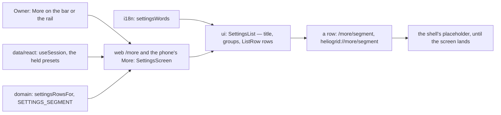

# T-M01-005 · Business Profile — shipped parts

Each part's `#### Part <x> · RFC` body and `#### Runtime` ledger, moved here unchanged in the commit that turned its row `shipped` (`docs/tasks/README.md`, Task anatomy).

## T-M01-005 · part f

#### Part f · RFC

##### Title
`T-M01-005f` — Settings under More: the list of every settings screen the person's role may open, on the web and both phones

##### Description
**User impact.** `More` on the bar and the rail stops being a page that says *arrives in a later update*. It opens a page titled `Settings`: the settings and administration screens the signed-in person may open, one row each, in six groups — *You*, *Your team*, *Your company*, *What you sell*, *Customer calls*, *Money*. An owner sees twelve rows; a field technician sees one, `Profile & preferences`. A row whose screen has not been built yet opens the same honest page every door shows today. Indirectly, every later settings screen — the company profile's settings life first (part o) — gets its way in and its `Back to settings`.

Who gains: every signed-in person, on the web, iOS and Android; the owner most, who administers the company. The problem: `More` is a placeholder on both apps (`apps/web/features/shell/PlaceholderScreen.tsx:15`, `apps/mobile/src/navigation/routes/app.ts:41`); no rule says which settings screen a role may open; no word of the list exists in any language; `m-settings`' `Back to settings` has nowhere to go (the task RFC, finding 9; the brief, ruling 20). Sources: the task RFC (*Decisions*, 7, ruled); `#### Parts`, row f; `F7-48`; `M01-29`; the F2 matrix as `packages/domain/src/authz/` mirrors it; the SCR-SHELL-01 record, section *More: the settings list, 13 Oct 2026* (`#### Design check`, fourteenth entry).

##### Goals
- Domain decides the rows: which settings screens exist, their group and order, and the one capability each needs; a person sees exactly the rows their held presets grant (`F7-48`).
- Every word — the title, six group names, twelve row names — in English, Hindi and Marathi, authored once.
- One `SettingsList` in `packages/ui` draws the page on both halves, at functional density, from one prop contract (Law 7): the person's tile (the avatar in the brand ring over the bloom, the name, their own row), then each group as one grey tile of icon rows (the redraw, `#### Design check`, fifteenth entry).
- `More` opens it on the web (`/more`) and on both phones; the bar's `More` stays active on it; a row leads to its screen's address, and to the shell's placeholder until that screen lands.

##### Non-goals
- The company profile's settings life — `Save changes`, the functional density of its own list, the re-seed line, `m-settings`, `d-settings` — part o (*Decisions*, 1).
- No settings screen is built here, and no row's screen changes.
- Sign-out and the grievance contact stay behind the avatar menu (SCR-SHELL-01 decision 2); the V2 rows are not drawn.
- No count, status or helper on a row; no loading, empty or error state (the rows are the session's grants; nothing is read).
- No breadcrumb on the web (`#### Design check`, fifth entry, row 14 is part o's, with the back control).

##### Readiness and dependencies
- Parts a–m are on `main`; part n is draft PR #299, open, its `e2e-web` lane red. This branch is cut from `origin/feat/T-M01-005n` by the walk (`references/walk.md`, step 3), then `origin/main` merged in (#300, #301). The n fix lands here if it is owed (`/task` step 7).
- The settings list is drawn; the check reads `NEEDS_CHANGE` on six record lines and no frame (`#### Design check`, fourteenth entry; *Decisions*, 4). The three frames are pictured into `.qa/board/SCR-SHELL-01/` after this RFC is approved and before the first edit.
- Not a light cycle: the proof matrix names the web and both phones.
- No migration; the local database stays at `0025`. No api change.
- No blocker once *Decisions* 1–3 are ruled.

##### Proposal
**What testing the requirements found** (`/task` step 2).
1. **Row f carries two surfaces.** The settings list (the task diagram's `more` node) and the company profile's settings life are two screens on three platforms: about 28 files for the list alone (*Delivery size*), about 20 for the life. One PR of both passes the plan cap (`docs/tasks/README.md`). → *Decisions*, 1.
2. **The record's *Who sees each row* disagrees with the F2 matrix in two cells.** It gives Finance *Collections* and *Usage*; the matrix grants `payments.connect_gateway` and `billing.view_usage_and_invoices` to the owner alone (`packages/domain/src/authz/payments.ts:28`, `billing.ts:28`). It gives Finance *Catalog* as *prices only*, which the matrix holds as a limited grant — `can` answers true (`policy.ts:33`), so the row opens. No frame changes: the two frames drawn are the owner's and a technician's. The rows are built from the matrix, never typed by role (`architecture.md` §4, item 3). → *Decisions*, 4.
3. **Eleven rows lead to screens that do not exist yet.** A dead control is forbidden (`T-SHELL-001`, Used by). The shell already answers this for its doors: `PlaceholderScreen` inside the shell, *This screen arrives in a later update.* The same page serves a settings row until its screen lands. → *Decisions*, 3.
4. **A settings screen has no address.** Each row is a link, and a link is a public address the web and the phone share (`M01-61`; `DOOR_SEGMENT`'s rule in `packages/domain/src/shell/doors.ts:14`). → *Decisions*, 2.
5. **Two words for one place.** The bar reads `More` (`F7-48`'s word, `SHELL.more`) and the page it opens is titled `Settings` (the record's ruling, so `Back to settings` names where it lands). Built as drawn: the destination's label and the page's title are two facts, and only the second is new.
6. **The M01-11 brief says sign-out is under More** (`docs/ux/briefs/SCR-M01-11-profile-preferences.md:51`); the drawn and built shell puts it in the avatar menu. The brief's line is corrected in this part (Law 8).
7. **The rows' names are the screens' names.** `Profile & preferences`, `Team`, `Roles reference`, `Business profile`, `Branding`, `Proposal templates`, `Payment terms`, `Catalog`, `Agent & voice`, `Collections`, `Billing`, `Usage` — each is its screen's title in the register and the record; the catalog gets one message each, so a screen that lands reuses its row's word for its own title.
8. **Density.** The list is functional (`F7-17`, settings) on both halves; the phone keeps the 20 px sides and grey tiles of the 1 Oct redraw. `ListRow` carries `density` already.
9. **Deferred rows this part's files meet.** D66 (`touches apps/mobile/src/screens/shell/use-pill-items.ts`) — not touched, stays. D67 (`DoorRoute` kept by hand; `T-M02-001 starts`) — stays: `More` leaves `DoorRoute` for its own screen, the hand-kept list remains. D143 (`touches apps/mobile/src/screens/shell/` · `apps/web/features/shell/`) — stays: the shell's language frames are not this part's; the Android row runs in Hindi on the new page alone. D169 (`touches apps/web/app/(inside)/` · `apps/mobile/src/navigation/routes/app.ts`) — stays: offline handling is unchanged. No row reads `T-M01-005f starts`.

**Flow.**
1. The session holds the person's presets (`user.tenant.roles`). `settingsRowsFor(roles)` in domain returns the groups in order, each with the rows the presets grant; a group with no row is left out; `Profile & preferences` needs no grant.
2. `settingsWords(t)` in i18n hands the title, each group's name and each row's name.
3. `SettingsList` draws the title, the group headings (overline) and the rows — each a `Pressable` tile, 56 tall, a chevron trailing (built so, not `ListRow`: the row is one keyboard control with the 44 px floor, and `ListRow` is a plain div) — and calls `onOpen(row)`.
4. Web: `/more` renders `SettingsScreen` inside the shell (`More` active on the rail); a row pushes `/more/<segment>`; `app/(inside)/more/[row]/page.tsx` shows the placeholder for a row the person may open and *not found* for any other, as `[door]` does; a screen's own route replaces it when it lands.
5. Phone: the `More` route renders `SettingsScreen` in `ShellFrame` with the shell's top bar and `More` in view; a row navigates to `SettingsRow` with its segment, which shows the placeholder the same way; a deep link `heliogrid://more/<segment>` reaches it.

**Key decisions.**
- **The rows and their grants are domain's** (`shell/settings-rows.ts`), as the destinations are (`standing-destinations.ts`): a capability check is never written in a screen (`architecture.md` §4, item 3). The addresses sit beside them, as `DOOR_SEGMENT` does.
- **One `SettingsList` in `packages/ui`** rather than two page compositions: the page's shape (title, overline groups, rows) is one contract both platforms draw (Law 7, Law 11); the apps keep routing only.
- **The placeholder's parts are reused, not copied** (review): on the phone, one `ShellPage` (the shell's bar, pill and grievance note) and one `ShellNotFoundState` serve `PlaceholderScreen`, the list and a row's screen; on the web a row's screen composes the shell's `EmptyShellPage`. The web's `[door]` page and the phone's `doors.ts` stay as they are.

**Order.** The three board pictures · domain: the rows, test red first · i18n: the words, test red first · ui: `SettingsList`, both halves, its component spec · the web route, screen and flow · the phone route and screen · the briefs and the task · review · the live rows · the gate.

**Refusals.** None new. A row's address the person's presets do not grant answers *This page does not exist*, as a door does (`F7-48`).

**The twin.** Both apps render one `SettingsList` from one `settingsRowsFor` and one `settingsWords`; each keeps its router.

**Decisions** (the owner's; the recommended way first).
1. **The split.** Part f is the settings list under `More` (this RFC); a new part o is the company profile's settings life, after f, with row f's `m-settings`, `d-settings` and `declarations-edited-reseed-scope` — or part f stays one part of both surfaces, about 48 files, over the plan cap.
2. **The rows' addresses.** Under the destination that opens them: `/more/<segment>` on the web and `heliogrid://more/<segment>` on the phone (`profile`, `team`, `roles`, `company-profile`, `branding`, `proposal-templates`, `payment-terms`, `catalog`, `agent`, `collections`, `billing`, `usage`), one list in domain beside `DOOR_SEGMENT` — or `/settings/<segment>`, the page's title as a second segment vocabulary beside `more`.
3. **A row whose screen is not built.** It opens the shell's placeholder page, as every door does today, and each screen's own route replaces it when it lands — or only the rows whose screens exist are drawn, so the page shows no row until part o.
4. **The record's six faults** (`#### Design check`, fourteenth entry: `NEEDS_CHANGE`, record lines only, no frame). The owner pastes the helper's prompt now — it is on the clipboard — and Main fetches and checks again before the first edit; the rows follow the F2 matrix either way — or the record is corrected at the board's next touch and this part builds on the frames as they stand.

**Ruled by the owner, 2026-10-13, with the approval: the first way of each of the four.**

##### Architecture diagram

##### Package changes
- `packages/domain` — `shell/settings-rows.ts`: `SETTINGS_ROWS` (row, group, capability or none), `SETTINGS_SEGMENT`, `settingsRowsFor(roles)`; exported from `shell/index.ts`. Reads `can` from `authz`. Pure.
- `packages/i18n` — `copy/settings.ts`: `settingsWords(t)` — the title, six group names, twelve row names; exported from `src/index.ts`. Messages extracted into the three catalogs.
- `packages/ui` — `components/SettingsList/`: `SettingsList.types.ts` (the props, with the person), `SettingsList.logic.ts` (the three columns, each row's glyph, the person's row), `SettingsList.tsx`, `SettingsList.native.tsx`, `SettingsList.css`, `index.ts`; exported from `src/index.ts`. Composes `Text`, `Block`, `Pressable`, `Avatar`, `BrandBloom` and `ShellGlyph`, which gains eight glyphs (building, palette, calendar-clock, package, headset, wallet, credit-card, gauge) and an `accent` tone; the phone draws the gradient ring as an SVG stroke from the three iris tokens.
- `apps/web` — `features/settings/`: `SettingsScreen.tsx`, `index.ts`; `app/(inside)/more/page.tsx` and `app/(inside)/more/[row]/page.tsx`; `features/shell/PlaceholderScreen.tsx` takes a settings row's title.
- `apps/mobile` — `screens/settings/`: `SettingsScreen.tsx`, `index.ts`; `navigation/routes/app.ts`: `More` → `SettingsScreen`, new `SettingsRow` route; `screens/shell/doors.ts` and `PlaceholderScreen.tsx`: a settings row's title.
- Law 12: the new segments get their own guard, `packages/domain/tests/shell/settings-rows.test.ts` (distinct, plain, never a door's — a new row in `.claude/protections.md`, which also says out loud that the shell glyph list and `Ground.css`'s tiles list are held by review and the exhaustive `Record` typecheck); the new messages are held by `check:catalogs`; no brand, enum, token, route table or error code is new on the wire.

##### Data and schema changes
None — nothing stored or sent between runtimes changes.

##### File and folder changes
| action | path | purpose | placement reason |
|---|---|---|---|
| add | `packages/domain/src/shell/settings-rows.ts` | the rows, their groups, their grants, their segments; `settingsRowsFor` | §4.3 — a permission rule is domain's |
| modify | `packages/domain/src/shell/index.ts` | export | the entry |
| add | `packages/domain/tests/shell/settings-rows.test.ts` | rows f-u1, f-u2 | its test |
| add | `packages/i18n/src/copy/settings.ts` | `settingsWords`, `settingsRowName`, and `settingsListFor` (built, not planned: the groups worded once for both screens and the component page, Law 11) | §4.6 — copy both platforms read |
| modify | `packages/i18n/src/index.ts` | export | the entry |
| add | `packages/i18n/tests/settings.test.ts` | row f-u3 | its test |
| modify | `packages/i18n/src/locales/{en,hi,mr}/messages.po` · `messages.ts` | fifteen new messages by `extract` (four reused), Hindi and Marathi authored; the compiled catalogs by `build` | the catalogs |
| add | `packages/ui/src/components/SettingsList/SettingsList.types.ts` · `SettingsList.logic.ts` · `SettingsList.tsx` · `SettingsList.native.tsx` · `SettingsList.css` · `index.ts` | the page's parts on both halves; the logic file holds the three columns (built, not planned — review: a value never sits in the types file) | §4.8 — one contract, two halves |
| modify | `packages/ui/src/index.ts` · `src/styles.css` | export; the stylesheet | the entries |
| modify | `packages/ui/src/components/AppShell/ShellGlyph.logic.ts` · `AppShell.types.ts` · `ShellGlyph.css` · `ShellGlyph.native.tsx` | built, not planned: the `chevron-right` glyph, then the redraw's eight row glyphs and the `accent` tone, drawn once for both halves | an icon is drawn here |
| modify | `packages/ui/src/primitives/Ground/Ground.css` | built, not planned: the person's tile and a group's tile join the tiles list (`F7-49`: a tile is drawn only by `Ground`); a row is flat inside its tile | the one tile record |
| add | `tests/e2e/components/SettingsList.spec.tsx` · `SettingsList.story.tsx` | rows f-ct1, f-ct2: the owner's and the technician's frames, pictured; the story binds the opened row in the browser | the component suite |
| add | `apps/web/features/settings/SettingsScreen.tsx` · `index.ts` | the page inside the shell | §4.9 — the app composes |
| add | `apps/web/app/(inside)/more/page.tsx` · `more/[row]/page.tsx` | the routes: the list, and a row's placeholder | the app's router |
| add | `apps/web/features/settings/SettingsRowScreen.tsx` · `constants.ts` | **built, not planned:** a row's placeholder page and its address, in the settings feature — the shell's `PlaceholderScreen` and `constants.ts` stay untouched (planned, not built), the row's own screen composes the shell's `EmptyShellPage` | the feature composes; `apps/web/features/shell/index.ts` exports the page |
| modify | `apps/web/features/shell/index.ts` · `components/EmptyShellPage.tsx` · `hooks/use-rail-items.ts` | built, not planned: `EmptyShellPage` and `DOOR_PATH` on the barrel, the page marked a client component (a server layout imports the barrel); the rail keeps a destination lit on every page under it (`/more/team`), as the phone does — review, Law 11 | the barrel; the rail |
| add | `tests/e2e/web/more.spec.ts` · `more-[row].spec.ts` | rows f-c1 · f-c2 and f-c3 — one spec per route, as `e2e-flow-per-screen` names them (review: planned as one `settings.spec.ts`); each takes its look, whose Linux baselines CI draws on the first run and a CI-fix commit lands (`tests/e2e/CLAUDE.md`) | the suite's rule |
| modify | `tests/invariants/src/e2e-flow-per-screen.ts` | built, not planned (review): the phone's `settings` screens held without a Maestro flow, as the shell and the three setup screens are — reached only behind Create company; a harness change, for the owner's yes on the card | the invariant |
| modify | `.claude/protections.md` · `docs/tasks/deferred.md` | built, not planned (review): the settings addresses' row; D213, the four inline right chevrons that should take the shell glyph | Law 12; the ledger |
| add | `apps/mobile/src/screens/settings/SettingsScreen.tsx` · `index.ts` | the page in `ShellFrame` | the app composes |
| modify | `apps/mobile/src/navigation/routes/app.ts` | `More` opens the page; `SettingsRow` with its segment | the router |
| add | `apps/mobile/src/screens/settings/SettingsRowScreen.tsx` | **built, not planned:** a row's placeholder screen inside `ShellPage` — `doors.ts` stays untouched (planned, not built) | the screen composes |
| add | `apps/mobile/src/screens/shell/components/ShellPage.tsx` · `ShellNotFoundState.tsx` | built, not planned (review, §8 zero duplication): the shell's bar, pill and grievance note, and the not-found state, written once for `PlaceholderScreen` (modified to compose them), the list and a row's screen | the shell's parts |
| modify | `apps/mobile/src/screens/shell/PlaceholderScreen.tsx` | built, not planned (review): composes `ShellPage` and `ShellNotFoundState`; its door map and refusal are unchanged | the shell's door |
| modify | `docs/ux/briefs/SCR-M01-11-profile-preferences.md` | ruling 7's sign-out line follows the drawn shell | Law 8 |
| modify | `docs/ux/briefs/SCR-M01-05-business-profile.md` | ruling 20: the list is drawn, where | the brief owns the screen's facts |
| modify | `docs/ux/briefs/SCR-SHELL-01-app-shell.md` | one line: what `More` opens | the brief inherits the drawn decision |
| modify | `docs/tasks/M01-onboarding.md` | this RFC, the design check's fourteenth entry, the ledger, the Parts rows f and o | the task |
| modify | `packages/domain/package.json` · `pnpm-lock.yaml` · `packages/domain/src/files/checksum.ts` | **built, not planned — part n's CI fix, landed here** (`/task` step 7: the folder is held by this part): `@noble/hashes` 2.4.0 is ESM-only and the Playwright runner loads packages with `require`, so every web and component spec failed at load (*request for `./_md.js` is from a module not been linked*, PR #299's `e2e-web`); pinned to 1.8.0, the same library's dual-format line, imported as `@noble/hashes/sha2` | the checksum's home |

##### API and contract changes
None — no wire boundary changes.

##### Risks and rollout
- **A role's rows drift from the matrix.** Impossible by construction: the rows ask `can`, and the matrix is held equal to F2 by the invariant.
- **A segment collides with a later screen's address.** The list is domain's and tested; a screen that lands takes its row's segment.
- **Rollout.** An app from before this part keeps its placeholder under `More`; nothing it sends or reads changes.

##### Acceptance criteria and proof
The task's AC-4 (every drawn state at 375 and 1536 with parity; no raw colour literal) is this part's, on the three frames of the SCR-SHELL-01 record's *More* section. AC-1 is `not_applicable` in the task; AC-2 and AC-3 have no row here.

| AC/row | owner | tier | surface | action → expected | proof |
|---|---|---|---|---|---|
| f-u1 the rows by preset | main-dev | required | unit | `epc_owner` → six groups, twelve rows in the record's order; `field_technician` → one group, `Profile & preferences`; `finance` → *You* and *What you sell* (Catalog, by the limited grant), never Collections or Usage; `operations` → *You* and *What you sell*; a group with no row is absent; `opensSettingsRow` by name — Finance/Usage false, Finance/Catalog true, no preset/Profile true, technician/Team false (review). Planted red: Usage open to everyone — *never hands Finance the owner’s money rows* and five more failed by name, 2026-10-13 | `packages/domain/tests/shell/settings-rows.test.ts` |
| f-u2 the segments | main-dev | required | unit | twelve distinct segments, each a plain address word; none equal to a `DOOR_SEGMENT` | the same |
| f-u3 the words | main-dev | required | unit | the title, six groups and twelve rows in English, Hindi and Marathi, each row's word its screen's register title. Planted red: `usage` handed its key — *en*, *hi*, *mr* and *names every group and every row* failed by name, 2026-10-13 | `packages/i18n/tests/settings.test.ts` |
| AC-4 · f-ct1 the owner's page | main-dev | required | `3100` at 375 and 1536 | the title, six overline headings, twelve rows at functional density, 56 tall, a chevron each; at 1536 three columns; no raw colour literal; the picture saved | `tests/e2e/components/SettingsList.spec.tsx` |
| AC-4 · f-ct2 the technician's page | main-dev | required | `3100` at 375 | one heading, one row; the picture saved | the same |
| AC-4 · side-by-side, three frames | qa-web | required | board pictures against the component pictures | `More · EPC Owner (375)`, `More · Field Technician (375)`, `More · EPC Owner (1536)` beside their saved pictures | the three composed images |
| f-c1 More opens Settings | ci | required | CI `e2e-web`, 375 and 1536 | the owner's rail `More` → `/more`, h1 `Settings`, twelve rows in six groups, `More` `aria-current`; no sideways scroll; axe clean; the look | `tests/e2e/web/more.spec.ts` |
| f-c2 a row | ci | required | CI `e2e-web` | `Team` → `/more/team`, the placeholder's h1 `Team` and *arrives in a later update*, `More` still `aria-current`; the look; Back → `/more` | `tests/e2e/web/more-[row].spec.ts` |
| f-c3 not the person's | ci | required | CI `e2e-web` | `/more/not-a-row` → the shell's not-found page | the same |
| f-w1 · f-w2 · f-w3 · f-w4 | qa-web | required | web 375 and 1536 | the standing owner: `More` → the page; the twelve rows at 375 (f-w1) and the three columns at 1536 (f-w2); `Team` → its placeholder with `More` still current, Back, `/more/not-a-row` not found, `/more/usage` (f-w3); `Profile & preferences` → its placeholder and back at 375 (f-w4); no console error; no sideways overflow | the pages, the console |
| f-i1 · f-i2 · f-i3 | qa-ios | required | iOS, English | `More` on the pill → the page with `More` active, twelve rows, the board frame beside it (f-i1); `Team` and `Usage` → their placeholders, back → the page (f-i2); the deep links `heliogrid://more/not-a-row` (not found, the way home) and `heliogrid://more/team` (f-i3) | the tree, the pictures |
| f-a1 · f-a2 · f-a3 | qa-android | required | Android · Hindi | the same three journeys in Hindi; the words the catalog's; no fatal in logcat | the tree, the pictures, logcat |
| Hindi and Marathi component row | main-dev | required | `3100` | the owner's page in Hindi and Marathi: every row and heading from the catalog, nothing clipped | `SettingsList.spec.tsx` |
| the gate | evaluator | required | repo | — | `pnpm check:all` |

No api row: nothing on the wire changes. No api-down window.

##### Delivery size
- One part: **28 files** (three of them the catalogs). **Built: 53 files** — the twenty-five more: part n's CI fix (3), the compiled catalogs (3), the story (1), the phone's two shell parts and its `PlaceholderScreen` (3), the web's rail hook, empty page, shell barrel, settings constants and row screen (5), the second web spec (1), the invariant (1), the protections and deferred registers (2), the ui logic file, stylesheet import, glyph list in two files and the tiles list (5), and the SCR-SHELL-01 brief (1); over the 20% rule, said on the card with each file's reason in the table above.
- **Code: about 330 authored lines** — domain 70, i18n 50, ui 110, the web 60, the phone 40.
- **Tests: about 230 authored lines** — domain 60, i18n 30, the component spec 60, the web flow 80.
- About 560 in all, under both targets. No smaller part is acceptable alone: rows with no page are nothing, a page with no rows is the placeholder it replaces, and one platform alone breaks Law 7.
- Order: as *Proposal*.

Checklist:
- [ ] the three board frames pictured into `.qa/board/SCR-SHELL-01/`
- [ ] domain: the rows and segments, tests red first
- [ ] i18n: the words, test red first; the three catalogs
- [ ] ui: `SettingsList`, both halves; the component spec
- [ ] the web route, screen and flow
- [ ] the phone route and screen
- [ ] the three briefs, the task
- [ ] review
- [ ] the live rows: web, iOS, Android
- [ ] the gate

#### Runtime
Branch `feat/T-M01-005f`, cut from `origin/feat/T-M01-005n` (`52f62d83`, draft PR #299 open, its `e2e-web` lane red) on a clean tree, by the walk (`references/walk.md`, step 3), 2026-10-13; `origin/main` (`8c925111`, #300 and #301) merged in at once. The owner's working tree had one change before this task, `apps/mobile/src/env.ts` (Android's api host), dropped at the owner's word before the branch was cut.

| resource | initial | identity |
|---|---|---|
| web `3002` · api `8084` · Metro `8081` · component tests `3100` | none listening; `/health/ready` unanswered | — |
| Postgres `5544` · object store `9000` · Temporal `7233` | running (`pre_existing`) | `heliogrid-pg-local` · `heliogrid-object-store-local` · `heliogrid-temporal` (with `-admin`, `-jwks`) |
| simulator · emulator | none booted | — |
| browser tabs | one tab, the SCR-SHELL-01 board (`started_by_task`, opened for the owner's drawing before the walk) | `seed` |
| database routing | `heliogrid_test` / `heliogrid_test` | `.env.local` lines 7 and 12 |
| runtime logs | `api.log` 26,270,634 · `web.log` 766,241 · `metro.log` 2,624,343 bytes | — |
| watchers | no `tsx … watch` process | — |

**Part f · QA (2026-10-13)** — one stack on `heliogrid_test`: the api, the web and Metro from source (`api`, `web`, `mobile-metro` launch configurations, all `started_by_task`), the iPhone 17 Pro simulator with the app part n installed (no native file changed since), and `Pixel_8_API_36` booted by this task with a fresh debug build (the Android 16 emulator held no app). The three board frames were pictured by `qa-web` on its one retry (the first was blocked by the pane's chat panel) into `.qa/board/SCR-SHELL-01/`.

- **Order.** The reviewer read alone: fourteen findings in round one (two blockers: the web spec's name against `e2e-flow-per-screen`, and the phone screens' missing flow or hold), all applied; three doc findings in round two; clean in round three, its cap. Then `qa-web`, `qa-ios` and `qa-android` together. The web helper found the look wrong on three points (the group gap, the title's size, the title's left edge); the fix — the group blocks flush with the title, the title at the h2 size on both halves — landed with the owner's yes, unread by the reviewer (its cap was reached), and the three helpers were continued on the touched rows. The Hindi row needed the standing account's language set to Hindi, which no built screen does yet: Main set it through `PATCH /users/me` as the account, and set it back to English after.
- **Planted reds seen.** `settings-rows.test.ts`: Usage open to everyone → *never hands Finance the owner’s money rows* and five more failed by name. `settings.test.ts`: `usage` handed its key → *en*, *hi*, *mr* and *names every group and every row* failed by name. Each restored from a scratchpad copy.
- **Mistakes found.** (1) The shell barrel's new export pulled `@heliogrid/ui` into the server layout: every inside page answered 500 in dev — found at readiness, fixed with `'use client'` on `EmptyShellPage`; held by running the app, no check. (2) Part n's `@noble/hashes` 2.4.0 broke every web and component spec at load (PR #299's red lane) — pinned to 1.8.0; held by `e2e-web`. (3) The web spec was named for a concern, not its route — held by `e2e-flow-per-screen`. (4) Three phone screens repeated the shell's bar, pill and grievance block — held by the duplication ratchet. (5) The component's columns were one grid with shared row tracks, leaving a gap under *You* at 1536 — held by the ct spec's new assertion. (6) The web's group gap, title size and title edge differed from the board — held by `qa-web`'s compare.
- **Log ranges.** `qa-web` 26,361,155–26,413,583 (42 lines) and, on the rerun, 26,454,223–26,475,045 (18 lines); `qa-ios` 26,423,772–26,426,651 (4 lines, three 304s) and 26,454,223–26,472,364; `qa-android` 26,361,155–26,442,412 (about 75 lines, one 401 on `/auth/session` before the first sign-in) and 26,454,223–26,480,407 (24 lines, no 4xx or 5xx from the phone). Each helper's own report holds its range; the pictures are in the session's scratchpad `qa/` folder and the four composed images `side-*.png` beside them.
- **Mistake (7), found by the gate.** The catalogs' source-line references went stale after the review's edits moved lines in `settings.ts`, after Main's earlier `check:catalogs` had passed; the first gate run re-extracted them, Main compiled and proved the words again. Held by `check:catalogs`; the rule: the freshness check runs after the LAST copy edit, not the first.
- **Tree hash.** Taken before the helpers and compared after each return: the only changes are Main's own (the look fix and this ledger), none a helper's. Database routing `heliogrid_test` / `heliogrid_test` throughout.

**Part f · the redraw (2026-10-13).** After the first commit card the owner redrew the frames (`#### Design check`, fifteenth entry) and chose Option A at 1536. The component was rebuilt on both halves — the person's tile, one tile per group, icon rows, eight glyphs and the accent tone — and the apps pass the person's name; the component spec and the web spec follow (the person's tile is the first of the twelve controls; five headings). The helper compare ran twice: the first found the bloom's place, the missing ring, the subtitle's size, the chevron circle's 40 and the 1536 tile's 96; the second matches within 2 px. The reviewer's cap was reached before the redraw, so the rebuild is unread by it (said on the card). The web, iOS and Android helpers then reran every live row on the rebuilt page.

**As proven (part f).**

| row | result | evidence |
|---|---|---|
| f-u1 · f-u2 · f-u3 | passed | `pnpm check`: 35 files, 660 tests; the reds above |
| AC-4 · f-ct1 · f-ct2 · Hindi and Marathi row | passed | `test:ct components/SettingsList.spec.tsx`: 6 passed; pictures in `tests/e2e/test-results-ct/settings-list/` |
| AC-4 · side-by-side, three frames | passed, differences ruled | first on the first drawing, then on the redraw: `qa-web` compared the redrawn frames twice (the second within 2 px on every measured item: avatar 56 / 72, tile 96 / 128, icon circle 40, chevron circle 36, row pitch 58, heading-to-tile 21, group gap 32) and once more on the live page; the icons match in kind; ruled: the shell's chrome absent from the component pictures, the technician frame's persona, the bloom's own strength, the board cut by the pill |
| f-w1 · f-w2 · f-w3 · f-w4 | passed, twice | `qa-web` on the first drawing, then on the redraw: the person's tile first of twelve buttons, five overlines, rows 56 tall inset 8 in their tiles with a 58 pitch, `More` `aria-current` on `/more`, `/more/team` and `/more/profile`; three columns with lefts 104 · 573 · 1043, the tile 437 × 128; `/more/not-a-row` not found; no sideways overflow; the 401 on `/auth/session` is the app's own probe; at 375 the web's rail narrows the tile so its subline wraps (the rail is the web's, ruled) |
| f-i1 · f-i2 · f-i3 | passed, twice | `qa-ios` on the first drawing, then on the redraw (f-i1 four runs in all): the person's tile 362 × 96 pt one control, the ring 62 pt, icon circles white (255) on the tile (243), the bloom over the right half, rows 346 × 56 at x 28 with a 58 pitch, five headings, `More` lit; Team and Usage placeholders; both deep links; the bell's unread 2 is live data; row words read about 10 % narrower than the board by eye, inside the estimate's error |
| f-a1 · f-a2 · f-a3 | passed, twice | `qa-android` in Hindi on the first drawing, then on the redraw: the person's tile 371 × 96 dp one control with the ring at 62 dp, five Hindi headings, twelve controls in the catalog's words, rows 355 × 56 dp with white icon circles, nothing clipped, और lit; टीम and उपयोग placeholders; the not-found page in Hindi; 0 FATAL |
| f-c1 · f-c2 · f-c3 | CI | `tests/e2e/web/more.spec.ts`, `more-[row].spec.ts`; their four look baselines are drawn by CI's first run |
| the gate | passed but one documented check | the Evaluator, three runs (a fresh one after the redraw, at the owner's word): the third, on the rebuilt component, passed build, lint, typecheck, duplication, OpenAPI, catalogs, 229 unit files / 4,107 tests with the api tests, and every invariant before `e2e-flow-per-screen`, which names the four look baselines; the earlier two: the first stopped at `check:catalogs` (mistake 7); the second passed build, lint, typecheck, duplication, OpenAPI, catalogs, 229 unit files / 4,107 tests with the api tests, and every invariant but `e2e-flow-per-screen`, which names the four look baselines of `more` and `more-[row]` that only CI draws (`tests/e2e/CLAUDE.md`; landed by a CI-fix commit, as #262 did) |

**Measurements (part f).** Main's context at the second card: 733,000 tokens of 1,000,000 (628,000 at the first card). Helpers, from their completion notices (each helper's last cumulative figure): design-check 65,255 · the board captures 26,976 + 92,872 + 67,687 · the reviewer 155,003 · the frame compare 44,573 · qa-web 96,258 · qa-ios 81,451 · qa-android 76,368 · the Evaluators 48,118 + 35,616 — 790,177 in all.
